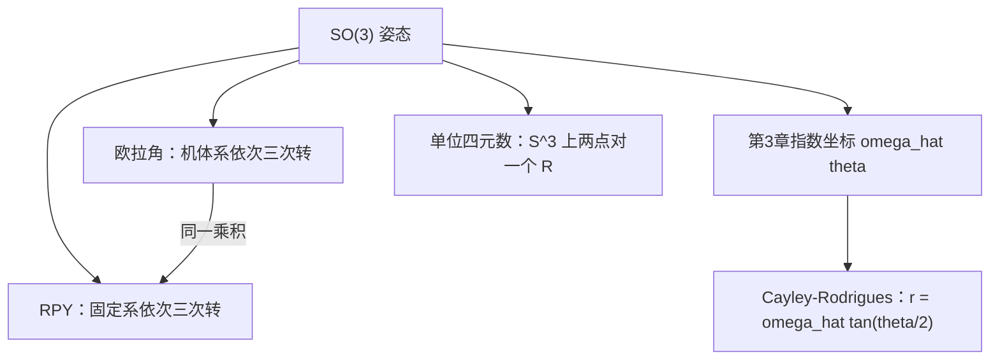
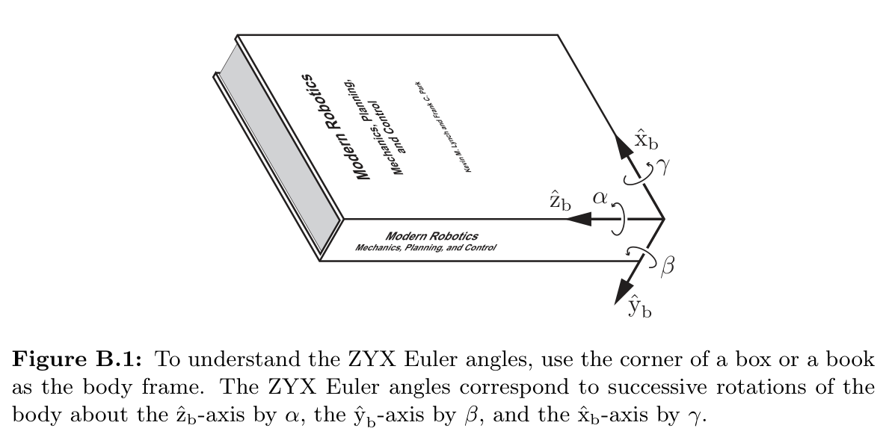

# 附录B 旋转的其他表示

### 来源说明

- 作者：Kevin M. Lynch、Frank C. Park
- 书名：*Modern Robotics: Mechanics, Planning, and Control*（现代机器人学：力学、规划与控制），2017 初版、2019 年 12 月预印本大字版
- 官方来源：https://hades.mech.northwestern.edu/images/2/2e/MR-largefont-v2.pdf
- 本笔记仅供个人学习使用。

阅读范围：PDF 第 597–606 页。PDF 597 的标题是 Appendix B Other Representations of Rotations（旋转的其他表示）。页眉书页约为 577–586。PDF 607 起是 Appendix C Denavit–Hartenberg Parameters，本笔记不读 607 及之后。第 3 章已经用指数坐标 \(\hat{\omega}\theta\) 做 \(\mathrm{SO}(3)\) 的主参数；本附录补四种常用写法。

### 本章总览

三维姿态有三个自由度，但不能指望一组三个连续参数在整个 \(\mathrm{SO}(3)\) 上都好用。附录按四条线展开：ZYX 与其他 Euler angles（欧拉角），XYZ roll–pitch–yaw（滚转–俯仰–偏航），unit quaternions（单位四元数），以及 Cayley–Rodrigues parameters（Cayley–Rodrigues 参数）。

欧拉角和 RPY 都是三次依次旋转，矩阵乘积可以相同，物理解释不同。单位四元数多一个变量、加一条单位约束，用来躲开指数坐标在 \(R=I\) 附近除以 \(\sin\theta\) 的数值问题。Cayley–Rodrigues 用半角正切把第 3 章的半径 \(\pi\) 实心球拉到无穷远，合成公式短。

图注：附录 B 的四条表示都指向同一个 \(\mathrm{SO}(3)\)。ZYX 欧拉角与 XYZ 滚转–俯仰–偏航共用一张旋转矩阵；指数坐标是第 3 章主参数，Cayley–Rodrigues 由它经半角正切得到。

### 核心知识点

#### ZYX 欧拉角

机体系 \(\{b\}\) 起初与空间系 \(\{s\}\) 对齐。先绕机体 \(\hat{z}_b\) 转 \(\alpha\)，再绕机体 \(\hat{y}_b\) 转 \(\beta\)，最后绕机体 \(\hat{x}_b\) 转 \(\gamma\)。三元组 \((\alpha,\beta,\gamma)\) 就是 ZYX Euler angles。因为每次都相对**当前机体系**，总旋转是右乘：

\[
R(\alpha,\beta,\gamma)=I\,\mathrm{Rot}(\hat{z},\alpha)\,\mathrm{Rot}(\hat{y},\beta)\,\mathrm{Rot}(\hat{x},\gamma).
\]

\(\mathrm{Rot}(\hat{z},\alpha)\)、\(\mathrm{Rot}(\hat{y},\beta)\)、\(\mathrm{Rot}(\hat{x},\gamma)\) 与第 3 章坐标轴旋转公式相同。展开后（\(s_\alpha=\sin\alpha\)，\(c_\alpha=\cos\alpha\)，其余类推）

\[
R(\alpha,\beta,\gamma)=
\begin{pmatrix}
c_\alpha c_\beta & c_\alpha s_\beta s_\gamma-s_\alpha c_\gamma & c_\alpha s_\beta c_\gamma+s_\alpha s_\gamma\\
s_\alpha c_\beta & s_\alpha s_\beta s_\gamma+c_\alpha c_\gamma & s_\alpha s_\beta c_\gamma-c_\alpha s_\gamma\\
-s_\beta & c_\beta s_\gamma & c_\beta c_\gamma
\end{pmatrix}.
\tag{B.1}
\]

图注：书 Figure B.1。三次转都相对当时的机体轴。同一乘积在 B.2 节还会被读成固定系上的 XYZ 滚转–俯仰–偏航。

任意 \(R\in\mathrm{SO}(3)\) 都能写成 (B.1)。由 \(r_{11}^2+r_{21}^2=\cos^2\beta\)，只要 \(\cos\beta\neq 0\) 即 \(\beta\neq\pm 90^\circ\)，\(\beta\) 有两支：

\[
\beta=\operatorname{atan2}\bigl(-r_{31},\sqrt{r_{11}^2+r_{21}^2}\bigr)
\in[-90^\circ,90^\circ],
\]

\[
\beta=\operatorname{atan2}\bigl(-r_{31},-\sqrt{r_{11}^2+r_{21}^2}\bigr)
\in[90^\circ,270^\circ].
\]

\(\operatorname{atan2}\) 是双参数反正切，定义写在本书第 6 章开头。本附录只调用它。

👉 双参数 \(\operatorname{atan2}\) 的象限约定见第 6 章。📝待补全

\(\beta\neq\pm 90^\circ\) 时 \(\alpha=\operatorname{atan2}(r_{21},r_{11})\)，\(\gamma=\operatorname{atan2}(r_{32},r_{33})\)。\(\beta=\pm 90^\circ\) 时 \(\alpha\) 与 \(\gamma\) 合成一个单参数族：\(\beta=90^\circ\) 时二者绕同一竖轴反向转，若 \((\bar{\alpha},90^\circ,\bar{\gamma})\) 是解，则一切满足 \(\bar{\alpha}'-\bar{\gamma}'=\bar{\alpha}-\bar{\gamma}\) 的三元组也是解。这就是万向节锁。

🔑 关键速记：ZYX 是机体轴依次 \(z\)-\(y\)-\(x\)；\(\beta=\pm 90^\circ\) 时 \(\alpha\) 与 \(\gamma\) 不再独立。

#### 反解算法与其他欧拉角

算法要把 \(\alpha,\gamma\in(-\pi,\pi]\)、\(\beta\in[-\pi/2,\pi/2)\)。记 \(r_{ij}\) 为 \(R\) 的元。

- \(r_{31}\neq\pm 1\)：\(\beta=\operatorname{atan2}\bigl(-r_{31},\sqrt{r_{11}^2+r_{21}^2}\bigr)\)（根号取正），\(\alpha=\operatorname{atan2}(r_{21},r_{11})\)，\(\gamma=\operatorname{atan2}(r_{32},r_{33})\)。
- \(r_{31}=-1\)：\(\beta=\pi/2\)，一族解。书给一组：\(\alpha=0\)，\(\gamma=\operatorname{atan2}(r_{12},r_{22})\)。
- \(r_{31}=1\)：\(\beta=-\pi/2\)，一族解。书给一组：\(\alpha=0\)，\(\gamma=-\operatorname{atan2}(r_{12},r_{22})\)。

ZYX 也可以看成三轴腕：零位时 \(\{0\}\) 到 \(\{3\}\) 对齐，\(R_{03}=\mathrm{Rot}(\hat{z},\alpha)\mathrm{Rot}(\hat{y},\beta)\mathrm{Rot}(\hat{x},\gamma)\)。\(\beta\) 的零位可以另选。把零位改到 Figure B.3 那种姿态，得到 ZYZ Euler angles：

\[
R(\alpha,\beta,\gamma)=\mathrm{Rot}(\hat{z},\alpha)\mathrm{Rot}(\hat{y},\beta)\mathrm{Rot}(\hat{z},\gamma),
\]

展开为 (B.6)。每个 \(R\) 仍有一组 \((\alpha,\beta,\gamma)\)，反解公式与 ZYX 不同，附录没有再写。

更一般地，只要轴 1 垂直于轴 2、轴 2 垂直于轴 3（轴 1 与轴 3 不必垂直），

\[
\mathrm{Rot}(\text{axis 1},\alpha)\,\mathrm{Rot}(\text{axis 2},\beta)\,\mathrm{Rot}(\text{axis 3},\gamma)
\]

都能当 \(\mathrm{SO}(3)\) 的三参数。第一、三次转角各走长度 \(2\pi\) 的区间，第二次只走长度 \(\pi\) 的区间。

🔑 关键速记：欧拉角的要件是相邻轴正交；中间角只覆盖 \(\pi\)，两端各覆盖 \(2\pi\)。

#### 滚转–俯仰–偏航

Euler angles 相对机体系依次转；roll–pitch–yaw angles 相对**空间固定轴**依次转。XYZ RPY：从 \(R=I\) 出发，先绕固定 \(\hat{x}\) 转 \(\gamma\)，再绕固定 \(\hat{y}\) 转 \(\beta\)，最后绕固定 \(\hat{z}\) 转 \(\alpha\)。固定系旋转对应左乘，顺序与书写相反：

\[
R(\alpha,\beta,\gamma)=\mathrm{Rot}(\hat{z},\alpha)\mathrm{Rot}(\hat{y},\beta)\mathrm{Rot}(\hat{x},\gamma)\,I.
\]

乘出来的矩阵与 ZYX 欧拉角的 (B.2) **完全相同**。同一张乘积有两种读法：机体系 \(z\)-\(y\)-\(x\)（ZYX 欧拉角），或把三次转的次序反过来、改到固定系（XYZ RPY）。

船舶与固定翼飞机常用这组词。机体系约定：\(\hat{x}\) 向前，\(\hat{z}\) 在水平飞行时竖直向下，\(\hat{y}\) 沿机翼。此时 (B.8) 的 \((\alpha,\beta,\gamma)\) 分别叫偏航、俯仰、滚转。

🔑 关键速记：ZYX 欧拉角与 XYZ RPY 是同一乘积；一个按机体轴正序右乘，一个按固定轴逆序左乘。

#### 单位四元数

指数坐标的对数公式要除以 \(\sin\theta\)，小转角数值敏感。三参数表示的必要奇异出现在 \(R=I\)。单位四元数用四个数加一条约束换掉这处奇异。

设 \(R=e^{[\hat{\omega}]\theta}\)，\(\|\hat{\omega}\|=1\)，\(\theta\in[0,\pi]\)。定义

\[
q=\begin{pmatrix}q_0\\ q_1\\ q_2\\ q_3\end{pmatrix}
=\begin{pmatrix}\cos(\theta/2)\\ \hat{\omega}\sin(\theta/2)\end{pmatrix}\in\mathbb{R}^4.
\tag{B.9}
\]

\(\|q\|=1\)，所以 \(q\) 在 \(\mathbb{R}^4\) 的三维单位球面 \(S^3\) 上，四个坐标只有三个独立。由 \(1+2\cos\theta=\operatorname{tr} R\) 和倍角公式，

\[
q_0=\frac12\sqrt{1+r_{11}+r_{22}+r_{33}},
\tag{B.10}
\]

\[
\begin{pmatrix}q_1\\ q_2\\ q_3\end{pmatrix}
=\frac{1}{4q_0}
\begin{pmatrix}r_{32}-r_{23}\\ r_{13}-r_{31}\\ r_{21}-r_{12}\end{pmatrix}.
\tag{B.11}
\]

（PDF 文本层把 (B.11) 最后一项印得像 \(r_{21}-212\)；按同页另外两行的反对称差以及第 3 章对数公式，第三行是 \(r_{21}-r_{12}\)。）

反过来：绕单位轴 \((q_1,q_2,q_3)\) 的方向转角 \(2\cos^{-1}q_0\)。显式矩阵为

\[
R=
\begin{pmatrix}
q_0^2+q_1^2-q_2^2-q_3^2 & 2(q_1q_2-q_0q_3) & 2(q_0q_2+q_1q_3)\\
2(q_0q_3+q_1q_2) & q_0^2-q_1^2+q_2^2-q_3^2 & 2(q_2q_3-q_0q_1)\\
2(q_1q_3-q_0q_2) & 2(q_0q_1+q_2q_3) & q_0^2-q_1^2-q_2^2+q_3^2
\end{pmatrix}.
\tag{B.12}
\]

\(q\) 与对径点 \(-q\) 给出同一 \(R\)：每个旋转对应球面上两个对径单位四元数。

两旋转 \(R_q,R_p\) 的四元数 \(\pm q,\pm p\) 先排成 \(2\times 2\) 复矩阵

\[
Q=\begin{pmatrix}q_0+iq_1&q_2+iq_3\\ -q_2+iq_3&q_0-iq_1\end{pmatrix},\quad
P=\begin{pmatrix}p_0+ip_1&p_2+ip_3\\ -p_2+ip_3&p_0-ip_1\end{pmatrix},
\tag{B.13}
\]

再算 \(N=QP\)。乘积 \(R_qR_p\) 的单位四元数是 \(\pm(n_0,n_1,n_2,n_3)\)，

\[
\begin{pmatrix}n_0\\ n_1\\ n_2\\ n_3\end{pmatrix}
=
\begin{pmatrix}
q_0p_0-q_1p_1-q_2p_2-q_3p_3\\
q_0p_1+p_0q_1+q_2p_3-q_3p_2\\
q_0p_2+p_0q_2-q_1p_3+q_3p_1\\
q_0p_3+p_0q_3+q_1p_2-q_2p_1
\end{pmatrix}.
\tag{B.15}
\]

Gallier 第 15 章把单位四元数直接定义成 \(\mathrm{SU}(2)\)，用伴随表示给出满射 \(r:\mathrm{SU}(2)\to\mathrm{SO}(3)\)，核是 \(\{I,-I\}\)，这与这里的 \(q\sim -q\) 是同一件事。那边还有指数 \(\exp:\mathfrak{su}(2)\to\mathrm{SU}(2)\) 和 Shoemake 的 slerp。本附录只写 \(S^3\) 坐标、从 \(R\) 反求、以及用 \(2\times 2\) 复矩阵乘积写合成，没有写 slerp，也没有把同态写成 \(r_q\)。

👉 完整深度讲解见 01 线性代数第 15 章。📝待补全

🔑 关键速记：\(q=(\cos(\theta/2),\hat{\omega}\sin(\theta/2))\) 在 \(S^3\) 上；\(q\) 与 \(-q\) 是同一个旋转。

#### Cayley–Rodrigues 参数

由 \(R=e^{[\hat{\omega}]\theta}\) 令

\[
r=\hat{\omega}\tan\frac{\theta}{2}\in\mathbb{R}^3.
\tag{B.16}
\]

对照第 3 章 Figure 3.13 的半径 \(\pi\) 实心球，半角正切把球的半径拉到无穷。这组参数来自对任意维旋转都成立的 Cayley 公式：若 \(R\in\mathrm{SO}(3)\) 且 \(\operatorname{tr} R\neq -1\)，则 \((I-R)(I+R)^{-1}\) 斜对称。记它为 \([r]\)，则

\[
R=(I-[r])(I+[r])^{-1},\qquad [r]=(I-R)(I+R)^{-1}.
\tag{B.17, B.18}
\]

这给出 \(\mathfrak{so}(3)\) 与 \(\{\,R\in\mathrm{SO}(3):\operatorname{tr} R\neq -1\,\}\) 的一一对应。\(\operatorname{tr} R=-1\) 时改用

\[
R=-(I-[r])(I+[r])^{-1},\qquad [r]=(I+R)(I-R)^{-1},
\tag{B.19, B.20}
\]

对应那些迹不是 \(+1\) 的旋转。\(\operatorname{tr} R\neq -1\) 时还有显式

\[
R=\frac{(1-r^\top r)I+2rr^\top+2[r]}{1+r^\top r},\qquad
[r]=\frac{R-R^\top}{1+\operatorname{tr} R}.
\tag{B.21, B.22}
\]

\(r=0\) 对应 \(I\)，\(-r\) 对应逆旋转。两条恒等式：

\[
1+\operatorname{tr} R=\frac{4}{1+r^\top r},\qquad
R-R^\top=\frac{4[r]}{1+r^\top r}.
\tag{B.23, B.24}
\]

两旋转 \(R_1,R_2\) 的参数 \(r_1,r_2\) 合成 \(R_3=R_1R_2\) 的参数为

\[
r_3=\frac{r_1+r_2+(r_1\times r_2)}{1-r_1^\top r_2}.
\tag{B.25}
\]

若 \(r_1^\top r_2=1\)，等价于 \(\operatorname{tr}(R_1R_2)=-1\)，改用

\[
s=\frac{r}{\sqrt{1+r^\top r}},
\]

此时 \(\|s\|=\sin(\theta/2)\)，方向与 \(r\) 相同，并且

\[
R=I+2\sqrt{1-s^\top s}\,[s]+2[s]^2.
\tag{B.27}
\]

合成改为

\[
s_3=s_1\sqrt{1-s_2^\top s_2}+s_2\sqrt{1-s_1^\top s_1}+(s_1\times s_2).
\tag{B.28}
\]

角速度也短。若 \(r(t)\) 对应 \(R(t)\)，

\[
\omega_s=\frac{2}{1+\|r\|^2}(r\times\dot{r}+\dot{r}),
\qquad
\omega_b=\frac{2}{1+\|r\|^2}(-r\times\dot{r}+\dot{r}).
\tag{B.29, B.30}
\]

再对时间求导得到角加速度 (B.31)、(B.32)：多一项 \(-r^\top\dot{r}\,\omega\)。

Rodrigues 公式本身在第 3 章；Gallier 第 11 章用 \(A\) 的长度当 \(\theta\)，第 15 章再转到四元数。Cayley–Rodrigues 的 \(r=\hat{\omega}\tan(\theta/2)\) 既不是第 3 章的 \(\hat{\omega}\theta\)，也不是四元数的 \(\hat{\omega}\sin(\theta/2)\)。

👉 Rodrigues 与 \(\mathrm{SO}(3)\) 指数的矩阵写法见 01 线性代数第 11 章；四元数半角见第 15 章。📝待补全

🔑 关键速记：\(r=\hat{\omega}\tan(\theta/2)\) 在 \(\operatorname{tr} R\neq -1\) 时与斜对称矩阵一一对应；合成是向量加叉积再除 \(1-r_1^\top r_2\)。

### 章末要点

- ZYX 欧拉角按机体轴 \(z\)-\(y\)-\(x\) 右乘；中间角 \(\beta=\pm 90^\circ\) 时 \(\alpha,\gamma\) 锁死成一族。
- XYZ RPY 按固定轴 \(x\)-\(y\)-\(z\) 左乘，矩阵与 ZYX 欧拉角相同，只是读法相反。
- 单位四元数 \(q\in S^3\)，\(q\) 与 \(-q\) 是同一个 \(R\)，用来躲开 \(R=I\) 处的三参数奇异。
- Cayley–Rodrigues 用半角正切拉长第 3 章的 \(\pi\) 球，合成与角速度公式短，但 \(\operatorname{tr} R=-1\) 要换式。
- 第 3 章主参数仍是指数坐标 \(\hat{\omega}\theta\)；Notes 3.7 把它也叫 Euler–Rodrigues parameters，不要和本附录的欧拉角、Cayley–Rodrigues 混名。

### 易混淆点与差异对比

**欧拉角与 RPY。** 前者钉在机体轴上正序转，后者钉在固定轴上按相反次序转。乘积可以一样，轴钉在哪一系不一样。这和第 3 章左乘 / 右乘是同一类区别。

**ZYX 与 ZYZ。** 只是中间轴零位和第三次转的轴不同。反解公式不能共用。

**万向节锁不是「没有解」。** \(\beta=\pm 90^\circ\) 时解变成一族，\(\alpha\) 与 \(\gamma\) 只剩一个组合自由度。

**三种「Rodrigues」。** 第 3 章 Rodrigues 公式是 \(e^{[\hat{\omega}]\theta}\)；Notes 3.7 的 Euler–Rodrigues parameters 就是这组指数坐标；本附录 Cayley–Rodrigues 是 \(r=\hat{\omega}\tan(\theta/2)\)。三个名字不要互换。

**四元数的半角。** Lynch 的 \(\theta\) 是 \(\mathrm{SO}(3)\) 转角，四元数用 \(\theta/2\)。Gallier 第 15 章指数映射里的 \(\theta\) 进的是四元数的 \(\cos\theta\)，对应旋转角 \(2\theta\)。对照时先问「这个 \(\theta\) 是转角还是半角」。

**\(q\) 与 \(-q\)。** 连续插值时符号必须选同一半球，否则会走远路。本附录只写对径对应同一 \(R\)，插值公式在 Gallier 第 15 章。

**\(\operatorname{atan2}\) 与普通 \(\arctan\)。** 反解欧拉角必须用双参数版本才能保住象限。定义不在本附录。

### 本章要点总结

附录 B 给 \(\mathrm{SO}(3)\) 准备了四套备用坐标。ZYX 欧拉角是机体轴 \(z\)-\(y\)-\(x\) 的三次右乘，中间角到 \(\pm 90^\circ\) 会锁死。同一张矩阵也可以读成固定系上的 XYZ 滚转–俯仰–偏航。单位四元数把旋转放到 \(S^3\) 上，用第四个变量避开 \(R=I\) 附近的除法，代价是每个姿态对应两个对径点。Cayley–Rodrigues 参数是轴角的半角正切，和 \(\operatorname{tr} R\neq -1\) 的旋转一一对应，合成与角速度都有短公式。第 3 章的主工具仍然是指数坐标和 Rodrigues 公式；这四套表示只在需要欧拉角接口、插值或局部坐标时再取用。
