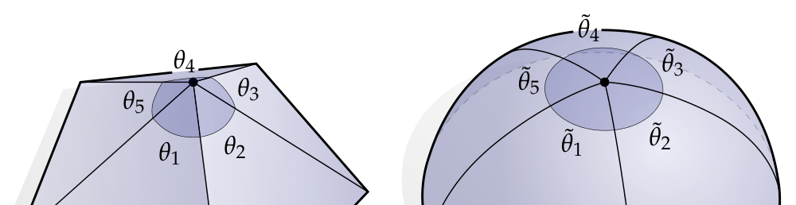
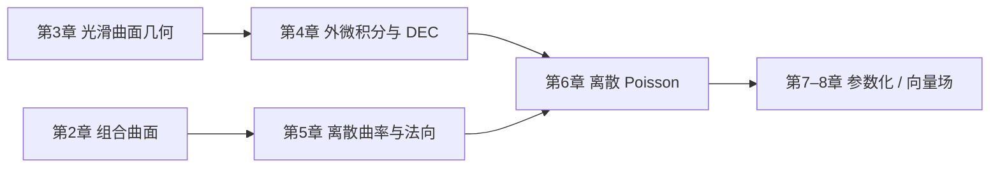

# 第1章 引言

### 来源说明

- 作者：Keenan Crane
- 书名：Discrete Differential Geometry: An Applied Introduction（离散微分几何：应用导论）
- 官方来源：https://www.cs.cmu.edu/~kmcrane/Projects/DDG/paper.pdf
- 本笔记仅供个人学习使用。

阅读范围：第1章 Introduction，PDF 第 4–7 页（书页 3–6）。书签把 1.1 Disclaimer、1.2 Copyright、1.3 Acknowledgements 都标在 PDF 7。下一章 Combinatorial Surfaces 从 PDF 8 起，本笔记不读 8 及之后。

### 本章总览

这份讲义同时做两件事：给三维 geometry processing（几何处理）打底，并当作传统 differential geometry（微分几何）的第一门课。核心主张是：像 curvature（曲率）这样的几何量，必须同时从计算和数学两边看。两边互相校正，才能做出能处理真实几何数据的算法。

作者强调用直观、可视的方式重看微积分和线性代数，而不是只写形式代数。主题覆盖曲线与曲面、曲率、connection（联络）与 parallel transport（平行移动）、exterior algebra（外代数）、exterior calculus（外微积分）、Stokes’ theorem（Stokes 定理）、simplicial homology（单纯同调）、de Rham cohomology（de Rham 上同调）、Helmholtz–Hodge decomposition（Helmholtz–Hodge 分解）、conformal mapping（共形映射）、finite element methods（有限元）和 numerical linear algebra（数值线性代数）。应用包括曲率逼近、曲线与曲面光滑、曲面参数化、向量场设计和测地距离计算。

统一语言是 discrete exterior calculus（离散外微积分，DEC）。讲义假定读者接触过基本线性代数和向量微积分；编码练习用 Javascript 或 C++，但不依赖继承、模板等重范式。配套框架在 `https://github.com/dgpdec/course`。书面习题解答需向作者索取。本笔记不展开习题与 Coding Exercises。

### 核心知识点

#### 课程要解决什么问题

真实几何数据很少是光滑公式，而是网格、点云一类离散对象。如果先在光滑范畴里把算法写清楚，再离散化，就有机会把光滑理论里必须成立的结构带到网格上。反过来，网格上的计算也能逼人把“曲率、切空间、积分”说成可以检查的数量。

预备知识按讲义自己的说法：线性代数和向量微积分够用，关键概念会随用随复习。目标读者是要做 geometry processing 的人，不是要先读完一部抽象微分几何专著再开工。

🔑 关键速记：先在光滑侧把结构写对，再决定网格上怎么离散，而不是先凑离散公式再回头找理论。

#### 为什么用外微积分

讲义承认，网格处理算法本来就有很多写法。选择 exterior calculus of differential forms（微分形式的外微积分）有两层理由。

第一是语言。它在相当程度上就是现代微分几何和数学物理的工作语言。学会这套说法，才能借用已有理论发明新算法，也能把现成算法放回同一套理论里对照。同一框架下，光滑、参数化、向量场设计等任务往往只写成几行，典型地是解一个 Poisson equation（Poisson 方程）。

第二不只是“换一种说法”。先在光滑几何里陈述算法，才能保证随后离散时把关键结构保住。DEC 被作者当作一套“整论一起离散、各件还能对得上”的理论，尤其擅长保住曲面的 homological structure（同调结构）。

👉 外代数、外微积分和 DEC 的算子表、Hodge 对偶、Stokes 定理，要到第4章才展开。外微积分把向量、面积元、体积元写成可以相乘和求导的形式；DEC 再把这些对象放到网格的顶点、边和面上。本章只交代“为什么选这门语言”。完整讲解见第4章。📝待补全

👉 同调与 Helmholtz–Hodge 分解出现在第8章。同调管的是“洞有几个、圈能不能缩掉”；Hodge 分解则把向量场拆成梯度、余梯度和调和三部分。本章只点出 DEC 能保住这类结构。完整讲解见第8章。📝待补全

🔑 关键速记：外微积分既是共同语言，也是“先光滑、后离散、保住结构”的工作方式。

#### 顶点角和：同一种量可以有多种离散

章首图把同一个顶点画了两次。左边是网格顶点，五个欧氏 tip angle（顶角）$\theta_1,\ldots,\theta_5$ 的和一般不等于 $2\pi$。右边把同一组角改写成 $\tilde\theta_i$，使它们在切平面上刚好围成一整圈。

图注：左图是三角形网格上的一个顶点，五个欧氏顶角 $\theta_i$ 之和通常不是 $2\pi$。右图把同一组角按比例放大或缩小成 $\tilde\theta_i$，使 $\sum_i\tilde\theta_i=2\pi$，对应“切空间里应有整整一圈方向”。原书第1章章首图，PDF 4。

光滑曲面上，任一点的 tangent space（切空间）都应包含整整一圈方向，因此顶角和必须是 $2\pi$。把网格加密，顶点会变平，欧氏角和也会逼近 $2\pi$。讲义给出另一种做法：不必等网格变细，直接改“角”的定义。令

$$
s := \frac{2\pi}{\sum_i \theta_i},
\qquad
\tilde\theta_i := s\,\theta_i.
$$

于是无论网格多粗，

$$
\sum_i \tilde\theta_i = s\sum_i \theta_i = 2\pi.
$$

概念上，可以想象顶点被略微抹圆，曲率被推进本来扁平的三角形里。后续计算一律改用离散角 $\tilde\theta_i$。作者明确说：这种约定并不总有用；但在切空间结构很关键的问题上，它能导出很有效的网格算法，并指向 [KCPS13, SC18]。

这一段的主题会在全书反复出现：**同一种几何量没有唯一“正确”的离散方式**，只有是否适合当前目的。希望是把整套理论一起离散，使各块还能对得上。

🔑 关键速记：欧氏角和可以不等于 $2\pi$；按比例改写成 $\tilde\theta_i$ 后，粗网格也能保住“切平面是一整圈”。

#### 全书阅读顺序

讲义自己写的阅读顺序，和目录编号不完全同步。正文说：先看曲面的微分几何（第3章），这条叙述会自然接到光滑外微积分（第4章）以及它的 DEC 离散；再看离散曲面的基本性质（第2章）和法向（第5章），一直推到贯穿应用的离散 Poisson 方程（第6章）。后面各章再带上 conformal structure（共形结构）、homology（同调）、parallel transport（平行移动）等概念。

第2章的 combinatorial surface（组合曲面）先丢掉嵌入位置，只记顶点、边、面如何粘起来。它在离散侧扮演的角色，接近光滑侧的 topological surface（拓扑曲面）：管连通，不管长短厚薄。

👉 组合曲面、抽象单纯复形和半边网格的定义见第2章。组合曲面只回答“哪几块贴在一起”，不回答“顶点在空间的哪里”。半边网格是后面算法的基本导航结构。完整讲解见第2章。📝待补全

👉 第3章用映射 $f:M\to\mathbb{R}^3$ 讲曲面：微分 $df$ 负责把平面上的箭头推到曲面上，诱导度量 $g(X,Y)=df(X)\cdot df(Y)$，法向变化给出曲率。本章只说明为什么必须先有这幅光滑图。完整讲解见第3章。📝待补全

离散曲面的法向和各种曲率定义会在第5章收拢，并连接到 Gauss–Bonnet。Poisson 方程则是第6章的中心等式：许多光滑、参数化、向量场任务最后都化成它。

👉 离散法向、面积梯度、体积梯度和离散 Gauss–Bonnet 见第5章。那里会把“网格角和不是 $2\pi$”重新读成曲率。完整讲解见第5章。📝待补全

👉 离散 Laplace 算子、有限元与 DEC 两套离散、以及离散 Poisson 方程见第6章。本章只说后面应用会反复解这一个方程。完整讲解见第6章。📝待补全

第7章的共形参数化、第8章的向量场分解与设计，正文只在引言里点名文献来源，本笔记不读第7章 PDF 122 及之后的页面。

👉 第7章要把曲面尽量保角地铺到平面上，对应引言里的 conformal mapping。本章只保留“存在这一应用”。该细节原书未在第1章展开。完整讲解见第7章。📝待补全

🔑 关键速记：概念顺序是“光滑几何 → 外微积分 → 组合网格 → 离散曲率 → Poisson → 应用”，不要按目录数字从第2章硬读到第8章。

#### 写作约定、版权与文献出处

作者要求每个概念都配具体几何图，尽量避开抽象代数推演。做书面习题时，应先给几何直觉，再补形式细节。

PDF 7 的 Disclaimer 写明：讲义仍是 work in progress，会有错误；判断对错首先靠自己的头脑。发现错误需同时告知页码和版本。

Copyright：除 Stanford Bunny 网格由 Stanford Computer Graphics Laboratory 提供外，图像与文字均为作者本人制作。版权标记为 © Keenan Crane 2011–2021, all rights reserved。

Acknowledgements 说明讲义源自 2011 年起每年开设的 DDG 课，先在 Caltech，后在 CMU。初稿与 SIGGRAPH 2013 修订得到 Peter Schröder、Max Wardetzky、Clarisse Weischedel、Mathieu Desbrun、Fernando de Goes、Corentin Wallez 等人反馈。配套代码库的革新归功于 Nicholas Sharp 与 Rohan Sawhney。

算法文献在引言里点到为止，本笔记只记出处，不把后文细节提前写成结论：

- mean curvature flow（平均曲率流）：[DMSB99]
- 第7章共形参数化：[MTAD08]
- 第8章离散 Helmholtz–Hodge：[DKT08]
- 带指定奇点的光滑向量场：[CDS10]；用 Helmholtz–Hodge 改进的 8.4.1 节此前未发表，归于 Fernando de Goes [dGC10]
- DEC 本身：[Hir03, DHLM05, DKT08]
- 许多算法里的 cotan-Laplace（余切 Laplace）算子至少可追溯到 [Mac49]

🔑 关键速记：先看图、先信几何，再信代数；文献只在对应章节核对，不在引言里展开算法。

### 章末速记

1. 讲义同时教三维几何处理和传统微分几何，统一语言是 DEC。
2. 先在光滑范畴陈述算法，再离散，才能把切空间、同调等结构保住。
3. 顶点欧氏角和一般不是 $2\pi$；令 $\tilde\theta_i=s\theta_i$、$s=2\pi/\sum\theta_i$，粗网格也能让角和恰好为 $2\pi$。
4. 同一种几何量可以有多种离散，没有唯一“正确”写法。
5. 阅读顺序以第3章光滑几何和第4章外微积分为先，第2章组合网格与第5–6章离散对象随后。

### 易混淆点与差异对比

“网格加密后角和会接近 $2\pi$”和“立刻改写角的定义使和为 $2\pi$”是两条路。前者靠逼近，后者靠改离散约定。引言用后者说明：离散不必是光滑量的逐点采样。

DEC 不是“把连续公式里的导数换成差分”这么一件事。它要离散的是一整套外微积分，使积分、对偶、同调还能对得上。只改某一个曲率公式，并不自动得到 DEC。

目录里第2章写在第3章前面，引言推荐的概念顺序却是先第3章再第2章。做笔记时按概念依赖走：先有光滑曲面图，再谈网格怎么编码。

单纯星形（simplicial star）和后面的 Hodge star 不是同一个对象。引言还没定义二者，只是第2章脚注已经预告要分开。

| 对象 | 本章说法 | 不要读成 |
| --- | --- | --- |
| $\theta_i$ | 网格上的欧氏顶角 | 已经保证和为 $2\pi$ |
| $\tilde\theta_i$ | 按 $s$ 缩放后的离散角 | 加密网格后的极限角 |
| DEC | 整套外微积分的离散理论 | 某一个曲率离散公式 |
| 第2章 | 组合连通性 | 已经带有嵌入度量 |

要点：离散是在选结构，不是在等网格变细。

### 本章要点总结

- 这份讲义用 DEC 把光滑微分几何和网格算法写成同一套语言，面向真实三维几何数据。
- 先光滑、后离散，是为了保住切空间、同调一类“必须成立”的结构，而不是先凑离散再补理论。
- 顶点角和是第一个例子：欧氏和可以不是 $2\pi$，按比例改写成 $\tilde\theta_i$ 后，粗网格也能模拟“切平面是一整圈”。
- 同一种量没有唯一正确离散；DEC 的目标是让整套理论的各块还能对得上。
- 第2–3章分别补组合编码和光滑几何，第4–6章才进入外微积分、离散曲率和 Poisson。第7章起的应用本章只点名。
