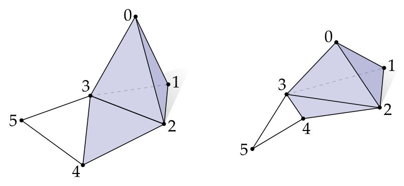
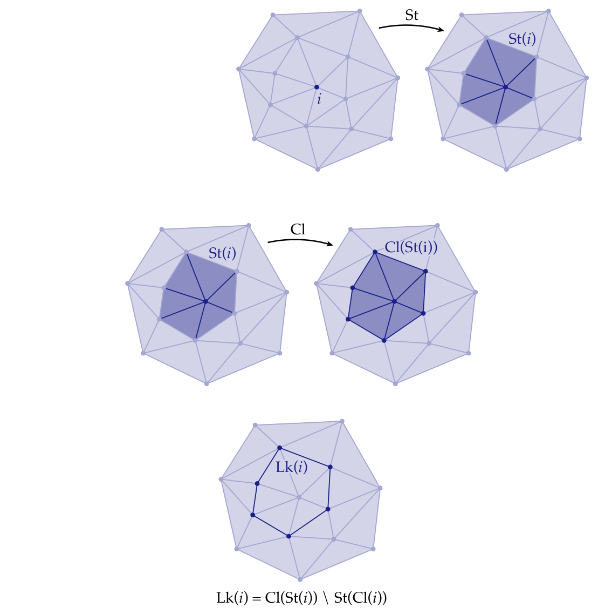
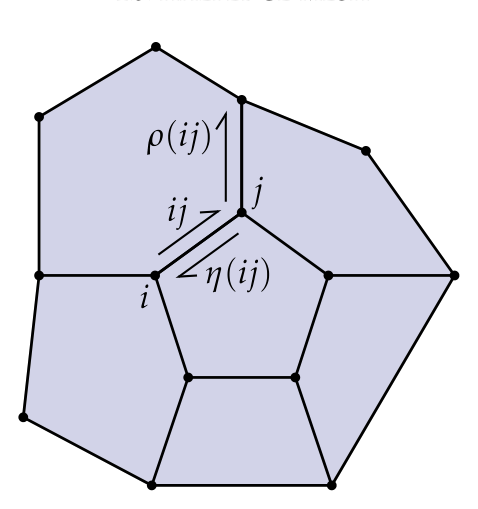

# 第2章 组合曲面

### 来源说明

- 作者：Keenan Crane
- 书名：Discrete Differential Geometry: An Applied Introduction（离散微分几何：应用导论）
- 官方来源：https://www.cs.cmu.edu/~kmcrane/Projects/DDG/paper.pdf
- 本笔记仅供个人学习使用。

阅读范围：第2章 Combinatorial Surfaces，PDF 第 8–29 页（书页 7–28）。书签：2.1 PDF 9，2.2 PDF 11，2.3 PDF 15，2.4 PDF 17，2.5 PDF 19，2.6 Written Exercises PDF 23，2.7 Coding Exercises PDF 28。第3章从 PDF 30 起，本笔记不读 30 及之后。2.6 与 2.7 的习题和编程题只登记存在，不展开、不写解答、不写实现步骤。

### 本章总览

曲面在这里先被理解成物体的“外壳”：橘子是实心球，皮是球面；甜甜圈上的釉是环面而不是球面。第2章故意丢掉形状和嵌入位置，只问各块如何连在一起。这样的对象叫 combinatorial surface（组合曲面）。它在离散微分几何里扮演的角色，接近光滑理论里的 topological surface（拓扑曲面）。

讲义把连通性写成三种编码：abstract simplicial complex（抽象单纯复形）、adjacency matrix（邻接矩阵）和 halfedge mesh（半边网格）。前两种能描述比曲面更一般的形状；半边网格专门对付二维、可定向、流形曲面，并允许一般多边形面，是后面算法的基本数据结构。

基本简化假设是流形：显微镜下，形状看起来和普通欧氏空间一样。对曲面，目前只要求每一点附近有一块 topological disk（拓扑圆盘）。更细的“像欧氏空间”会通向微分拓扑、共形几何、Riemann 几何等分支，本章不展开。

### 核心知识点

#### 流形假设和拓扑圆盘

流形假设让我们能把平坦欧氏空间里会做的事——向量、求导、积分——搬到弯曲对象上。对曲面，最基本的要求是：任一点附近都能找到一小块拓扑圆盘。

拓扑圆盘大致是：把平面单位圆盘连续变形，但不撕裂、不穿孔、不把边粘起来。旗、叶子、手套是圆盘。圆（没有内部）、实心球、空心球面、甜甜圈、指尖陀螺、茶壶不是圆盘。章首图用有限多边形分别拼出拓扑圆盘、拓扑环带，以及既不是圆盘也不是“只有一块盘”的多面体。

组合侧先不谈长度和角度。Hatcher 的代数拓扑书 [Hat02] 被点名为想看更技术处理时的参考，本章自己只用组合语言。

👉 第3章才会给曲面一个空间中的形状：映射 \(f:M\to\mathbb{R}^3\)、诱导度量 \(g\) 和法向 \(N\)。组合曲面回答“谁和谁相邻”；第3章回答“相邻之后如何弯曲”。完整讲解见第3章。📝待补全

🔑 关键速记：组合曲面只管怎么粘，不管在空间里长什么样；局部像圆盘，就是这里的流形。

#### 抽象单纯复形

要区分球面和环面，先忘掉大小厚薄，只记连通性。办法之一是 simplicial complex（单纯复形）。它其实能编码比曲面复杂得多的对象。

从顶点集 \(V=\{0,1,2,\ldots,n\}\) 出发。彼此“紧挨着”的顶点子集叫 \(k\)-simplex（\(k\)-单形）。\(k\in\mathbb{Z}_{\ge 0}\) 是单形的 degree（度数）：一个 abstract \(k\)-simplex 是 \(k+1\) 个互异顶点。三角形是 2-单形，例如 \(\{3,4,2\}\)；边是 1-单形，例如 \(\{3,5\}\)；0-单形就是单个顶点。为方便，常把顶点 \(i\in V\) 和 0-单形 \(\{i\}\in K\) 看成同一对象。

目前不给顶点坐标。同一组单形可以画成完全不同的空间形状，所以叫 abstract（抽象）。度数可以任意高，不必想象它在三维空间里长什么样。顶点顺序暂时也不重要：\(\{2,3,4\}\) 和 \(\{3,4,2\}\) 是同一个 2-单形。

图注：左右是同一抽象单纯复形，不是两个不同的形状。它包含六个顶点、十条边、五个三角形和一个四面体。左边把四面体画得更“立”，右边把同样的连接关系摊平。原书 Figure 1，PDF 10。

单形的任意非空子集还是单形，叫做 face（面）；真子集叫 proper face（真面）。例如 \(\{2,3\}\) 是 \(\{3,4,2\}\) 的真面；\(\{2,3,4\}\) 是面但不是真面。

集合 \(K\) 成为 simplicial complex 的条件是：每个 \(\sigma\in K\) 的每一个面 \(\sigma'\subseteq\sigma\) 也在 \(K\) 里。一堆三角形本身还不是复形，必须把它们的边和顶点一并收进来。讲义通常假定 \(K\) 有限，但原则上也可以考虑无限复形，例如整个欧氏平面的三角剖分。

抽象单纯复形说到底是：整数的若干子集，并且对取子集运算封闭。这个看起来过简的对象，足够精确编码任意复杂曲面的拓扑。

🔑 关键速记：\(k\)-单形有 \(k+1\) 个顶点；复形必须把每个单形的所有面都收齐。

#### 子复形与纯复形

subcomplex（子复形）\(K'\subseteq K\) 自己也是单纯复形。单独一条边不是子复形；边加上它的两个顶点才是。

\(K\) 是 pure \(k\)-simplicial complex（纯 \(k\)-单纯复形），当且仅当每个 \(\sigma'\in K\) 都落在某个度数为 \(k\) 的单形里（可以是自己）。边上挂着多余三角形、旁边漂着孤立边或孤立点，都不是纯的。

后面谈曲面时，默认工作对象是纯 2-复形：所有东西都被某个三角形（或更高维时的顶维单形）装着。

🔑 关键速记：子复形自己必须对取面封闭；纯 \(k\)-复形里没有“低维碎片”在外面晃。

#### 星、闭包与链环

对顶点 \(i\in V\)，simplicial star（单纯星）\(\mathrm{St}(i)\) 是所有含 \(i\) 的单形。它看起来像 \(i\) 的局部邻域，但通常还不是复形：缺一圈外沿边。

closure（闭包）\(\mathrm{Cl}(S)\) 是含 \(S\) 的最小子复形。于是 \(\mathrm{Cl}(\mathrm{St}(i))\) 补上那圈外沿，成为复形。

若先闭包再取星：\(\mathrm{Cl}(i)\) 只是顶点本身，因此 \(\mathrm{St}(\mathrm{Cl}(i))=\mathrm{St}(i)\)。两套集合的差正是那圈外沿边，定义为 link（链环）

\[
\mathrm{Lk}(i)=\mathrm{Cl}(\mathrm{St}(i))\setminus\mathrm{St}(\mathrm{Cl}(i)).
\]

对一般子集 \(S\subseteq K\)（不必是子复形）：

- \(\mathrm{St}(S)\)：\(K\) 中所有包含 \(S\) 里任一单形的单形；
- \(\mathrm{Cl}(S)\)：含 \(S\) 的最小子复形；
- \(\mathrm{Lk}(S)=\mathrm{Cl}(\mathrm{St}(S))\setminus\mathrm{St}(\mathrm{Cl}(S))\)。

图注：上排从顶点 \(i\) 取星，得到含 \(i\) 的三角形，但缺外沿边。中排对 \(\mathrm{St}(i)\) 取闭包，补上外沿，得到 \(\mathrm{Cl}(\mathrm{St}(i))\)。下排把闭包里不属于 \(\mathrm{St}(\mathrm{Cl}(i))\) 的那圈边单独画出，就是 \(\mathrm{Lk}(i)\)。原书 PDF 11–12 插图拼合。

脚注提醒：这里的 star 和后面的 Hodge star 完全不是同一个对象。

👉 Hodge star 属于第4章的外微积分：它在 \(k\)-形式和 \((n-k)\)-形式之间建立对应，和“含某个顶点的单形集合”无关。本章的 \(\mathrm{St}\) 只用于在复形里导航。完整讲解见第4章。📝待补全

🔑 关键速记：星是含 \(S\) 的单形，闭包补下面，链环是 \(\mathrm{Cl}(\mathrm{St}(S))\setminus\mathrm{St}(\mathrm{Cl}(S))\)。

#### 边界与内部

对纯 \(k\)-子复形 \(K'\subseteq K\)，boundary（边界）\(\mathrm{bd}(K')\) 是下述集合的闭包：所有恰好作为 \(K'\) 中一个单形之真面的那些单形。interior（内部）是

\[
\mathrm{int}(K')=K'\setminus\mathrm{bd}(K').
\]

星、闭包、链环、边界、内部是任意维单纯复形上的通用导航语言。对二维曲面，后面会换成更贴身的半边网格；但要定义什么叫组合曲面，仍然用得上星、闭包和链环。

🔑 关键速记：边界来自“只被一个顶维单形用过一次的真面”，内部是去掉边界之后剩下的部分。

#### 定向单纯复形

到现在为止，单形是无序集合。许多计算需要 orientation（定向），因为定向编码被测对象的符号。从山脚到山顶的高差，和从山顶到山脚差一个负号。

做法是把无序集换成有序元组。边有 \((i,j)\) 与 \((j,i)\) 两种。三角形有六个有序三元组，它们分成两类：顺时针走一圈，或逆时针走一圈。定向是有序元组的等价类：不在乎从哪个顶点起走，只在乎绕向。讲义写成

\[
ijk:=\{(i,j,k),(j,k,i),(k,i,j)\},\qquad
ikj:=\{(i,k,j),(j,i,k),(k,j,i)\}.
\]

一般 \(k\)-单形恰有两个定向：顶点的全体偶置换，和全体奇置换。边是 \(ij=\{(i,j)\}\) 与 \(ji=\{(j,i)\}\)；四面体是 \(ijkl\) 与 \(jikl\)。0-单形只有一种写法 \(i=\{i\}\)，但仍允许指定 \(+i\) 与 \(-i\) 两种定向，以便后面定义相对定向和边界算子。

两个有向单形若共享顶点，可以谈 relative orientation（相对定向）。有向边 \(ij\) 与 \(jk\) 定向一致，\(ij\) 与 \(kj\) 相反。有向三角形 \(ijk\) 与 \(jil\) 一致，\(ijk\) 与 \(ijl\) 相反。一般规则：两个 \(k\)-单形若恰好共享 \(k\) 个顶点，则它们定向相同当且仅当限制到共享顶点上的两个 \((k-1)\)-单形定向相反。更精确地说，真面 \(\sigma'\) 与 \(\sigma\) 定向相同，当 \(\sigma'\) 出现在 \(\sigma\) 的某个偶置换里。0-单形与 1-单形是例外：有向边 \(ij\) 与终点 \(j\) 同向、与起点 \(i\) 反向。

oriented simplicial complex（有向单纯复形）就是给每个单形各挑一个定向。定向可以任意指定。若可能，常让共享 \((k-1)\)-面的 \(k\)-单形取相同定向，例如平面三角剖分里所有三角形都顺时针。

🔑 关键速记：定向是绕向的等价类，不是从哪个顶点起算；相对定向看共享面上的绕向是否相反。

#### 单纯曲面

日常形状（帽子、脸、香蕉）用曲面就够，不必上最一般的复形。abstract simplicial surface（抽象单纯曲面）是纯单纯 2-复形，并且每个顶点的链环都是单条边圈；等价地说，每个顶点的星都是由三角形拼成的组合圆盘。这种局部圆盘条件就是这里的 manifold（流形）。

讲义注明：此时本来可以给复形装一个拓扑，使它成为通常意义的拓扑曲面；但许多拓扑行为在纯组合语言里就已经看得清楚，不必先造拓扑。

单纯曲面不允许三条三角形挤在同一条边上，也不允许多个“锥”在同一顶点相会。这类构型叫 nonmanifold（非流形）。

带边界时，定义放宽为：链环也可以是一条边的简单路径，而不必是圈。对任何单纯曲面 \(K\)，\(\mathrm{bd}(K)\) 总是零个或多个闭圈。

oriented simplicial surface（有向单纯曲面）要求能给每个三角形指定一致定向：共享一条边的两个三角形定向相同。此后默认：只要能一致定向，就取一致定向。

一致定向不是总能做到。从任意三角形出发向外“生长”定向，有可能绕回来发现新三角形无法同时迁就所有邻居。组合 Möbius band（Möbius 带）就是例子。不可定向曲面实践中不常见，但必须知道它们存在。

高维推广：simplicial \(n\)-manifold 是纯单纯 \(n\)-复形，每个顶点的链环是单纯 \((n-1)\)-球面。单纯 \(n\)-球面是对

\[
S^n:=\{x\in\mathbb{R}^{n+1}:|x|=1\}
\]

的三角剖分。于是单纯曲面是单纯 2-流形：链环都是边的闭圈。单纯 3-流形是四面体网格，每个顶点被一个球面三角剖分包住。单纯 1-流形要求每个顶点的链环是一对点，因此只能是若干闭圈。

🔑 关键速记：单纯曲面 = 纯 2-复形 + 每个顶点的链环是一个圈（带边时允许一条路径）。

#### 邻接矩阵

给每个度数的单形分别编号：顶点 \(0,\ldots,|V|-1\)，边 \(0,\ldots,|E|-1\)，三角形 \(0,\ldots,|F|-1\)。同一度数内编号不重复即可，具体谁先谁后无所谓。

矩阵 \(A_0\) 记录哪条边含哪个顶点：第 \(r\) 行第 \(c\) 列为 1 表示第 \(r\) 条边含第 \(c\) 个顶点，否则为 0。\(A_1\) 同样记录哪个三角形含哪条边。一般地，\(A_k\) 的列数等于 \(k\)-单形个数，行数等于 \((k+1)\)-单形个数。

这些矩阵绝大多数条目是 0，实践中必须用 sparse matrix（稀疏矩阵）：只存非零项的 \((r,c,x)\)。稀疏存储本身是另一门设计问题，本章只要求概念上把它看成三元组列表。

若复形有定向，可做 signed adjacency matrix（带符号邻接矩阵）：非零项按相对定向取 \(+1\) 或 \(-1\)。两个一致定向、共享一条边的三角形，就是正文里的标准例子。

邻接矩阵既方便用数值线性代数计算，也和后面的 discrete differential form（离散微分形式）连在一起。

👉 离散微分形式把数量放在顶点、边、面上，邻接矩阵随后会变成离散外导数的组合骨架。第4章的 DEC 才会把 \(A_k\) 读成算子。完整讲解见第4章。📝待补全

🔑 关键速记：\(A_k\) 的一行是一个 \((k+1)\)-单形，一列是一个 \(k\)-单形；有定向时 1 改成 \(\pm 1\)。

#### 半边网格

自然世界里的许多外壳都是流形、可定向曲面。halfedge mesh（半边网格）专吃这种结构。它不如邻接矩阵一般：挂在外面的悬边、Möbius 带、体网格都不在它的设计范围。换来的好处是：面可以是一般多边形，而不只是三角形；在一些重要情形，它还能用比任何单纯复形更少的元素描述同一拓扑。形式上，半边网格编码的是 2-dimensional CW complex；定义见 [Hat02, Chapter 0]。

对无边界的有向单纯曲面，有两条观察：每条边恰含于两个多边形；顶点周围的边可以排成循环顺序。这两条对一般 \(n\) 边形面仍然成立。

无向边 \(\{i,j\}\) 拆成两条有向边 \(ij\neq ji\)，这里叫 halfedge（半边）。全体半边记为 \(H\)。无边界时 \(|H|=2|E|\)。

两个关键映射：

- twin（孪生）\(\eta:H\to H\)，\(\eta(ij)=ji\)；
- next（下一条）\(\rho:H\to H\)，对有向三角形 \(ijk\in K\) 有 \(\rho(ij)=jk\)。

图注：半边 \(ij\) 沿所在面走到 \(\rho(ij)\)，翻到对侧反向半边是 \(\eta(ij)\)。反复使用这两个映射，就能绕出面、边和顶点，而不必另存一张完整的邻接表。原书 PDF 20 插图。

反过来，只凭 \(\rho\) 和 \(\eta\) 就能恢复多边形网格的顶点、边和面：

- 面是 \(\rho\) 的轨道；
- 边是 \(\eta\) 的轨道；
- 顶点是 \(\rho\circ\eta\) 的轨道。

任意一对映射只要满足三条，就描述一个合法组合曲面：\(H\) 有偶数个元素；\(\rho\) 与 \(\eta\) 都是 \(H\) 上的置换；\(\eta\) 是无不动点的对合，即 \(\eta(\eta(ij))=ij\) 且 \(\eta(ij)\neq ij\)。把半边按 \(0,1,2,3,\ldots\) 成对编号后，\(\eta\) 甚至可以不存：偶数 \(h\) 的孪生是 \(h+1\)，奇数 \(h\) 的孪生是 \(h-1\)。于是每个偶数个元素上的置换都描述一个组合曲面。

半边还能描述单纯复形写不出来的三角剖分。一个例子是把三角形 \(ijk\) 的两条边粘成锥，再用一个“单边形”圆盘封底：只有四条半边，单纯复形既写不出边如何自粘，也收不进那个单边形。另一个例子是两个三角形、一个顶点的环面；单纯复形里 \(\{i,i,i\}\) 根本不是集合，更无法区分两个不同的 “\(iii\)”。单纯复形要表示环面，至少需要 7 个顶点、21 条边、14 个三角形；同一连通性既可以画在对边粘合的正方形上，也可以在 \(\mathbb{R}^3\) 里用直线、互不交叉的扁平三角形画出，即 Császár polyhedron（Császár 多面体）。

有边界的曲面（圆盘、环带）看起来违反“每条边恰在两个多边形里”。处理办法是：把每个边界分支看成一个多边多边形，把洞填上并做标记。填完之后又是无边界曲面，导航规则照旧。

半边网格是本讲义后续算法的基本数据结构：追 next 和 twin，就能到达任意网格元素。

🔑 关键速记：面看 \(\rho\) 的圈，边看 \(\eta\) 的圈，顶点看 \(\rho\circ\eta\) 的圈；边界先当普通面填上。

#### 书面习题与编程习题（不展开）

2.6 Written Exercises 从 PDF 23 起到 PDF 27，编号 Exercise 2.1–2.15。正文在习题区先给出若干将在后文用到的事实，本笔记只记结论，不写证明、不解题。

Euler characteristic（Euler 示性数）\(\chi=V-E+F\) 是拓扑不变量：局部改连通性（例如在多边形中间插一个顶点）不改变它；整体改拓扑（多一个连通分支、多一个手柄）才会变。对单纯圆盘有 \(V-E+F=1\)，对抽象单纯球面有 \(V-E+F=2\)。connected、compact、orientable、无边界的曲面，被 genus（亏格）\(g\)（手柄个数）完全区分，更一般的公式是 Euler–L’Huilier formula

\[
V-E+F=2-2g.
\]

该式对一般 \(n\) 边形面也成立。习题 2.1 要求证明圆盘和球面的特殊情形；2.2–2.7 讨论正则价、不规则价的最小个数、三角/四边/四面体网格的渐近元素比；2.8–2.15 分别练星闭包链环、边界内部、把曲面写成置换或矩阵，以及 1-流形与边界的分类事实。全部不在此展开。

顶点的 valence（价）是含该顶点的边数。单纯曲面顶点价为 6 时称 regular（正则）。许多数值算法（如 subdivision）只在正则情形表现理想，不规则顶点越少越好。这些定量关系放在习题里，正文没有另给独立定理清单。

2.7 Coding Exercises 从 PDF 28 到 PDF 29，要求从半边网格构造顶点–边、边–面邻接矩阵，并用矩阵实现边界/余边界以及星、闭包、链环，对应 CODING 1–9。按本项目约定，编程题不展开，也不写实现步骤。

🔑 关键速记：\(\chi=V-E+F\) 只随全局拓扑变；闭的可定向曲面满足 \(V-E+F=2-2g\)。习题与代码本笔记不写。

### 章末速记

1. 组合曲面只编码连通性；局部是拓扑圆盘，就是这里的流形。
2. 抽象 \(k\)-单形有 \(k+1\) 个顶点；复形必须对取面封闭，纯复形没有低维碎片。
3. \(\mathrm{Lk}(S)=\mathrm{Cl}(\mathrm{St}(S))\setminus\mathrm{St}(\mathrm{Cl}(S))\)；单纯曲面要求每个顶点的链环是一个圈。
4. 邻接矩阵 \(A_k\) 记录 \((k+1)\)-单形与 \(k\)-单形的关联，有定向时用 \(\pm 1\)，必须稀疏存储。
5. 半边用 \(\rho\)（next）和 \(\eta\)（twin）的轨道恢复面、边、顶点；它能描述单纯复形写不出的粘法。

### 易混淆点与差异对比

抽象单形没有坐标。Figure 1 左右不是两个复形，只是同一连接关系的两种画法。一谈到长度、角度、法向，就已经离开第2章、进入第3章或第5章。

星 \(\mathrm{St}\) 和 Hodge star 名字相同，对象不同。前者是“含这些单形的上层单形”，后者是形式之间的对偶。闭包 \(\mathrm{Cl}\) 也不是点集拓扑里那个闭包算子的完全翻版：它是含给定集合的最小子复形。

“有定向”和“可一致定向”不是一回事。给每个单形各挑一个定向，总是做得到；让共享边的三角形定向一致，Möbius 带就做不到。

半边网格不是单纯复形的另一种写法。单纯复形要求单形是互异顶点的集合，因此写不出边自粘、写不出单顶点环面；半边只要求 \(\rho,\eta\) 满足置换和对合，面还可以是一般多边形。

无符号邻接矩阵只回答“是否关联”。带符号版本多了相对定向，后面会接到离散外导数；二者不要混用。

| 编码 | 能描述 | 不能或不便描述 |
| --- | --- | --- |
| 抽象单纯复形 | 任意维、非流形、带悬边 | 边自粘、重复顶点的面 |
| 邻接矩阵 | 与复形相同，便于线性代数 | 悬挂与高维同样昂贵 |
| 半边网格 | 流形可定向曲面、一般多边形、更省的粘法 | 非流形、不可定向、体网格 |

要点：先问自己要的是拓扑连通、矩阵运算，还是网格上绕圈导航，再选三种编码之一。

### 本章要点总结

- 组合曲面丢掉嵌入，只记谁和谁相连；它是离散侧的拓扑曲面。
- 抽象单纯复形是对取子集封闭的顶点子集族。单纯曲面再加两条：纯 2-复形，以及每个顶点的链环是圈（带边时是路径）。
- 星、闭包、链环、边界、内部是通用导航语言；定向用偶/奇置换的等价类，相对定向看共享面。
- 邻接矩阵把关联写成稀疏表，带符号时记下 \(\pm 1\)，为后文离散微分形式做准备。
- 半边网格用 next 与 twin 的轨道恢复面、边、顶点，是后续算法的基本结构；边界先填成普通面。习题 2.1–2.15 与 CODING 1–9 不展开。
