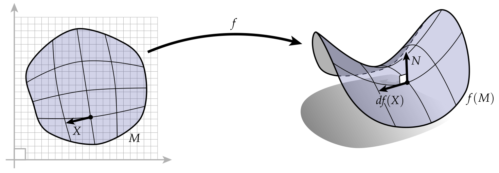
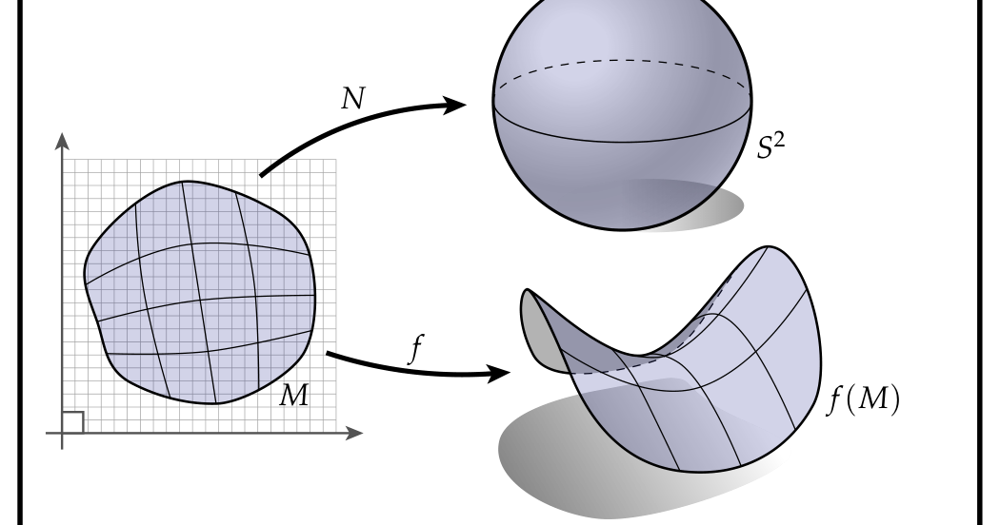
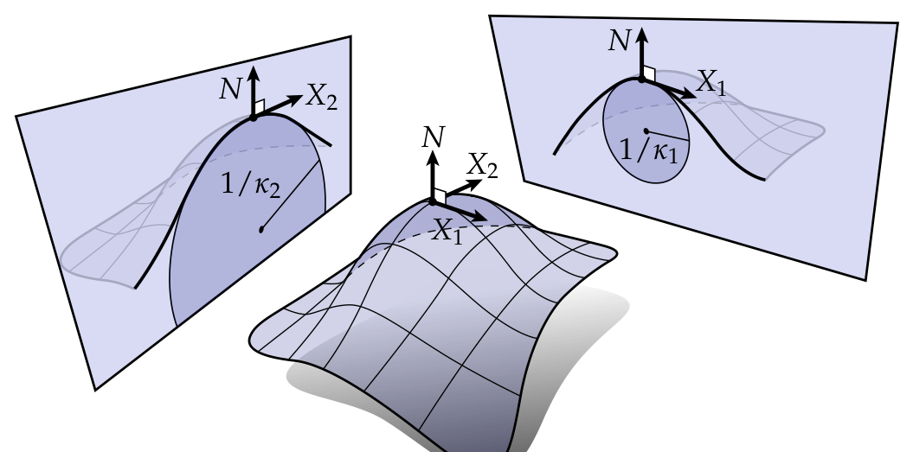

# 第3章 微分几何速成

### 来源说明

- 作者：Keenan Crane
- 书名：Discrete Differential Geometry: An Applied Introduction（离散微分几何：应用导论）
- 官方来源：https://www.cs.cmu.edu/~kmcrane/Projects/DDG/paper.pdf
- 本笔记仅供个人学习使用。

阅读范围：第3章 A Quick and Dirty Introduction to Differential Geometry，PDF 第 30–46 页（书页 29–45）。书签：3.1 PDF 30，3.2 PDF 33，3.3 PDF 36，3.4 PDF 39，3.5 PDF 43。第4章从 PDF 47 起，本笔记不读 47 及之后。本章无独立习题节。

### 本章总览

光滑曲面有许多讲法，例如用 chart（坐标卡）。这一章选了一幅和离散侧最合拍的图：一块材料在空间里的形状，写成映射 $f:M\to\mathbb{R}^3$。$M\subset\mathbb{R}^2$ 是平面区域，$f(M)\subset\mathbb{R}^3$ 是它在空间里的像。微分 $df$ 负责把平面上的箭头推到曲面上。由 $df$ 得到度量，由单位法向 $N$ 得到 Gauss map（Gauss 映射）和曲率。

随后用同一套“拉伸箭头”的语言重讲实函数的导数和 directional derivative（方向导数），再把曲线写成 $\gamma:I\to\mathbb{R}^3$，得到 Frenet–Serret 标架。曲面曲率先沿一个切方向切出法截面，再取出主曲率、平均曲率和 Gauss 曲率。第一、第二基本形式只是度量和 shape operator（形状算子）的旧名字。章末说明坐标矩阵怎么写、以及线性算子与双线性形式换基时为什么不能用同一套变换。

👉 第2章已经把曲面写成组合对象：顶点、边、面如何粘在一起，还不带 $f$ 和 $N$。本章补上空间中的形状。网格上的 $df$ 往往会直接变成一条边。完整讲解见第2章。📝待补全

### 核心知识点

#### 浸入、微分与诱导度量

把 $M$ 想成橡皮膜，$X$ 是画在膜上的一小段。把膜拉成 $f(M)$ 时，这段线也变成另一段，记作 $df(X)$。微分没有比这幅图更“深”的含义：它只告诉你从一块空间走到另一块空间时，向量如何被拉伸或 push forward（前推）。

图注：左边是参数域 $M$ 上的切向量 $X$。映射 $f$ 把它送到右边曲面 $f(M)$ 上的 $df(X)$。$N$ 是该点的单位法向。长度一般会变：平面上用 $\langle X,X\rangle$，空间里用 $df(X)\cdot df(X)$。原书 PDF 30。

前推后的长度是 $\sqrt{df(X)\cdot df(X)}$，其中 $\cdot$ 是 $\mathbb{R}^3$ 的标准内积。它通常不等于出发时的长度。平面上的内积改用角括号，例如原长是 $\sqrt{\langle X,X\rangle}$。任意两个切向量的内积写成

$$
g(X,Y)=df(X)\cdot df(Y).
$$

$g$ 叫曲面的 metric（度量），更严格说是 $f$ 诱导的度量。记号 $df(X)$ 既可指单根向量的前推，也可指整个向量场；本章多数式子里这两种读法差别不大。$TM$ 表示 $M$ 的 tangent bundle（切丛），即全部切向量的集合。

🔑 关键速记：$df$ 只做一件事——把箭头从 $M$ 推到 $f(M)$；度量就是把推过去的两根箭头做 $\mathbb{R}^3$ 点积。

#### 法向、可定向性与 Gauss 映射

向量 $u\in\mathbb{R}^3$ 在点 $p$ 处与曲面正交，当且仅当对 $p$ 处所有切向量 $X$ 都有 $df(X)\cdot u=0$。常取出长度为 1 的 unit normal（单位法向）$N$。每点有两个：$+N$ 与 $-N$。若能在整个 $M$ 上连贯地选出一个方向，就称 $M$ 可定向。圆环形带子可定向，Möbius 带不可定向。

可定向时，$N$ 可以看成连续映射 $N:M\to S^2$，叫做 Gauss map：每一点对应它的单位法向，并视作单位球面 $S^2$ 上的一点。把 $S^2$ 看成 $\mathbb{R}^3$ 里到原点距离为 1 的点集之后，对 $N$ 也能做和 $f$ 一样的事。微分 $dN$ 叫 Weingarten map（Weingarten 映射），描述法向如何随点移动。沿切方向 $X$ 的法向变化是 $dN(X)$，后面讲曲率时要用。

图注：同一块参数域 $M$ 有两个映射。$f$ 给出嵌入曲面 $f(M)$，$N$ 给出 Gauss 映射，像在单位球面 $S^2$ 上。$dN$ 描述法向如何变，是曲率的来源。原书 PDF 31 框内总图。

🔑 关键速记：可定向才能在整个曲面上连贯选出 $N$；曲率看的是 $N$ 怎么变，不是 $f$ 本身怎么弯。

#### 共形坐标

曲线常引入 isometric / arc-length / unit-speed parameterization（等距、弧长、单位速度参数）。要求 $|df(X)|=|X|$，也就是从参数域进 $\mathbb{R}^3$ 时不发生拉伸。

曲面一般不存在等距参数，哪怕只是局部。地球表面无法无畸变地铺到平面上，就是这个事实。多数时候必须拉伸。

更省事的替代是 conformal coordinates（共形坐标）。映射 $f$ 共形，当它保住任意两向量的夹角。具体写为：$f:\mathbb{R}^2\supset M\to\mathbb{R}^3$ 满足

$$
df(X)\cdot df(Y)=a\langle X,Y\rangle
$$

对一切切向量 $X,Y$ 成立，其中 $a$ 是正函数。实践中常把 $a$ 写成 $e^u$，这样就不必担心缩放是否为正。向量仍可被拉长，但曲面不被剪切：正交向量仍正交。

uniformization theorem（单值化定理）保证共形映射总存在：任何圆盘都能共形映到平面。因此对 $f(M)$ 上任一点 $p$，总能在 $p$ 附近一块圆盘状邻域里找到共形参数。和单位速度曲线一样，常常只需知道它存在，不必真的构造出来。需要跟踪的拉伸信息也最少：每点只需一个数，而不是整张 Jacobian。

👉 把整张曲面尽量共形地铺到平面上，是第7章 parameterization 的主题。本章只说明局部共形坐标总存在，以及它为什么让公式变短。完整讲解见第7章。📝待补全

🔑 关键速记：曲面通常没有等距参数；共形参数总存在，每点只需记住一个正缩放 $a$ 或 $e^u$。

#### 导数就是在拉伸箭头

实函数 $\phi(x)$ 通常画成 $x$ 轴上方的高度，$\phi'$ 是虚线的斜率。另一幅图是：$\phi$ 把实直线本身拉开，节点变稀的地方导数大，变密的地方导数小。若 $X$ 是沿正 $x$ 轴的单位切向量，则

$$
\phi'=d\phi(X).
$$

左边是标量，右边是向量。等式能成立，是因为实直线上的切向量本来就可以用一个实数表示伸向正侧还是负侧。这种 type checking（类型核对）可以像检查物理单位一样，用来检查公式。

高度函数那幅图并不是同一件事。那时实直线被拉成平面曲线 $\gamma=(x,\phi(x))\subset\mathbb{R}^2$。类型对不上：$\phi'$ 是标量，$d\gamma(X)$ 是 2-向量。拉伸量也不等于通常的 $\phi'$：$|d\gamma(X)|=\sqrt{1+(\phi')^2}$。

若 $\phi$ 定义在 $\mathbb{R}^2$ 上，$d\phi(X)$ 就是沿 $X$ 的方向导数。可以继续画高度函数，问“沿哪一侧上山”；也可以想象 $\phi$ 把一张橡皮膜拉成实直线上的细长对象，膜上的箭头 $X$ 被拉成 $d\phi(X)$。类型仍然匹配：$d\phi(X)$ 是 $\mathbb{R}$ 上的切向量，可用一个实数表示。

更代数的写法要等到外微积分。现在只需记住：从一块空间到另一块空间的映射都是某种弯曲、扭转、拉伸（或撕裂）；导数描述小箭头在路上变成了什么。

👉 第4章会用 differential form（微分形式）和外导数把“箭头被拉伸”写成可计算的代数。本章只建立几何图。完整讲解见第4章。📝待补全

🔑 关键速记：导数是单位切向量被映射拉伸的倍数；高度图和“拉开底空间”不是同一幅图。

#### 曲线的几何

曲线写成 $\gamma:I\to\mathbb{R}^3$，$I=[0,T]\subset\mathbb{R}$。微分 $d\gamma$ 同样描述切向量如何被拉伸，诱导长度是 $|d\gamma(X)|=\sqrt{d\gamma(X)\cdot d\gamma(X)}$。若对每个切向量都有 $|d\gamma(X)|=|X|$，就称参数是单位速度 / 弧长 / 等距：橡皮筋完全放松。离散侧常常没有底参数域 $I$，曲线一开始就作为 $\mathbb{R}^3$ 的子集给出，只能假定它处于放松状态。

设 $\gamma$ 是单位速度，$X$ 是 $I$ 上正向单位向量。则 $T=d\gamma(X)$ 是曲线的单位切向量。再看 $T$ 如何变：把变化拆成方向和大小，

$$
dT(X)=-\kappa N.
$$

$N$ 是 principal normal（主法向），$\kappa\in\mathbb{R}$ 是 curvature（曲率）。$T$ 与 $N$ 始终正交：若 $T$ 的变化与 $T$ 平行，它就不再是单位长。这是所有单位向量场都该记住的论证。约定 $N$ 指向曲线“左侧”：在 $T,N$ 张成的平面里，从 $T$ 逆时针转四分之一圈得到 $N$。再令 binormal（副法向）$B=T\times N$，得到标准正交的 Frenet frame（Frenet 标架）。

标架沿曲线的变化由 Frenet–Serret 公式给出。把 $T,N,B$ 看成行向量，撇号表示沿单位速度的变化，例如 $T'=dT(X)$，则

$$
\begin{bmatrix}T'\\N'\\B'\end{bmatrix}
=
\begin{bmatrix}
0&-\kappa&0\\
\kappa&0&-\tau\\
0&\tau&0
\end{bmatrix}
\begin{bmatrix}T\\N\\B\end{bmatrix}.
$$

中间的矩阵记为 $A$，右侧标架记为 $Q$，于是 $Q'=AQ$。$\tau$ 是 torsion（挠率），描述法向和副法向如何绕曲线扭转。

Cartan 的证明只留结论：$T,N,B$ 两两正交推出 $QQ^T=I$，从而 $Q$ 正交；对时间求导得到 $Q'Q^T$ 反对称；但 $A=Q'Q^T$，故 $A$ 反对称。反对称迫使对角线为 0；第一行（从而第一列）已由 $\kappa$ 与 $N$ 的定义确定；剩下的独立分量 $A_{23}=-A_{32}$ 不受约束，命名为 $\tau\in\mathbb{R}$。讲义自己评论：这段证明容易核对，但几何直觉不足，例如为什么 $N$ 同时朝 $T$ 和 $B$ 变、而 $B$ 只朝 $N$ 变。

圆 $S$ 的曲率可以当场读出来。半径 $r$ 的圆，单位速度走一圈要时间 $2\pi r$，这段时间里切向转过角度 $2\pi$。$T$ 是单位长，其瞬时变化完全由瞬时转角决定，于是 $\kappa=|dT(X)|=2\pi/(2\pi r)=1/r$。$r\to\infty$ 时圆看起来像直线，曲率为 0；$r\to 0$ 时圆看起来像一点，曲率为无穷。

平面光滑曲线 $\gamma$ 在任一点 $p$ 都有一个 osculating circle（密切圆）$S$：与 $\gamma$ 有相同的切向 $T$ 和曲率向量 $\kappa N$，也就是“直到二阶都一致”。构造法是取 $r=1/\kappa$，并让圆的某条切向对准 $T$。也可以让圆穿过 $p$ 以及左右两侧各一个趋近点；三点共用时，一阶和二阶导数在极限下一致。密切圆的半径和圆心分别叫 radius of curvature（曲率半径）和 center of curvature（曲率中心）。空间曲线把故事限制在 osculating plane（密切平面）$T\times N$ 里，因为该平面同时含切向和曲率向量。

对曲线，用 $T$ 的变化或用 $N$ 的变化来写曲率差别不大，二者在密切平面里只差四分之一转。对曲面通常改看法向变化，因为没有一条特别优越的切向。

🔑 关键速记：单位速度下 $dT=-\kappa N$，圆的曲率是 $1/r$；Frenet 矩阵反对称，对角为 0，剩下的独立量就是挠率 $\tau$。

#### 曲面的法曲率

蛋壳、甜甜圈、螺旋通心粉曲率大；地板、天花板、纸箱曲率小。啤酒瓶则沿一个方向很快绕成圆，沿另一个方向完全平直。一般做法是：在曲面上取单位切向 $df(X)$，用它和法向 $N$ 张成平面，平面与曲面交出一条曲线，这条曲线的曲率 $\kappa_n$ 叫沿 $X$ 的 normal curvature（法曲率）。

Frenet–Serret 给出沿曲线 $dN=\kappa T-\tau B$。抽出 $dN$ 的切向部分，得到

$$
\kappa_n(X)=\frac{df(X)\cdot dN(X)}{|df(X)|^2}.
$$

分母上的 $|df(X)|^2$ 只是去掉从 $M$ 进 $\mathbb{R}^3$ 时的拉伸。法曲率有符号：曲面可以弯向法向，也可以弯离法向。

🔑 关键速记：法曲率是“用 $N$ 和 $df(X)$ 切开曲面”得到的那条曲线的曲率，公式是 $df\cdot dN$ 再除以拉伸。

#### 主曲率、平均曲率与 Gauss 曲率

每一点都可以问：沿哪个方向弯得最厉害？法曲率取到最大、最小的单位向量 $X_1,X_2$ 叫 principal directions（主方向），对应的 $\kappa_1,\kappa_2$ 叫 principal curvatures（主曲率）。啤酒瓶标记点上可以是 $\kappa_1=1$、$\kappa_2=0$。

图注：中间是曲面片。左侧法截面沿 $X_2$ 切开，密切圆半径为 $1/\kappa_2$；右侧沿 $X_1$ 切开，半径为 $1/\kappa_1$。主方向是法曲率取到极值的方向。原书 PDF 40。

shape operator（形状算子）是唯一的映射 $S:TM\to TM$，满足对一切切向量 $X$

$$
df(SX)=dN(X).
$$

$S$ 与 Weingarten 映射 $dN$ 说的是同一件事：沿 $X$ 走时法向怎么变。差别只在于 $S$ 把变化写成 $M$ 上的切向量，$dN$ 写成 $\mathbb{R}^3$ 里的切向量。许多作者不做这个区分，直接把 $M$ 上的切向量和 $\mathbb{R}^3$ 里对应的切向量等距等同。讲义故意分开，以便显式跟踪对浸入 $f$ 的依赖——要真的计算时，这个依赖很重要。$N$ 的变化总能写成切向量，因为 $N$ 是单位法向，不能沿法向变长或变短。

主方向、主曲率分别是 $S$ 的特征向量和特征值：

$$
SX_i=\kappa_i X_i.
$$

主方向关于诱导度量正交：$g(X_1,X_2)=df(X_1)\cdot df(X_2)=0$。因此一点处的法曲率被主曲率完全决定。若单位向量 $Y$ 相对 $X_1$ 转过角 $\theta$，则

$$
\kappa_n(Y)=\kappa_1\cos^2\theta+\kappa_2\sin^2\theta.
$$

直接拿主曲率计算，在离散侧往往不方便。反复出现、并且在离散世界里更好抓的是两个平均量。mean curvature（平均曲率）是主曲率的算术平均

$$
H=\frac{\kappa_1+\kappa_2}{2},
$$

Gaussian curvature（Gauss 曲率）是几何平均的平方

$$
K=\kappa_1\kappa_2.
$$

最粗的读法：Gauss 曲率像逻辑“与”（两个方向都有曲率吗），平均曲率像逻辑“或”（至少一个方向有曲率吗）。必须小心：$\kappa_1=-\kappa_2$ 时平均曲率也可以是 0。

零曲率曲面有专门名字。$K=0$ 的叫 developable surface（可展曲面）：能不拉伸、不撕裂地摊到平面上。柱面片段是例子，因为有一个主曲率为 0。$H=0$ 的叫 minimal surface（极小曲面）：它们在一定约束下使面积最小（“后面会看到”）。极小曲面往往呈鞍形，因为两个主曲率大小相等、符号相反。鞍面也是 $K<0$ 的例子。$K>0$ 的例子是半球。若再有 $\kappa_1=\kappa_2$，主方向不再唯一，沿任何 $X$ 都取到最大（也是最小）曲率，这样的点叫 umbilic point（脐点）。

基本事实到此为止：曲面曲率由两个主曲率完全刻画，它们是法曲率的最大与最小；Gauss 曲率和平均曲率只是这两个数的平均，但实践中往往更好下手。

👉 第5章会给离散曲面多种曲率定义（向量面积、面积梯度、体积梯度等），并讨论它们和光滑 $H,K$ 的关系以及数值收敛。本章只给光滑侧的定义。完整讲解见第5章。📝待补全

🔑 关键速记：$SX_i=\kappa_i X_i$，$H=(\kappa_1+\kappa_2)/2$，$K=\kappa_1\kappa_2$；$K=0$ 可展，$H=0$ 极小。

#### 第一、第二基本形式

first fundamental form $\mathrm{I}$ 和 second fundamental form $\mathrm{II}$ 没有引入新几何。它们分别是度量 $g$ 和形状算子 $S$ 的旧写法，而 $g$ 与 $S$ 本身又只是浸入 $f$ 与 Gauss 映射 $N$ 的函数：

$$
\mathrm{I}(X,Y):=g(X,Y),
$$

$$
\mathrm{II}(X,Y):=-g(SX,Y)=-dN(X)\cdot df(Y).
$$

最重要的是：$\mathrm{I}$ 和 $\mathrm{II}$ 只是已经见过的对象的另一种写法。

🔑 关键速记：$\mathrm{I}$ 就是 $g$，$\mathrm{II}$ 就是 $-g(S\,\cdot\,,\cdot)$；真正基本的是 $f$ 和 $N$。

#### 坐标里的几何

抽象定义之外，微分也可以写成极限

$$
df_p(X)=\lim_{h\to 0}\frac{f(p+hX)-f(p)}{h}.
$$

离散曲面上 $df(X)$ 往往会具体变成网格的一条边。光滑侧更常见的表示是 Jacobian 矩阵

$$
J=
\begin{bmatrix}
\partial f_1/\partial x_1 & \partial f_1/\partial x_2\\
\partial f_2/\partial x_1 & \partial f_2/\partial x_2\\
\partial f_3/\partial x_1 & \partial f_3/\partial x_2
\end{bmatrix},
$$

其中 $f(x_1,x_2)=(f_1(x_1,x_2),f_2(x_1,x_2),f_3(x_1,x_2))$。求 $df(X)$ 就是把 $J$ 作用到 $X=[X_1\,X_2]^T$。

讲义用一小节警告：坐标表示有害。矩阵可以表示完全不同的对象，行为也不同。同一个 $\begin{bmatrix}0&1\\1&0\end{bmatrix}$ 可以是两点完全图的邻接矩阵、Pauli 矩阵 $\sigma_x$，或二面体群 $D_4$ 的元素。矩阵不是对象，只是对象的表示。

更具体的几何例子是 linear operator（线性算子）与 bilinear form（双线性形式）：

$$
f:\mathbb{R}^2\to\mathbb{R}^2,\quad u\mapsto f(u),
\qquad
g:\mathbb{R}^2\times\mathbb{R}^2\to\mathbb{R},\quad (u,v)\mapsto g(u,v).
$$

在坐标 $(x_1,x_2)$ 里它们分别由矩阵 $A,B$ 表示：$f(u)=Au$，$g(u,v)=u^TBv$。若新坐标由基变换 $P$ 给出，$\tilde u=Pu$，$\tilde v=Pv$，则

$$
f(u)=PAP^{-1}\tilde u,
\qquad
g(u,v)=\tilde u^T(P^{-T}BP^{-1})\tilde v.
$$

也就是说，线性算子按 $A\mapsto PAP^{-1}$ 变，双线性形式按 $B\mapsto P^{-T}BP^{-1}$ 变。不是所有矩阵都按同一规则变换。

尽管如此，标准矩阵仍是连接经典文献的桥梁。$df$ 写成 Jacobian $J$。诱导度量满足 $g(u,v)=df(u)\cdot df(v)$，用矩阵 $\mathrm{I}\in\mathbb{R}^{2\times 2}$ 表示时

$$
u^T\mathrm{I}v=(Ju)^T(Jv)\implies \mathrm{I}=J^TJ.
$$

这里的 $\mathrm{I}$ 就是第一基本形式的矩阵。旧书还把条目写成

$$
\mathrm{I}=\begin{bmatrix}E&F\\F&G\end{bmatrix}.
$$

$F$ 出现两次是因为矩阵对称。$E,F,G$ 本身几乎没有独立几何含义，但野外文献里仍会碰到。

形状算子与第二基本形式的矩阵满足 $u^T\mathrm{II}v=u^T\mathrm{I}Sv$，因此 $\mathrm{II}=\mathrm{I}S$。$\mathrm{II}$ 的经典分量是

$$
\mathrm{II}=\begin{bmatrix}e&f\\f&g\end{bmatrix},
$$

在坐标 $(x,y)$ 里

$$
e=N\cdot f_{xx},\qquad f=N\cdot f_{xy},\qquad g=N\cdot f_{yy}.
$$

乘积 $\mathrm{I}S$ 不能靠“盯着矩阵”判断怎么换基：$\mathrm{I}$ 是双线性形式，$S$ 是线性映射。但 $\mathrm{I}S$ 表示第二基本形式，所以应按双线性形式变换：$\mathrm{I}S\mapsto P^{-T}\mathrm{I}SP^{-1}$。

经典法曲率公式与前面的微分写法在差一个符号约定下一致：

$$
\kappa_n(u)=\frac{\mathrm{II}(u,u)}{\mathrm{I}(u,u)}
=\frac{u^T\mathrm{II}u}{u^T\mathrm{I}u}
=\frac{u^T\mathrm{I}Su}{u^T\mathrm{I}u}
=\frac{df(u)\cdot dN(u)}{|df(u)|^2}.
$$

🔑 关键速记：$\mathrm{I}=J^TJ$，$\mathrm{II}=\mathrm{I}S$；算子换基用 $PAP^{-1}$，形式换基用 $P^{-T}BP^{-1}$，二者不能混。

### 章末速记

1. 曲面是 $f:M\to\mathbb{R}^3$；$df$ 前推切向量，$g(X,Y)=df(X)\cdot df(Y)$ 是诱导度量。
2. 可定向才能选出连续的 $N:M\to S^2$；$dN$ 是 Weingarten 映射，曲率来自法向变化。
3. 曲面一般没有等距参数，但局部共形参数总存在，拉伸只需一个正函数 $a$ 或 $e^u$。
4. 法曲率 $\kappa_n(X)=df(X)\cdot dN(X)/|df(X)|^2$；主曲率是形状算子的特征值，$H=(\kappa_1+\kappa_2)/2$，$K=\kappa_1\kappa_2$。
5. $\mathrm{I}$ 与 $\mathrm{II}$ 不是新对象；坐标里 $\mathrm{I}=J^TJ$、$\mathrm{II}=\mathrm{I}S$，换基时算子和形式走不同规则。

### 易混淆点与差异对比

$df(X)$ 的长度一般不等于 $|X|$。只有等距参数才相等；曲面通常没有这种参数。共形只保角，不保长。

高度函数的斜率，和“把底空间拉开”的 $d\phi(X)$，不是同一幅图。把 $\phi$ 画成 $\gamma=(x,\phi(x))$ 时，$|d\gamma(X)|=\sqrt{1+(\phi')^2}$，并不等于 $\phi'$。

$dN$ 和 $S$ 说的是同一件法向变化，但一个落在 $\mathbb{R}^3$，一个落在 $TM$。计算时必须知道自己用的是哪一个，因为中间隔着 $df$。

$H=0$ 不是“没有弯曲”，而是两个主曲率大小相等、符号相反。$K=0$ 也不是“完全平”，柱面就是例子。脐点上 $\kappa_1=\kappa_2$，主方向不唯一。

第一、第二基本形式容易让人以为又来了两套理论。它们只是 $g$ 和 $S$ 的旧名字。经典分量 $E,F,G$ 与 $e,f,g$ 高度依赖坐标，单独没有多少几何内容。

| 对象 | 它是什么 | 换基或离散时注意 |
| --- | --- | --- |
| $df$ / $J$ | 线性映射，前推切向量 | 离散时常变成一条边 |
| $g$ / $\mathrm{I}$ | 双线性形式 | 换基用 $P^{-T}BP^{-1}$ |
| $S$ | $TM\to TM$ 的线性算子 | 换基用 $PAP^{-1}$ |
| $\mathrm{II}=\mathrm{I}S$ | 仍是双线性形式 | 按形式变，不要按算子变 |
| $H$ / $K$ | 主曲率的算术平均 / 乘积 | $H=0$ 仍可很弯 |

要点：先认准对象是算子还是形式，再决定公式里该出现 $df$、$dN$ 还是 $S$。

### 本章要点总结

- 曲面几何的底图是浸入 $f$、前推 $df$、诱导度量 $g$，以及可定向时的 Gauss 映射 $N$。
- 共形坐标总存在且最省事：保角、每点只记一个正缩放；等距参数对曲面一般不存在。
- 曲线用单位速度得到 Frenet 标架；曲率是切向转动的快慢，圆为 $1/r$，挠率是标架里剩下的那个反对称分量。
- 曲面曲率先做法截面上的 $\kappa_n$，再取形状算子的特征值 $\kappa_1,\kappa_2$；常用的是 $H$ 与 $K$。
- $\mathrm{I}$、$\mathrm{II}$ 和 $E,F,G,e,f,g$ 只是坐标包装。矩阵会撒谎：同样的数字格子，算子和形式换基规则不同。
