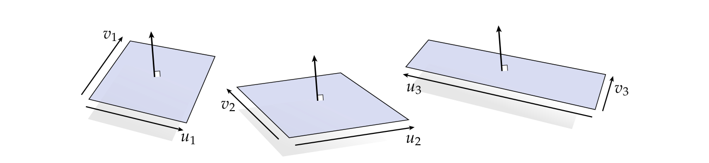
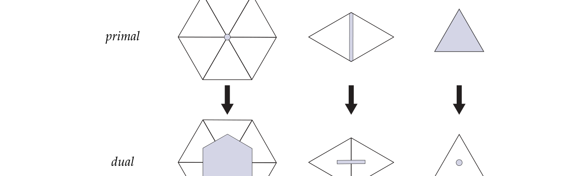

# 第4章 外微分速成

### 来源说明

- 作者：Keenan Crane
- 书名：*Discrete Differential Geometry: An Applied Introduction*（离散微分几何：应用导论）
- 官方来源：https://www.cs.cmu.edu/~kmcrane/Projects/DDG/paper.pdf
- 本笔记仅供个人学习使用。本地 PDF 不是可再分发的授权副本。

阅读范围：PDF 第 47–85 页。书签 Chapter 4 从 PDF 47 起；PDF 47 标题为 Chapter 4 A Quick and Dirty Introduction to Exterior Calculus。下一章 Chapter 5 从 PDF 86 起，本笔记不读 86 及之后。页眉书页约为 46–84。文本层可抽出。习题只留结论，不写可运行代码。

### 本章总览

向量微积分管「小箭头」怎样随空间变化。外代数（exterior algebra）再补上面积和体积：用 \(k\)-向量（\(k\)-vector）表示有大小、有定向的「小体积」。外微分（exterior calculus）再问这些小体积怎样变化，也就是怎样微分 \(k\)-向量。

标量场在这里改叫 \(0\)-形式（\(0\)-form）。名字看起来花哨，好处是 Stokes 定理（Stokes' theorem）能写成一条式子，并且直接通向网格上的离散外微分（discrete exterior calculus, DEC）。

整章路线是：外代数的楔积（wedge product）与 Hodge 星（Hodge star）\(\rightarrow\) 向量与 \(1\)-形式（\(1\)-form）\(\rightarrow\) 微分形式 \(\rightarrow\) 外微分 \(d\) 与 div / grad / curl \(\rightarrow\) 积分与 Stokes \(\rightarrow\) 把形式积到网格单元上得到 DEC。

曲面度量、共形参数化、主曲率方向，第 3 章已经讲过。本章用它们解释体积形式和坐标，不把第 3 章的曲率公式再推一遍。

👉 曲面几何、诱导度量 \(g\)、共形因子，见第 3 章。

### 核心知识点

#### 外代数在讲什么

线性代数处理向量。外代数多出两件事：有限大小，以及定向（orientation）。\(k\)-维线性子空间对应 \(k\)-向量，就像直线对应普通向量。

\(1\)-向量就是普通向量，表示有向长度。\(2\)-向量用 \(u\wedge v\) 表示，可以想成 \(u,v\) 张成的平行四边形。\(3\)-向量 \(u\wedge v\wedge w\) 是平行六面体。字母 \(k\) 是维数。

同一平面里，许多对向量可以张出同一个 \(2\)-向量：只要面积和定向相同。图上三个平行四边形面积相同，因此

\[
u_1\wedge v_1=u_2\wedge v_2=u_3\wedge v_3.
\]

平行四边形只是卡通，不是唯一代表。

定向：\(1\)-向量有正负；\(2\)-向量在 \(\mathbb{R}^3\) 里对应平面法向 \(+N\) 或 \(-N\)，所以 \(u\wedge v=-v\wedge u\)；\(3\)-向量对应体积的「向内 / 向外」。连续对换相邻向量会改定向；偶置换保持定向，奇置换反转。

图注：书 PDF 49。三个平行四边形面积相同、法向一致，因此表示同一个 \(2\)-向量。形状被拉斜不影响 \(u\wedge v\)。

🔑 关键速记：\(k\)-向量是带大小和定向的小体积；平行四边形只是 \(2\)-向量的一种画法。

#### 楔积的四条规则

由「小体积」的几何，得到任意向量空间里楔积的常用规则。对 \(u,v,w\in\mathbb{R}^n\) 和标量 \(a,b\in\mathbb{R}\)：

- 反对称（antisymmetry）：\(u\wedge v=-v\wedge u\)
- 结合（associativity）：\((u\wedge v)\wedge w=u\wedge(v\wedge w)\)
- 对加法分配：\(u\wedge(v+w)=u\wedge v+u\wedge w\)
- 对标量分配：\((au)\wedge(bv)=ab(u\wedge v)\)

由此立刻有 \(u\wedge u=0\)：两条相同边张不出面积。正文先不给更形式的公理定义，强调规则来自几何。

🔑 关键速记：楔积反对称、可结合、可分配；重复向量楔积为零。

#### Hodge 星

子空间可以用自身张成，也可以用正交补（orthogonal complement）指定。Hodge 星 \(\star\) 把 \(\mathbb{R}^n\) 里的 \(k\)-向量送到互补的 \((n-k)\)-向量。

\(\mathbb{R}^3\) 里的 \(2\)-向量 \(u\wedge v\) 对应某个法向 \(1\)-向量 \(\star(u\wedge v)\)。方向用约定钉死：要求 \(\det(u,v,\star(u\wedge v))>0\)，与右手法则一致。对标准正交基下的两个单位正交向量，再要求该行列式为 \(1\)。于是在欧氏 \(\mathbb{R}^3\) 里

\[
\star(u\wedge v)=u\times v.
\]

一般情形：若 \(e_1,\ldots,e_n\) 是标准正交基，\(u_1,\ldots,u_k\) 单位正交，则 \(\star\) 由

\[
(u_1\wedge\cdots\wedge u_k)\wedge\star(u_1\wedge\cdots\wedge u_k)=e_1\wedge\cdots\wedge e_n
\]

唯一确定。单位 \(k\)-体积再楔上互补的单位 \((n-k)\)-体积，应得到 \(\mathbb{R}^n\) 唯一的单位 \(n\)-体积。

\(\mathbb{R}^2\) 里 \(1\)-向量的 Hodge 星仍是 \(1\)-向量，效果是逆时针转四分之一圈。\(\star\) 对加法分配。

图注：书 PDF 53。左图用虚线平面的法向表示正交补；右图把 \(u\wedge v\) 的 Hodge 星画成法向箭头 \(\star(u\wedge v)\)。

🔑 关键速记：\(\star\) 把 \(k\)-体积换成互补的 \((n-k)\)-体积；\(\mathbb{R}^3\) 里 \(\star(u\wedge v)=u\times v\)。

#### \(\mathbb{R}^n\) 里的计算例子

向量写成标准正交基 \(e_1,\ldots,e_n\) 的线性组合。计算时：\(e_i\wedge e_i=0\)；对换一对基会改号。

例 1：\(u=e_1+2e_2\)，\(v=e_1+e_2-e_3\)，展开后

\[
u\wedge v=-e_1\wedge e_2-e_1\wedge e_3-2e_2\wedge e_3.
\]

例 2：对上面的 \(2\)-向量做 Hodge 星，用 \(\star(e_1\wedge e_2)=e_3\) 等右手法则，得到 \(\star w=-2e_1+e_2-e_3\)。更细的基关系见 4.5.1。

例 3：\(u=e_1+e_2+e_3\)，\(v=e_1+2e_2+3e_3\)，\(w=e_1-e_3\)，先算 \(v\wedge w\) 再与 \(u\) 楔，三项抵消，\(u\wedge v\wedge w=0\)。几何上三个 \(1\)-向量线性相关，\(3\)-体积是扁的。

🔑 关键速记：展开、消掉重复基、按定向归到标准单项，是算楔积和 \(\star\) 的基本手续。

#### 向量与 \(1\)-形式

\(1\)-形式 \(\alpha\) 是吃一个向量、吐一个标量的线性函数，也叫余向量（covector）。图上 \(\alpha(v)\) 是 \(v\) 在方向 \(\alpha\) 上的「影子」长度。

平坦空间里 \(1\)-形式看起来很像向量。弯曲空间必须分清：切向量会被嵌入映射 \(f:M\to\mathbb{R}^3\) 拉长。升降指标的音乐同构（musical isomorphism）\(\sharp\)、\(\flat\) 应满足

\[
u^\flat(v)=g(u,v),
\]

其中 \(g\) 是 \(f\) 诱导的度量。这样测的是拉伸后的几何，不是参数域上的假长度。

👉 诱导度量 \(g(u,v)=df(u)\cdot df(v)\) 见第 3 章。度量把参数域上的切向量送到曲面在 \(\mathbb{R}^3\) 里的像，再做欧氏点积。没有 \(g\)，\(\sharp\) 和 \(\flat\) 对不上真正的长度。

坐标：用 \(\partial/\partial x^1,\ldots,\partial/\partial x^n\) 作向量的标准正交基，用 \(dx^1,\ldots,dx^n\) 作对偶的 \(1\)-形式基。此时先把它们当成正交单位基，不必想成导数。对偶关系是

\[
dx^i\Bigl(\frac{\partial}{\partial x^j}\Bigr)=\delta^i_j.
\]

于是 \(\alpha(v)=\sum_i\alpha_i v_i\)，配对看起来像欧氏内积。

记号：向量、向量场多用 \(u,v,w\) 或 \(X,Y,Z\)；\(1\)-形式多用 \(\alpha,\beta,\gamma\)；函数 / \(0\)-形式多用 \(f,g,h\) 或 \(\varphi,\psi\)。向量系数指标在上，\(1\)-形式系数指标在下，以便 Einstein 求和。\(\sharp\) 升高指标，\(\flat\) 降低指标。平坦空间里不必改度量，只是把 \(dx^i\) 换成 \(\partial/\partial x^i\)，或反过来。

🔑 关键速记：\(1\)-形式测量向量；弯曲空间里 \(\flat\) 必须带上度量 \(g\)。

#### 微分形式与楔积

一对向量 \(u,v\) 张成平行四边形。把它投影到 \(\alpha,\beta\) 张成的平面，有向面积是

\[
\alpha\wedge\beta(u,v):=\alpha(u)\beta(v)-\alpha(v)\beta(u).
\]

这就是 \(2\)-形式。反对称推出 \(\alpha\wedge\alpha=0\)：投影到零面积平面。对加法分配。三个 \(1\)-形式的楔积是投影体积的行列式，也等于轮换的混合积，因此结合。

一般地，\(k\) 个 \(1\)-形式的楔积是 \(k\)-形式，测量 \(k\) 个向量的投影体积。对 \(k\)-形式 \(\alpha\)、\(l\)-形式 \(\beta\)、\(m\)-形式 \(\gamma\)：

- 反对称：\(\alpha\wedge\beta=(-1)^{kl}\beta\wedge\alpha\)
- 结合：\(\alpha\wedge(\beta\wedge\gamma)=(\alpha\wedge\beta)\wedge\gamma\)
- 当 \(l=m\) 时分配：\(\alpha\wedge(\beta+\gamma)=\alpha\wedge\beta+\alpha\wedge\gamma\)

\(k\)-形式对自变量也反对称：交换两个输入向量只改号。它还是多重线性的：固定其余向量后，对剩下那一个线性。

向量值形式：\(E\)-值 \(k\)-形式吃 \(k\) 个向量，吐 \(E\) 里一个值。嵌入 \(f:M\to\mathbb{R}^3\) 是 \(\mathbb{R}^3\)-值 \(0\)-形式，微分 \(df\) 是 \(\mathbb{R}^3\)-值 \(1\)-形式。若 \(E\) 没有乘法，两个 \(E\)-值 \(1\)-形式的楔积没有默认定义；\(\mathbb{C}\) 用复数乘法，\(\mathbb{R}^3\) 可选用叉积。

👉 \(f\) 与 \(df\) 作为曲面几何的语言，见第 3 章。\(f\) 记录点的位置，\(df(u)\) 是参数方向 \(u\) 被拉到 \(\mathbb{R}^3\) 后的切向量。

🔑 关键速记：\(k\)-形式测量 \(k\) 个向量的有向投影体积；楔积的符号来自这个体积。

#### Hodge 对偶与形式基

\(n\) 维空间里，\(k\) 维体积既可用 \(k\) 个方向指定，也可用互补的 \(n-k\) 个方向指定。因此 \(k\)-形式与 \((n-k)\)-形式应能一一对应。

\(\mathbb{R}^3\) 的标准基：

- \(0\)-形式基：\(1\)
- \(1\)-形式基：\(dx^1,dx^2,dx^3\)
- \(2\)-形式基：\(dx^2\wedge dx^3,\ dx^3\wedge dx^1,\ dx^1\wedge dx^2\)
- \(3\)-形式基：\(dx^1\wedge dx^2\wedge dx^3\)

个数是 \(1,3,3,1\)。一般是二项式系数 \(\binom{n}{k}\)，并有 \(\binom{n}{k}=\binom{n}{n-k}\)。\(\mathbb{R}^3\) 上没有 \(4\)-形式。

Hodge 星在这组基上的表（书 PDF 67）：

\[
\begin{aligned}
\star 1&=dx^1\wedge dx^2\wedge dx^3,\\
\star dx^1&=dx^2\wedge dx^3,\quad
\star dx^2=dx^3\wedge dx^1,\quad
\star dx^3=dx^1\wedge dx^2,\\
\star(dx^1\wedge dx^2)&=dx^3,\quad
\star(dx^2\wedge dx^3)=dx^1,\quad
\star(dx^3\wedge dx^1)=dx^2,\\
\star(dx^1\wedge dx^2\wedge dx^3)&=1.
\end{aligned}
\]

平坦空间里更一般的写法：\(\star(dx^{i_1}\wedge\cdots\wedge dx^{i_k})=dx^{i_{k+1}}\wedge\cdots\wedge dx^{i_n}\)，其中 \((i_1,\ldots,i_n)\) 是 \((1,\ldots,n)\) 的偶置换。

🔑 关键速记：\(k\)-形式基的个数是 \(\binom{n}{k}\)；\(\star\) 按互补基配对，并靠偶置换定号。

#### 体积形式与形式内积

曲面上不能直接用参数域的 \(dx^1\wedge dx^2\) 当面积。若 \(u,v\in\mathbb{R}^2\) 单位正交，真正的面积是 \(\lvert df(u)\times df(v)\rvert\)。练习 4.1 的结论是它等于 \(\sqrt{\det(g)}\)，其中

\[
\det(g):=g(u,u)g(v,v)-g(u,v)^2,\qquad g(u,v):=df(u)\cdot df(v).
\]

因此曲面面积元是 \(\sqrt{\det(g)}\,dx^1\wedge dx^2\)。一般的体积形式（volume form）是

\[
\omega:=\sqrt{\det(g)}\,dx^1\wedge\cdots\wedge dx^n.
\]

曲面上常取 \(\star 1=\omega\)，把常数函数 \(1\) 对应到「单位体积」。更一般地要求

\[
\alpha\wedge\star\beta=\langle\langle\alpha,\beta\rangle\rangle\omega,
\]

其中 \(\langle\langle\alpha,\beta\rangle\rangle=\sum_i\alpha_i\beta_i\) 是 \(k\)-形式内积。有的文献用这条当楔积的定义；本书强调几何意义在先。平坦 \(\mathbb{R}^3\) 里可用它写出

\[
u\cdot v=\star\bigl(u^\flat\wedge\star v^\flat\bigr),\qquad
u\times v=\bigl(\star(u^\flat\wedge v^\flat)\bigr)^\sharp.
\]

👉 \(\sqrt{\det(g)}\) 与共形参数化。第 3 章把共形映射写成保角，长度只差一个正因子 \(e^u\)。共形时 \(\sqrt{\det(g)}\) 退化成单一尺度函数 \(a\)，积分里只剩「函数值乘尺度再乘参数面积」。完整说法见第 3 章。

🔑 关键速记：体积形式 \(\omega=\sqrt{\det(g)}\,dx^1\wedge\cdots\wedge dx^n\) 才是弯曲空间里的真正体积。

#### 外微分与 grad / curl / div

外代数加上微分、积分，才成为外微分。外微分 \(d\) 记录 \(k\)-形式沿各个方向的变化。第 3 章的 \(df\) 是它的一个例子。

经典算子先用 \(\nabla=(\partial/\partial x^1,\ldots,\partial/\partial x^n)^\top\) 回忆：梯度 \(\nabla\varphi\) 是最陡上升方向；散度 \(\nabla\cdot X\) 量扩张；\(\mathbb{R}^3\) 的旋度 \(\nabla\times X\) 量旋转。书上把「散度很大」和「旋度很大」的场画成互为 \(90^\circ\) 旋转的一对。

\(0\)-形式的外微分就是微分

\[
d\varphi=\frac{\partial\varphi}{\partial x^1}dx^1+\cdots+\frac{\partial\varphi}{\partial x^n}dx^n.
\]

它与梯度只差音乐同构：\(\nabla\varphi=(d\varphi)^\sharp\)。代入向量得到方向导数 \(d\varphi(u)=u\cdot\nabla\varphi\)。

\(d\) 线性。楔积的乘积规则是：若 \(\alpha\) 是 \(k\)-形式，则

\[
d(\alpha\wedge\beta)=d\alpha\wedge\beta+(-1)^k\alpha\wedge d\beta.
\]

几何上仍是「总体积的变化 = 各因子体积的变化」，与普通乘积法则同一张面积图。

\(\mathbb{R}^3\) 上 \(1\)-形式的 \(d\alpha\) 展开后，系数正好是 \(\alpha^\sharp\) 的旋度，只是写成 \(2\)-形式。因此

\[
\nabla\times X=\bigl(\star d X^\flat\bigr)^\sharp.
\]

\(\mathbb{R}^2\) 里 \(\star\) 作用在 \(1\)-形式上是转 \(90^\circ\)，旋度转过去就是散度。\(\mathbb{R}^3\) 验算给出

\[
\nabla\cdot X=\star d\star X^\flat.
\]

汇总：

\[
\nabla\varphi=(d\varphi)^\sharp,\qquad
\nabla\times X=\bigl(\star d X^\flat\bigr)^\sharp,\qquad
\nabla\cdot X=\star d\star X^\flat.
\]

\(\mathbb{R}^3\) 里 grad / curl / div 分别是 \(d\) 作用在 \(0\)-、\(1\)-、\(2\)-形式上。

🔑 关键速记：\(d\) 升一次形式次数；grad、curl、div 是它配上 \(\star,\sharp,\flat\) 的三种样子。

#### 标量拉普拉斯与 \(k\)-形式拉普拉斯

标量拉普拉斯（scalar Laplacian）\(\Delta=\nabla\cdot\nabla\)，也常写成 \(\nabla^2\)。书强调它出现在扩散、波动、Schrödinger 方程里，特征值几乎决定一块几何；离散后用于参数化、平滑、向量场设计、距离、流体等。本章只给外微分写法，应用放到后面。

标量情形 \(\Delta=\star d\star d\)。一般 \(k\)-形式拉普拉斯是

\[
\Delta:=\star d\star d+d\star d\star.
\]

名称 Laplace–Beltrami（Laplace-Beltrami）只表示定义域可以弯曲，弯曲被装进 Hodge 星。也可先定义余微分（codifferential）\(\delta:=\star d\star\)，再写 \(\Delta=\delta d+d\delta\)。

\(0\)-形式没有 \(d\star d\star\) 这一项：\(\star\varphi\) 是 \(n\)-形式，再做 \(d\) 得到 \((n+1)\)-形式，\(n\) 维空间里没有这种对象。所以标量拉普拉斯常只写 \(\star d\star d\)。

👉 余切公式与 Poisson 方程见第 6 章。第 6 章用有限元和 DEC 两条路，把 \(\Delta=\star d\star d\) 做成网格上的余切拉普拉斯，并用来解 \(\Delta\varphi=\rho\)。

🔑 关键速记：标量 \(\Delta=\star d\star d\)；一般 \(k\)-形式还要加上 \(d\star d\star\)。

#### 积分与 Stokes 定理

\(n\) 维区域上的被积对象是 \(n\)-形式：每个小块要代入 \(n\) 个正交方向才能得到体积。平面区域面积 \(A_\Omega=\int_\Omega dx^1\wedge dx^2\)，加权后是 \(\int_\Omega\varphi\,dx^1\wedge dx^2\)。

曲面上必须乘体积形式：

\[
\int_\Omega\varphi\,\omega=\int_\Omega\varphi\sqrt{\det(g)}\,dx^1\wedge dx^2.
\]

共形参数化时 \(\sqrt{\det(g)}=a\)，积分变成 \(\int_\Omega\varphi a\,dx^1\wedge dx^2\)。

Stokes 定理：\(\alpha\) 是 \(n\) 维区域 \(\Omega\) 上的 \((n-1)\)-形式时，

\[
\int_\Omega d\alpha=\int_{\partial\Omega}\alpha.
\]

边界上积分形式，等于内部积分它的外微分。散度定理、Green 定理、微积分基本定理、Cauchy 积分公式都是它的特例。

散度定理 \(\int_\Omega\nabla\cdot X\,dA=\int_{\partial\Omega}n\cdot X\,d\ell\) 写成

\[
\int_\Omega d\star X^\flat=\int_{\partial\Omega}\star X^\flat.
\]

左端用 \(d\star X^\flat\) 而不是 \(\star d\star X^\flat\)，因为后者是 \(0\)-形式，还要再乘面积元。几何上：任意小区域上积分散度，得到的是边界通量。离散时「单点散度」不再单独出现。

练习 4.2 的结论：Stokes 也推出平面 Green 定理 \(\int_\Omega\nabla\times X\,dA=\int_{\partial\Omega}t\cdot X\,d\ell\)。

一维区间 \([a,b]\) 上，Stokes 就是 \(\int_a^b\partial\varphi/\partial x\,dx=\varphi(b)-\varphi(a)\)。

图注：Stokes 把「内部的 \(d\)」换成「边界上的积分」。DEC 不再对点抽样，而是把这条等式当成离散外微分的定义。

🔑 关键速记：\(\int_\Omega d\alpha=\int_{\partial\Omega}\alpha\)；离散微分靠的就是这一条。

#### 离散外微分

机器存不下每一点的箭头。DEC 的做法是：把连续形式在网格单元上积分，只保留有限个数。书说它「就是普通外微分，只是先积分再存储」。

离散 \(1\)-形式：在每条边 \(e\) 上存 \(\hat\alpha_e=\int_e\alpha\)。它量的是 \(\alpha\) 沿边的平均「流过」强度，对边的正交方向没有直接信息，指望附近不平行的边补上。一般地，在每个 \(k\) 维胞腔上积分过的 \(k\)-形式叫离散微分 \(k\)-形式。也可以不从连续形式来，直接给每条边任意赋值。

定向必须记下。从 \(a\) 到 \(b\) 的积分与反向差一个负号。边可写成有序对 \((i,j)\)。一般有向 \(k\)-单形是有序顶点 \((p_1,\ldots,p_{k+1})\)，几何是这些点的凸组合。\(0,1,2,3\)-单形分别是顶点、边、三角形、四面体。顶点的偶置换定向相同，奇置换相反。面的定向与高维单形一致，当且仅当公共顶点上看到偶置换。

在有向 \(k\)-单形上积分：取有序边向量 \((p_2-p_1,\ldots,p_{k+1}-p_1)\)，正交规范化后代入 \(k\)-形式，再对采样点求和，乘体积 \(\lvert\sigma\rvert\)。定向改号。实践中离散形式多半直接来自已离散的数据，例如顶点坐标。

离散 \(0\)-形式：函数在顶点上的积分，约定就是点值 \(\hat\varphi_i=\varphi(v_i)\)。单个顶点的恒等置换是偶置换，\(0\)-单形定向恒正。形式不必是实值：顶点坐标是 \(\mathbb{R}^3\)-值离散 \(0\)-形式，\(df\) 是 \(\mathbb{R}^3\)-值 \(1\)-形式。

离散外微分用 Stokes：三角形 \(\sigma\) 上 \(\int_\sigma d\alpha=\sum_{i=1}^3\hat\alpha_i\)。左边正是离散 \(2\)-形式 \(\widehat{d\alpha}\)。一般地，\(\hat d\) 把已在 \(k\)-单形上积分的 \(k\)-形式，变成在每个 \(k+1\)-单形上按边界求和后的积分。相邻三角形定向不一致时要改号，书上的例子是 \((\hat d\hat\alpha)_1=\hat\alpha_1+\hat\alpha_2+\hat\alpha_3\)，\((\hat d\hat\alpha)_2=\hat\alpha_4+\hat\alpha_5-\hat\alpha_2\)。

图注：书 PDF 83。上排是 primal（原始）顶点、边、面；下排是 dual（对偶）面、边、顶点。对偶胞腔不必是单形。正交对偶要求原、对偶元素落在正交线性子空间里。

离散 \(k\)-形式只沿 \(k\) 个方向采样。要对偶，需要对偶网格：\(n\) 维单纯网格里，每个 primal \(k\)-单形对应唯一的 dual \((n-k)\)-胞腔。平面三角网格上，primal 顶点 \(\leftrightarrow\) dual 面，primal 边 \(\leftrightarrow\) dual 边，primal 面 \(\leftrightarrow\) dual 顶点。曲面则要求内在正交：把相邻三角形展平后，原边与对偶边仍正交。

对角 Hodge 星（diagonal Hodge star）：

\[
\hat\star\hat\alpha_i=\frac{\lvert\sigma_i^\star\rvert}{\lvert\sigma_i\rvert}\hat\alpha_i.
\]

顶点体积按约定取 \(1\)。它把密度对齐：同一连续形式积在不同大小的原、对偶胞腔上，要用体积比换算。对偶到原始的星是原始到对偶的逆。primal \(1\)-形式常表示环量（circulation），dual \(1\)-形式常表示通量（flux），不能直接相加。

楔积、Lie 导数 \(L_X\)、内积 \(i_\alpha\) 在离散里也可以定义，本章不展开；完整且互相兼容的离散演算仍是研究课题。

👉 单纯复形、定向与半边，见第 2 章。第 2 章先把网格写成抽象单形和邻接，本章把连续 \(k\)-形式积到这些单形上。没有一致的定向，离散 \(d\) 的符号会对不上。

🔑 关键速记：离散形式 = 积在有向单元上的数；离散 \(d\) 就是 Stokes；离散 \(\star\) 是原、对偶体积比。

### 章末 3–5 条

- 外代数给小体积，外微分给这些体积的变化；Stokes 把内部的 \(d\) 换成边界积分。
- \(\mathbb{R}^3\) 里 grad / curl / div 是 \(d\) 作用在 \(0\)- / \(1\)- / \(2\)-形式上，再配 \(\star\) 与音乐同构。
- 标量拉普拉斯 \(\Delta=\star d\star d\)；弯曲被装进 Hodge 星。
- DEC 不存点上的箭头，而存单元上的积分；定向和质量比分别负责 \(d\) 和 \(\star\)。
- 楔积、Lie 导数、内积的完整离散配套，本章明确没有写完。

### 易混淆点与差异对比

\(k\)-向量与 \(k\)-形式不是同一套对象。前者是「小体积」，后者是「拿体积来测量」。楔积符号两边都用，一边在向量上，一边在形式上。

\(\partial/\partial x^i\) 与 \(dx^i\) 在 4.3 节先当正交单位基，到 4.6 节 \(\partial\varphi/\partial x^i\) 才真是偏导。不要一见到 \(d\) 就当成外微分。

\(\mathbb{R}^3\) 里 \(\star(u\wedge v)=u\times v\) 只是特例。一般维数没有叉积，旋度要改用 \(d\)。

连续 \(\star\) 把 \(k\)-形式送到同空间的 \((n-k)\)-形式。离散 \(\star\) 把 primal \(k\)-形式送到 dual \((n-k)\)-形式，两边住在不同网格上，不能相加。

积分用的是体积形式 \(\omega\)，不是参数域的 \(dx^1\wedge\cdots\wedge dx^n\)。漏掉 \(\sqrt{\det(g)}\) 就是在参数平面上算面积。

书把「离散」解释成「已经积分」。点采样的 \(0\)-形式恰好与积分重合；高次形式不是点采样。

### 本章要点总结

外代数用楔积拼有向小体积，用 Hodge 星取补。微分形式测量这些体积；外微分 \(d\) 升次数，并在 \(\mathbb{R}^3\) 里回收 grad / curl / div。积分对象是 \(n\)-形式，弯曲空间要乘 \(\omega=\sqrt{\det(g)}\,dx^1\wedge\cdots\wedge dx^n\)。Stokes 定理 \(\int_\Omega d\alpha=\int_{\partial\Omega}\alpha\) 把内部微分变成边界测量，也是 DEC 的定义：离散 \(k\)-形式存在有向 \(k\)-单元上，离散 \(d\) 沿边界带符号求和，对角 \(\star\) 用原、对偶体积比换密度。标量拉普拉斯写成 \(\star d\star d\)，网格上的余切公式要到第 6 章才展开。楔积与 Lie 导数的完整离散版本，本章没有给出。
