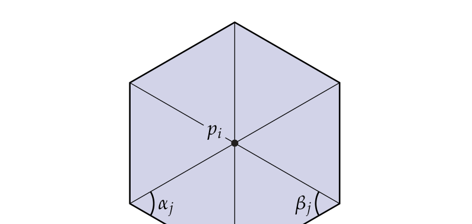

# 第5章 离散曲面曲率

### 来源说明

- 作者：Keenan Crane
- 书名：*Discrete Differential Geometry: An Applied Introduction*（离散微分几何：应用导论）
- 官方来源：https://www.cs.cmu.edu/~kmcrane/Projects/DDG/paper.pdf
- 本笔记仅供个人学习使用。本地 PDF 不是可再分发的授权副本。

阅读范围：PDF 第 86–101 页。书签 Chapter 5 从 PDF 86 起；PDF 86 标题为 Chapter 5 Curvature of Discrete Surfaces。下一章 Chapter 6 从 PDF 102 起，本笔记不读 102 及之后。页眉书页约为 85–100。文本层可抽出。习题只留结论。CODING 10–15 只记要验证的量，不写实现。

### 本章总览

光滑曲面的法向是「与所有切向量正交的那个方向」。离散曲面没有这么干净：面若共面，法向就是该平面的法向；多边形不共面，或问的是顶点法向，定义就不唯一。

本章先准备向量面积（vector area）和面积梯度，再给出两条从光滑图景自然下来的顶点法向：面积梯度与体积梯度。它们与平均曲率向量（mean curvature vector）$HN$ 在余切公式（cotan formula）上会合。随后列出几种没有光滑来源的常用加权，再用角度亏量（angle defect）写出离散 Gauss–Bonnet（Gauss-Bonnet）定理，最后用数值实验对照总曲率与逐点估计。

光滑的平均曲率、Gauss 曲率、共形坐标，第 3 章已经有定义。Euler 示性数 $\chi$ 第 2 章已经用作拓扑不变量。本章只把它们接到网格顶点上。

👉 主曲率、平均曲率 $H$、Gauss 曲率 $K$ 见第 3 章。$H$ 是两主曲率的算术平均，$K$ 是乘积；极小曲面是 $H=0$ 的曲面。本章用 $\Delta f=2HN$ 把 $H$ 和顶点法向绑在一起。

### 核心知识点

#### 多边形面积与有向面积

平面多边形顶点 $p_1,\ldots,p_n$。任取一点 $q$，把多边形拆成三角形 $q,p_i,p_{i+1}$。即使用有向面积，总和仍是多边形面积：多出来的正三角形会被负三角形抵消。

Stokes 给出另一条路。面积 $A=\int_P dx\wedge dy$，而 $dx\wedge dy=d(x\wedge dy)=-d(y\wedge dx)$，于是

$$
A=\frac12\int_{\partial P}x\wedge dy-y\wedge dx.
$$

沿每条边坐标线性、微分常数，边界积分化成

$$
A=\frac12\sum_i p_i\times p_j.
$$

练习 5.1 的结论：任意 $q$ 的有向三角形面积之和，正好等于上式。

🔑 关键速记：平面多边形面积只依赖边界；内部辅助点 $q$ 可以随便放，只要用有向面积。

#### 向量面积

曲面片 $f:M\to\mathbb{R}^3$ 的向量面积是法向的积分

$$
N_V:=\int_M N\,dA.
$$

它只依赖边界 $\partial M$。外形差得很远的两张曲面可以有相同的 $N_V$；物理直观是穿过边界曲线的总通量。平坦区域上 $N$ 为常值，$N_V$ 就是普通面积乘单位法向。圆环带上相对法向抵消，$N_V=0$。

练习 5.2 的结论：Stokes 给出

$$
N_V=\frac12\int_{\partial M}f\wedge df,
$$

$\mathbb{R}^3$ 里向量乘法取叉积。

🔑 关键速记：向量面积是法向的积分，完全由边界决定。

#### 面积梯度与顶点法向

三角形里拉动一个顶点 $p$，面积 $A$ 增加最快的方向是面积梯度。练习 5.3 的结论：

$$
\nabla_p A_\sigma=\frac12 u^\perp,
$$

其中 $u^\perp$ 是 $p$ 对边在三角形平面内旋转 $\pi/2$、并指向 $p$ 的向量。

整张曲面的面积梯度是各三角形之和。顶点 $p$ 只影响相邻三角形，所以只需在这个一环上求和。切向滑动不改变面积，真正增加面积的是沿法向推。因此用 $\nabla_p A$ 定义顶点法向。

练习 5.4 的结论是余切公式：

$$
\nabla_{p_i}A=\frac12\sum_j(\cot\alpha_j+\cot\beta_j)(p_j-p_i),
$$

$p_j$ 是 $p_i$ 的邻点，$\alpha_j,\beta_j$ 是边 $(p_i,p_j)$ 对面的两个角。

图注：书 PDF 90。中心顶点 $p_i$，邻点 $p_j$，$\alpha_j$ 与 $\beta_j$ 是对边两侧的角。面积梯度把这两只余切加起来，再乘边向量 $p_j-p_i$。

🔑 关键速记：面积梯度给出一种顶点法向；一环上的表达式就是余切公式。

#### 平均曲率向量与 Laplace–Beltrami

同一条余切公式也从平均曲率向量出来。光滑曲面满足

$$
\Delta f=2HN,
$$

$\Delta$ 是 Laplace–Beltrami 算子（Laplace-Beltrami operator）。把离散拉普拉斯作用在顶点坐标上再单位化，得到另一种顶点法向。最直接的离散 $\Delta$ 又回到余切公式，因此平均曲率法向与面积梯度法向是同一个向量。

坐标写法 $\Delta\varphi=\frac1{\sqrt{\lvert g\rvert}}\partial_{x^i}(\sqrt{\lvert g\rvert}\,g^{ij}\partial_{x^j}\varphi)$ 在三角网格上几乎不能用，因为没有 $g$ 的坐标表示。第 4 章已有 $\Delta=\star d\star d$。本章再用共形参数化：共形映射把长度乘上正因子 $e^u$，即 $\lvert df(X)\rvert=e^u\lvert X\rvert$。共形坐标总是存在的。此时

$$
\Delta\varphi=\frac{d(d\varphi(X))(X)+d(d\varphi(Y))(Y)}{e^{2u}},
$$

$X,Y$ 是任意单位正交方向，也就是平面拉普拉斯再除以度量尺度 $e^{2u}$。二阶导数描述凹凸，求和后对着平均曲率并不意外。练习 5.5 要求证明 $\Delta f=2HN$。

👉 Laplace–Beltrami 的外微分写法见第 4 章。标量情形 $\Delta=\star d\star d$，弯曲进 Hodge 星。本章只用 $\Delta f=2HN$ 和共形坐标下的二阶导数图像；网格矩阵见第 6 章。

👉 共形参数化见第 3 章。共形映射保角，长度只差正因子；单值化定理保证圆盘状邻域里总有共形坐标。本章用它把 $\Delta$ 写成平面拉普拉斯除以 $e^{2u}$。

🔑 关键速记：$\Delta f=2HN$；离散后面积梯度与平均曲率向量共用余切公式。

#### 体积梯度

若曲面围出体积 $V$，切向滑动仍不改变区域，最快增大 $V$ 的方向还是法向。离散时体积梯度给出的顶点法向，与面积梯度不同。

把封闭区域拆成四面体：每个四面体用一个网格面加上辅助点 $q$。与多边形一样，$q$ 的位置只要用有向体积就可以任意。单四面体体积 $V=\frac13 Ah$，几何上

$$
\nabla_p V=\frac13 AN,
$$

$N$ 是底面单位法向。对含 $p$ 的四面体求和，

$$
\nabla_p V=\frac13\sum_i A_i N_i.
$$

把 $q$ 放到 $p$ 上，$A_i,N_i$ 就变成原网格里含 $p$ 的面的面积与法向。练习 5.6 的结论：体积梯度与向量面积 $N_V$ 只差一个常数因子，方向相同。

🔑 关键速记：体积梯度是含该顶点的面面积法向之和；方向与向量面积一致，但与面积梯度不是同一条定义。

#### 没有光滑来源的几种顶点法向

离散微分几何希望光滑关系在离散里原样留下，例如 $\Delta f=2HN$ 不论对象光滑还是离散都应成立。下面几种常见定义目前没有已知的光滑来源。

均匀加权：$N_U:=\sum_i N_i$，把邻面法向直接相加。同一几何的不同剖分可以给出差得很远的顶点法向。

顶角色加权：$N_\theta:=\sum_i\theta_i N_i$，$\theta_i$ 是该顶点处的内角。对剖分的依赖比均匀加权小。

内接于球面的多面体：单位球面 $S^2$ 上点 $x$ 的单位法向就是 $x$ 自己。顶点都在球面上时，用顶点位置做法向是合理的。这个方向可以写成只依赖邻边向量 $e_j=p_j-p_i$ 的式子

$$
N_S=\frac1c\sum_{j=0}^{n-1}\frac{e_j\times e_{j+1}}{\lvert e_j\rvert^2\lvert e_{j+1}\rvert^2},
$$

常数 $c$ 只影响长度，可忽略。推导见 Max, “Weights for Computing Vertex Normals from Facet Normals.” 式子只含边向量，因此任意网格都能评，不要求内接于球。

CODING 10 要求实现 $N_U$、按面面积加权的 $N_V$、$N_\theta$、平均曲率法向 $\Delta f$、$N_S$、用顶角色亏量得到的 Gauss 曲率 $K$、总 Gauss 曲率、以及 Euler 示性数。用这些量检查离散 Gauss–Bonnet，并观察平均曲率法向的行为。

🔑 关键速记：$N_U$ 对剖分敏感；$N_\theta$ 用顶角色减敏感；$N_S$ 来自球面，但公式可在任意网格上算。

#### 球面三角形、角度亏量与离散 Gauss–Bonnet

练习 5.7：单位球上内角 $\alpha_1,\alpha_2,\alpha_3$ 的球面三角形面积是 $A=\alpha_1+\alpha_2+\alpha_3-\pi$。提示用三块二角形（diangle）。

练习 5.8：连续内角 $\beta_1,\ldots,\beta_n$ 的球面多边形面积是

$$
A=(2-n)\pi+\sum_{i=1}^n\beta_i.
$$

离散平面曲线在顶点处的曲率，是相邻单位法向在单位圆上的距离。离散曲面在顶点 $v$ 的离散 Gauss 曲率，取成单位球上、由邻面单位法向围出的球面多边形面积。练习 5.9 的结论：这块面积等于角度亏量

$$
d(v)=2\pi-\sum_{f\in F_v}\angle_f(v),
$$

$F_v$ 是含 $v$ 的面，$\angle_f(v)$ 是该面在 $v$ 处的内角。

图注：书 PDF 97。左：顶点 $v$ 周围的面法向 $N_1,\ldots,N_5$。右：这些单位法向在 $S^2$ 上围成球面多边形。其面积等于 $2\pi$ 减去一环内角和。

练习 5.10：有限、连通、可定向的单纯曲面 $K$ 上，

$$
\sum_{v\in V}d(v)=2\pi\chi,\qquad\chi=\lvert V\rvert-\lvert E\rvert+\lvert F\rvert.
$$

这与光滑 Gauss–Bonnet 对齐：$\int_M K\,dA=2\pi\chi$。

👉 Euler 示性数见第 2 章。$\chi=V-E+F$ 是拓扑不变量，与剖分无关；亏格 $g$ 固定时有 Euler–L’Huilier 公式。本章把 $\chi$ 接到总角度亏量上，得到离散 Gauss–Bonnet。

角度亏量描述的是顶点邻域里的总 Gauss 曲率。邻域边界可由相邻三角形中点连成。若要看曲率本身，须再除以顶点邻域面积。CODING 13 把顶点面积取成入射三角形面积之和的三分之一。

🔑 关键速记：$d(v)=2\pi-\sum\angle_f(v)$，全部顶点加起来等于 $2\pi\chi$。

#### 数值试验与收敛

5.6 节用实现核对：总角度亏量是否等于 $2\pi\chi$；再把角度亏量与局部二次插值得到的逐点 $K$ 比较。

总曲率：对数据目录里每张网格，窗口应显示总角度亏量和 Euler 示性数；不对就标红。环面为什么会得到略偏离零的值，书当作思考题，没有在正文给出数值。按 `d` 键变形后，总角度亏量应保持不变。可视化里红为正曲率，蓝为负曲率，黑为无曲率。

逐点估计：对中心三角形及其三个邻点，共六个顶点，在中心三角形平面上拟合高度函数

$$
h(x,y)=ax^2+by^2+cxy+dx+ey+f.
$$

对系数线性，解 $6\times6$ 系统。然后在重心用

$$
K=\frac{h_{x,x}h_{y,y}-h_{x,y}^2}{(1+h_x^2+h_y^2)^2}
$$

估值。书问读者能否自己推这条公式，正文不当作已证结论。

收敛比较在单位球上进行，真值 $K=1$。网格序列分不规则（irregular）与半规则（semiregular，反复细分）。误差用 $L^2$（平均误差）、$L^\infty$（最坏误差），以及总曲率误差（各数值之和与 Gauss–Bonnet 预言值之差的绝对值）。自变量是平均边长，图用双对数坐标。CODING 15 要求读者自己画图并解释斜率，正文没有给出斜率数字，也没有给出「哪一种一定收敛」的现成结论。

【信息缺口，需要局部查阅文档】书只布置了画误差图、观察误差出现位置、噪声行为、计算代价，没有在 PDF 101 及之前印出实验数据。

🔑 关键速记：总角度亏量应对齐 $2\pi\chi$；逐点 $K$ 可用亏量除面积，也可用六点二次高度拟合，收敛要以图为准，书未给数。

### 章末 3–5 条

- 多边形面积和向量面积都只依赖边界；辅助点用有向量就可以任意放。
- 面积梯度与 $\Delta f=2HN$ 共用余切公式；体积梯度与向量面积同向，但是另一条法向。
- $N_U$、$N_\theta$、$N_S$ 是常用定义，书标明没有已知光滑来源。
- 角度亏量 $d(v)=2\pi-\sum\angle_f(v)$，总和为 $2\pi\chi$。
- 看点态 Gauss 曲率要除邻域面积；二次拟合是另一条估计，数值结论书没印。

### 易混淆点与差异对比

面积梯度法向、体积梯度 / 向量面积法向、均匀加权、顶角色加权、球面内接公式、平均曲率向量，名字都叫「顶点法向」，来源不同。前两条从光滑变分下来；后几条书明确说不一定有光滑对应。CODING 10 里的 $N_V$ 按面面积加权，与 5.1 节积分定义的向量面积 $N_V$ 同名，不要混成一个对象。

余切公式在本章是面积梯度，在第 6 章是拉普拉斯矩阵。同一条 $\frac12(\cot\alpha+\cot\beta)$，一次作用在坐标上得到 $2HN$，一次作用在标量上得到 $\Delta u$。

角度亏量是邻域里的总 Gauss 曲率，不是点态密度。可视化必须除面积。环面总亏量「略不是零」，书提示去想，没有在这几页给出解释。

$\Delta f=2HN$ 里的 $\Delta$ 是作用在嵌入坐标上的向量值拉普拉斯。第 4 章的标量 $\Delta=\star d\star d$ 是同一套算子作用在 $0$-形式上。第 6 章才把矩阵写出来。

光滑 Gauss–Bonnet 积的是 $K\,dA$；离散把积分换成 $\sum d(v)$。不要把 $d(v)$ 直接叫做 $K(v)$。

### 本章要点总结

离散法向没有唯一答案。从光滑变分留下的是面积梯度和体积梯度：前者在一环上变成余切公式，并与 $\Delta f=2HN$ 重合；后者与向量面积同向。均匀加权、顶角色、球面公式是另外的实用定义。离散 Gauss 曲率用角度亏量 $d(v)=2\pi-\sum\angle_f(v)$ 表示，全部顶点相加得到 $2\pi\chi$，与光滑 $\int K\,dA=2\pi\chi$ 对齐。点态比较要除邻域面积，或改用六点二次高度拟合；收敛实验的具体斜率，这几页没有给出。
