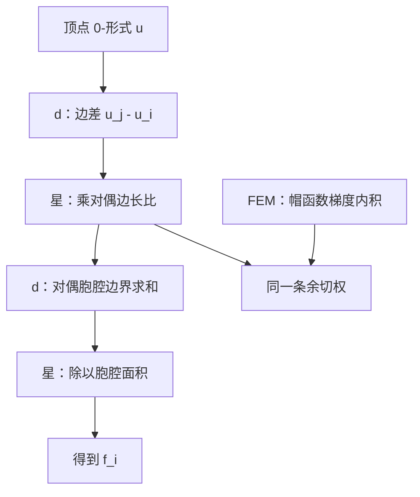
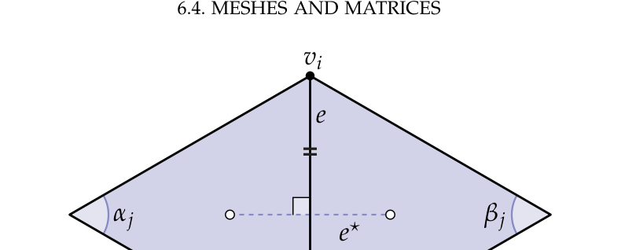

# 第6章 拉普拉斯

### 来源说明

- 作者：Keenan Crane
- 书名：*Discrete Differential Geometry: An Applied Introduction*（离散微分几何：应用导论）
- 官方来源：https://www.cs.cmu.edu/~kmcrane/Projects/DDG/paper.pdf
- 本笔记仅供个人学习使用。本地 PDF 不是可再分发的授权副本。

阅读范围：PDF 第 102–121 页。书签 Chapter 6 从 PDF 102 起；PDF 102 标题为 Chapter 6 The Laplacian。下一章 Chapter 7 Surface Parameterization 从 PDF 122 起，本笔记不读 122 及之后。页眉书页约为 101–120。文本层可抽出。习题只留结论。CODING 16–22 只记要组装的量，不写实现。

### 本章总览

第 4 章把标量拉普拉斯写成 \(\Delta=\star d\star d\)。第 5 章已经看见余切公式同时出现在面积梯度和 \(\Delta f=2HN\) 里。本章把这套算子做成三角网格上的矩阵，用来解 Poisson 方程（Poisson equation）\(\Delta\varphi=\rho\)，并做隐式平均曲率流（implicit mean curvature flow）。

离散有两条路：有限元 / Galerkin 投影（finite element method, FEM），以及离散外微分（DEC）。两条路得到同一条余切公式。随后是矩阵装配、把顶点面积放到右端、Dirichlet / Neumann 边界。

无边界紧曲面上，调和函数只有常数，常数不在 \(\Delta\) 的值域里。有边界时，解由边界条件决定。

### 核心知识点

#### 基本性质

标准 Poisson 问题是 \(\Delta\varphi=\rho\)。物理上 \(\rho\) 可以是质量密度或电荷密度，\(\varphi\) 是对应的引力或电势。几何处理里，平滑、带奇点的向量场、测地距离等都可以化成 Poisson。本章常在无边界紧曲面 \(M\) 上讨论。

练习 6.1 的结论：无边界、连通、紧区域上，二次可微的调和函数（harmonic function，即 \(\Delta\varphi=0\)）只有常数。因此若 \(\varphi\) 是一组解，\(\varphi+c\) 也是：\(\Delta c=0\)。

练习 6.2 的结论：同一类区域上，常数不在 \(\Delta\) 的像里，不存在 \(\varphi\) 使 \(\Delta\varphi=c\)。\(\rho\) 若含常数分量，问题不适定。有时可以改解 \(\Delta\varphi=\rho-\bar\rho\)，其中 \(\bar\rho=\int_M\rho\,dV/\lvert M\rvert\)。是否允许，要看具体问题。

\(L^2\) 内积 \(\langle f,g\rangle=\int_\Omega f(x)g(x)\,dx\) 量两个函数有多对齐。向量场同样有 \(\langle X,Y\rangle=\int_\Omega X\cdot Y\,dx\)。Green 第一恒等式是

\[
\langle\Delta f,g\rangle=-\langle\nabla f,\nabla g\rangle+\langle N\cdot\nabla f,g\rangle_{\partial}.
\]

练习 6.3 的提示：对 \((n-1)\)-形式 \(g\star df\) 用 Stokes。

6.1 节先把 \(\Delta\) 写成正半定：\(\langle\Delta\varphi,\varphi\rangle\ge0\)。正定二次型像碗，半定像半圆柱，不定像鞍面；数值上半定算子容易找最小值。练习 6.4 又要求用 Green 恒等式证明：无边界紧曲面上 \(\Delta\) 负半定，并问负半定在实用上为何与正半定一样好。

这两处符号约定不一致。按书中写出的 Green 公式，无边界时 \(\langle\Delta\varphi,\varphi\rangle=-\langle\nabla\varphi,\nabla\varphi\rangle\le0\)，应是负半定。后文 FEM 把 \(\langle\Delta u,\varphi_j\rangle\) 写成 \(\sum\langle\nabla u,\nabla\varphi_j\rangle\)，没有带上 Green 的负号；余切公式则写成 \((\Delta u)_i=\frac12\sum(\cot\alpha_j+\cot\beta_j)(u_j-u_i)\)。笔记按原书分别记录，不改写成同一套符号。

🔑 关键速记：无边界紧曲面上调和函数只有常数，常数不在 \(\Delta\) 的像里；半定性保证 Poisson 好求。

#### 对照 Gallier 第 18 章的图拉普拉斯

图拉普拉斯和本书的离散拉普拉斯都是顶点函数上的邻点差分。Gallier 第 18 章把未归一化算子写成 \(L=D-W\)，\(d_i=\sum_j w_{ij}\)，作用是 \((Lx)_i=\sum_j w_{ij}(x_i-x_j)\)。二次型 \(x^\top Lx=\frac12\sum_{i,j}w_{ij}(x_i-x_j)^2\)，权重非负时半正定，行和为零。本书第 6 章从网格外微分 \(\star d\star d\) 和分片线性有限元出发，权重变成余切 \(w_{ij}=\frac12(\cot\alpha_j+\cot\beta_j)\)，也等于对偶边长比 \(\lvert e_{ij}^\star\rvert/\lvert e_{ij}\rvert\)。公式写成 \((\Delta u)_i=\frac12\sum_j(\cot\alpha_j+\cot\beta_j)(u_j-u_i)\)，与 \(L=D-W\) 同属一类差分算子，但权从几何来，并且 \((u_j-u_i)\) 与图论常见的 \((x_i-x_j)\) 差一个整体符号。

👉 度矩阵、权重矩阵、\(L=D-W\) 与二次型见 Gallier 第 18 章。📝待补全

🔑 关键速记：两边都是 \(D-W\) 一类的邻点差分；本书的权是余切 / 对偶边长比，不是任意图边权。

#### 有限元离散

真实解 \(u\) 落在无穷维函数空间里。FEM 在有限组基 \(\{\varphi_i\}\) 里找 \(\tilde u=\sum_i x_i\varphi_i\)，使 \(\lVert\tilde u-u\rVert\) 在某个范数下尽量小。

有限维类比：平面由 \(e_1,e_2\) 张成时，最佳逼近让误差与两个基都正交。Poisson 不知道真解 \(u\)，改让残差 \(\Delta\tilde u-f\) 与每个基 \(\varphi_j\) 正交：

\[
\langle\Delta\tilde u-f,\varphi_j\rangle=0.
\]

三角网格上最自然的基是分片线性帽函数（hat function）\(\varphi_i\)：在自身顶点为 \(1\)，在其余顶点为 \(0\)。\(\varphi_i\) 线性，\(\Delta\) 是二阶导数，不能直接往 \(\Delta u\) 上代。靠 Green 恒等式，把积分拆到三角形 \(\sigma_k\) 上。无边界时，相邻三角形在公共边上的法向相反，边界积分抵消，剩下 \(\langle\nabla u,\nabla\varphi_j\rangle\)。再把 \(u=\sum_i x_i\varphi_i\) 代入，得到刚度矩阵（stiffness matrix）

\[
A_{ij}:=\langle\nabla\varphi_i,\nabla\varphi_j\rangle,
\]

右端 \(b_i=\langle f,\varphi_i\rangle\)，求解 \(Ax=b\)。

练习 6.5：三角形底边的纵横比 \(w/h=\cot\alpha+\cot\beta\)。

练习 6.6：对面顶点的帽函数在三角形内部 \(\nabla\varphi=e^\perp/(2A)\)，\(e^\perp\) 是底边逆时针转四分之一圈，\(A\) 是面积。

练习 6.7：同一顶点的帽函数 \(\langle\nabla\varphi,\nabla\varphi\rangle=\frac12(\cot\alpha+\cot\beta)\)。

练习 6.8：同一三角形里两个顶点 \(i,j\)，\(\langle\nabla\varphi_i,\nabla\varphi_j\rangle=-\frac12\cot\theta\)，\(\theta\) 是对边夹角。

合起来，顶点 \(i\) 处

\[
(\Delta u)_i=\frac12\sum_j(\cot\alpha_j+\cot\beta_j)(u_j-u_i).
\]

这就是余切公式。

🔑 关键速记：Galerkin 条件是残差对每个帽函数正交；刚度矩阵的元素是 \(\langle\nabla\varphi_i,\nabla\varphi_j\rangle\)，算出余切权。

#### DEC 离散

同一方程写成 \(\star d\star du=f\)。逐步积分：

1. \(0\)-形式 \(u\) 存在顶点上，值为 \(u_i\)。
2. 离散外微分沿边积分：\((du)_{ij}=\int_{e_{ij}}du=u_j-u_i\)。
3. Hodge 星把原边环量换成对偶边通量：先除以原边长得平均，再乘对偶边长，

\[
(\star du)_{ij}=\frac{\lvert e_{ij}^\star\rvert}{\lvert e_{ij}\rvert}(u_j-u_i).
\]

4. 再对外对偶胞腔 \(C_i\) 积分：\((d\star du)_i=\sum_j\frac{\lvert e_{ij}^\star\rvert}{\lvert e_{ij}\rvert}(u_j-u_i)\)。
5. 最后的 \(\star\) 除以 \(\lvert C_i\rvert\)，得到

\[
(\star d\star du)_i=\frac1{\lvert C_i\rvert}\sum_j\frac{\lvert e_{ij}^\star\rvert}{\lvert e_{ij}\rvert}(u_j-u_i)=f_i.
\]

实践中常把 \(\lvert C_i\rvert\) 移到右端，得到对称系统

\[
(d\star du)_i=\sum_j\frac{\lvert e_{ij}^\star\rvert}{\lvert e_{ij}\rvert}(u_j-u_i)=\lvert C_i\rvert f_i,
\]

相当于离散 \(d\star du=\star f\)。\(d\star d\) 在曲面上有时叫共形拉普拉斯（conformal Laplacian）：共形变换不改变它。也可以把它看成积在每个对偶胞腔上的拉普拉斯，而不是点态值。

练习 6.9：对偶顶点放在外心（circumcenter）时，对偶边 \(e^\star\) 正交平分原边，并且

\[
\frac{\lvert e_{ij}^\star\rvert}{\lvert e_{ij}\rvert}=\frac12(\cot\alpha_j+\cot\beta_j).
\]

因此 DEC 与 Galerkin 得到同一个余切拉普拉斯。

图注：DEC 按 \(\star d\star d\) 逐步积分；FEM 用 \(\langle\nabla\varphi_i,\nabla\varphi_j\rangle\)。外心对偶下，对偶边长比等于 \(\frac12(\cot\alpha+\cot\beta)\)，两条路会合。

图注：书 PDF 112。原边 \(e\) 连接 \(v_i,v_j\)；对偶边 \(e^\star\) 连接两个外心，与 \(e\) 正交。两侧角是 \(\alpha_j,\beta_j\)。\(\lvert e^\star\rvert/\lvert e\rvert=\frac12(\cot\alpha_j+\cot\beta_j)\)。

👉 离散 \(d\) 与对角 Hodge 星见第 4 章。离散 \(k\)-形式是积在有向 \(k\)-单元上的数；\(\hat d\) 用 Stokes 沿边界求和；对角 \(\star\) 用原、对偶体积比。本章把这套手续作用在 \(0\)-形式 \(u\) 上，得到余切拉普拉斯。

🔑 关键速记：DEC 逐步做 \(d\)、\(\star\)、\(d\)、\(\star\)；外心对偶下边权就是余切。

#### 网格与矩阵

算法上，\((\Delta u)_i\) 是邻点加权和。要交给线性代数库，需要矩阵 \(L\in\mathbb{R}^{\lvert V\rvert\times\lvert V\rvert}\)，使得 \(Lu\) 就是这条公式。

先看求和算子 \((Bu)_i=\sum_j u_j\)。给每个顶点唯一下标 \(1,\ldots,\lvert V\rvert\)。第 \(i\) 行在邻点位置放 \(1\)，其余放 \(0\)。书用一张 12 顶点网格把整张 \(B\) 写出来。装配时从零矩阵出发，按一环填非零元。非零远少于零，应用稀疏矩阵，只存三元组 \((i,j,x)\)。

顶点编号只要求一一对应，与几何顺序无关。

🔑 关键速记：离散算子要写成稀疏矩阵；行对应输出顶点，列对应输入顶点。

#### Poisson 方程

标量 Poisson \(\Delta\varphi=\rho\)。把顶点面积放到右端，矩阵形式是

\[
Lu=M\rho.
\]

\(L\) 编码余切公式，\(M\) 是质量矩阵（mass matrix），在顶点 \(i\) 乘 \(\lvert C_i\rvert\)。点态拉普拉斯可写成 \(A:=M^{-1}L\)，实践中解 \(Lu=M\rho\)，不显式造 \(A\)。FEM 文献里 \(L\) 常叫刚度矩阵，\(M\) 叫质量矩阵。

CODING 16–20：给顶点编号；用两边向量的点积和叉积写余切；面面积；顶点对偶面积用入射面面积的三分之一，不必算外心胞腔，书称不影响收敛阶；装配稀疏余切拉普拉斯；解 \(\Delta\varphi=\rho\)。右端不能有常数分量。密度存在 `Vertex::rho`。书要求结果看起来像两张示意图（左密度、右势），PDF 文本层没有抽出像素值。

🔑 关键速记：解 \(Lu=M\rho\)，不要先造 \(M^{-1}L\)；右端先去掉常数分量。

#### 隐式平均曲率流

热方程 \(\partial u/\partial t=\partial^2 u/\partial x^2\)，也就是 \(\partial u/\partial t=\Delta u\)：凹包被按下，凸包被抬起，长时间变平。

图注：书 PDF 116。一维热方程 \(\partial u/\partial t=\partial^2 u/\partial x^2\)。凸包箭头向下，凹处箭头向上，对应 \(\Delta u\) 的符号。

把未知量从温度换成嵌入 \(f:M\to\mathbb{R}^3\)，

\[
\frac{\partial f}{\partial t}=\Delta f.
\]

第 5 章已有 \(\Delta f=2HN\)，所以上式是「沿法向、力度正比于平均曲率」的平均曲率流，也叫光顺（fairing）。

时间导数用差商 \((f_h-f_0)/h\)。右端若用已知的 \(f_0\)，得到显式 Euler（forward Euler）\(f_h=f_0+h\Delta f_0\)，不用解线性系统，但只能走很小的 \(h\)。右端改用未知的 \(f_h\)，得到隐式 Euler（backward Euler）

\[
(I-h\Delta)f_h=f_0.
\]

系统稀疏，代价与 Poisson 相近，稳定得多。坐标 \(x,y,z\) 可当三个标量分别解。CODING 21–22 装配流算子并做隐式流。书要求结果看起来像「左原网格、右平滑网格」两张图，文本层没有抽出像素。

👉 \(\Delta f=2HN\) 见第 5 章。把拉普拉斯作用在顶点坐标上，得到平均曲率乘单位法向的两倍。本章把它当成速度，做隐式时间步进。

🔑 关键速记：平均曲率流是 \(\partial f/\partial t=\Delta f\)；隐式 Euler 解 \((I-h\Delta)f_h=f_0\)。

#### 边界条件

边界条件规定解在 \(\partial M\) 上必须满足什么。无边界曲面可以先把内部算对，再加边界。Laplace 方程在内部的解完全由边界决定。\(n\) 是边界外单位法向。

两类最常见：

- Dirichlet：\(\partial M\) 上 \(u=g\)。Laplace 方程尽量光滑地把已知边界值延拓到内部。
- Neumann：\(\partial M\) 上法向导数 \(\partial u/\partial n=h\)，也就是 \(n\cdot\nabla u=h\)。光滑函数在边界上有指定「斜率」；若把 \(u\) 看成稳态温度，\(h\) 是边界热流。

Dirichlet–Poisson：内部 \(\Delta u=f\)，边界 \(u=g\)。离散时对任意 \(f,g\) 都有唯一解。物理图像：内部热源 \(f\)，边界温度钳在 \(g\)。余切公式在邻点 \(j\) 已在边界时，把 \(u_j\) 换成已知 \(g_j\)。

顶点先编内部 \(I\)、再编边界 \(B\)，余切矩阵分块

\[
L=\begin{pmatrix}L_{II}&L_{IB}\\L_{BI}&L_{BB}\end{pmatrix},
\]

\(L\) 对称故 \(L_{BI}=L_{IB}^\top\)。方程 \(Lu=b\)，\(b=Mf\)。已知 \(u_B=g\)，只需解第一块

\[
L_{II}u_I=b_I-L_{IB}g.
\]

\(L_{II}\) 满秩。装配第 \(i\) 行时，若邻点 \(j\) 在边界，就把 \(g_j\) 乘该边余切权从第 \(i\) 个右端减去。

等价的大系统是把 \(u_B\) 仍当未知，但用 \(I_B u_B=g\) 强制边界：

\[
\begin{pmatrix}L_{II}&L_{IB}\\0&I_B\end{pmatrix}
\begin{pmatrix}u_I\\u_B\end{pmatrix}
=
\begin{pmatrix}b_I\\g\end{pmatrix}.
\]

更大、不再对称，可能更慢。书的原则是：先做对，再做快。

Neumann–Laplace：内部 \(\Delta u=f\)，边界 \(\partial u/\partial n=h\)。不是总有解。\(f\) 是内部热源，\(h\) 是边界进出。散度定理要求

\[
\int_{\partial M}h\,ds=\int_M f\,dA.
\]

不兼容就无解。有些求解器仍返回最小二乘解且不报错；书要求自己查残差 \(\lVert Ax-b\rVert\)。有解时，解在加常数下不唯一，因为 \(\Delta\) 和法向导数都消掉常数。

离散上要求 \(\Delta u\) 与 \(f\) 在每个对偶胞腔 \(C_i\) 上积分相等。内部顶点仍是普通余切公式。边界顶点的 \(C_i\) 被 \(\partial M\) 裁切。散度定理把体积分变成 \(\partial C_i\) 上的 \(n\cdot\nabla u\)。\(\partial C_i\) 分成内部折线和边界折线。每个三角形内，\(u\) 是三只帽函数的线性组合；\(\nabla\varphi_k\) 与对边正交，所以穿过内部段 \(\sigma\) 的积分只依赖该段两端的 \(u\)。计算给出

\[
\int_\sigma n\cdot\nabla u\,ds=\frac12\cot\beta_j(u_j-u_i).
\]

内部边两侧各贡献一只余切，合成普通余切权。边界边只有一侧，只用已知的那一只角，不必猜网格外的 \(\beta\)。

边界折线 \(ia\)、\(bi\) 上的法向通量不能从「域内梯度」推出来，那正是 Neumann 数据。连续函数 \(h:\partial M\to\mathbb{R}\) 给出

\[
h_i:=\int_{\partial C_i\cap\partial M}n\cdot\nabla u.
\]

若已有边界边 \(ij,ki\) 上的总通量 \(h_{ij},h_{ki}\)（法向导数乘边长），则取 \(h_i=(h_{ij}+h_{ki})/2\)，加到式 (3) 的积分里。这些是已知常数，最后从右端减去。

装配：整张 \(\lvert V\rvert\times\lvert V\rvert\) 的 \(L\) 只改一处——边界边 \(ij\) 上 \(L_{ij}=\frac12\cot\alpha\)（只有一只已知角）。对角 \(L_{ii}\) 仍是非对角元之和，行和为零，常数仍在零空间。Neumann 系统是

\[
Lu=\begin{pmatrix}b_I\\b_B-h\end{pmatrix},
\]

\(h\in\mathbb{R}^{\lvert B\rvert}\) 是积过的 Neumann 值。与 Dirichlet 不同，这里仍要求全部 \(u\)，包括边界，因此用整张 \(L\)。

🔑 关键速记：Dirichlet 只解内部块 \(L_{II}u_I=b_I-L_{IB}g\)；Neumann 要通量匹配，解整张 \(L\)，右端边界减去 \(h\)。

### 章末 3–5 条

- 无边界紧曲面上，调和函数只有常数；常数分量必须从 Poisson 右端去掉。
- FEM 与 DEC 在外心对偶下给出同一条余切公式。
- 实践中解 \(Lu=M\rho\)，\(L\) 是余切刚度，\(M\) 是顶点面积。
- 隐式平均曲率流解 \((I-h\Delta)f_h=f_0\)，比显式 Euler 稳。
- Dirichlet 把已知边值移到右端；Neumann 还要 \(\int h=\int f\)，否则无解。

### 易混淆点与差异对比

本书 \(\Delta\) 的符号在 6.1 节内部就不统一：正文写 \(\langle\Delta\varphi,\varphi\rangle\ge0\)，Green 公式和练习 6.4 指向负半定，余切公式用 \((u_j-u_i)\)。图拉普拉斯 \(L=D-W\) 用 \((x_i-x_j)\)，半正定。对照时先认清差了一个整体符号，再比权重。

刚度矩阵 \(A_{ij}=\langle\nabla\varphi_i,\nabla\varphi_j\rangle\) 对角为正、邻接为负，对应 \(\sum w(u_i-u_j)\)。书随后写下的 \((\Delta u)_i=\frac12\sum(\cot)(u_j-u_i)\) 正好差号。装配 \(L\) 时要以自己选定的那一条公式为准，并与右端 \(M\rho\) 的物理意义对齐。

\(d\star d\) 是共形拉普拉斯，不除顶点面积；\(\star d\star d\) 才是点态。为了对称，常解 \(d\star du=\star f\)，也就是 \(Lu=M\rho\)。

Dirichlet 的小系统 \(L_{II}\) 与「仍求解 \(u_B\) 的大方块」代数等价，后者不对称。Neumann 没有「只解内部」这一步，边界未知数还在。

对偶面积 \(\lvert C_i\rvert\) 在 DEC 推导里是外心胞腔面积；CODING 18 允许用入射面面积的三分之一。书称不影响收敛阶，但不等于两个面积相等。

显式 Euler 看起来不用求解，但不能大步走。隐式系统与 Poisson 几乎同一张稀疏矩阵。

有的线性求解器在 Neumann 不兼容时仍给最小二乘解。书要求自己算残差，不要相信「回了向量就是解」。

### 本章要点总结

Poisson \(\Delta\varphi=\rho\) 在无边界紧曲面上差一个常数，并且右端不能有常数分量。离散拉普拉斯有 FEM 与 DEC 两条路，外心对偶下都变成余切权 \(\frac12(\cot\alpha+\cot\beta)\)，也等于 \(\lvert e^\star\rvert/\lvert e\rvert\)。矩阵形式解 \(Lu=M\rho\)。同一算子作用在嵌入上，隐式 Euler 给出平均曲率流。Dirichlet 把边界值移进右端，只解内部块；Neumann 要求通量与热源匹配，并用整张 \(L\)。它与 Gallier 第 18 章的 \(L=D-W\) 同属邻点差分，但权来自网格外微分 / 有限元，符号约定以本章公式为准。
