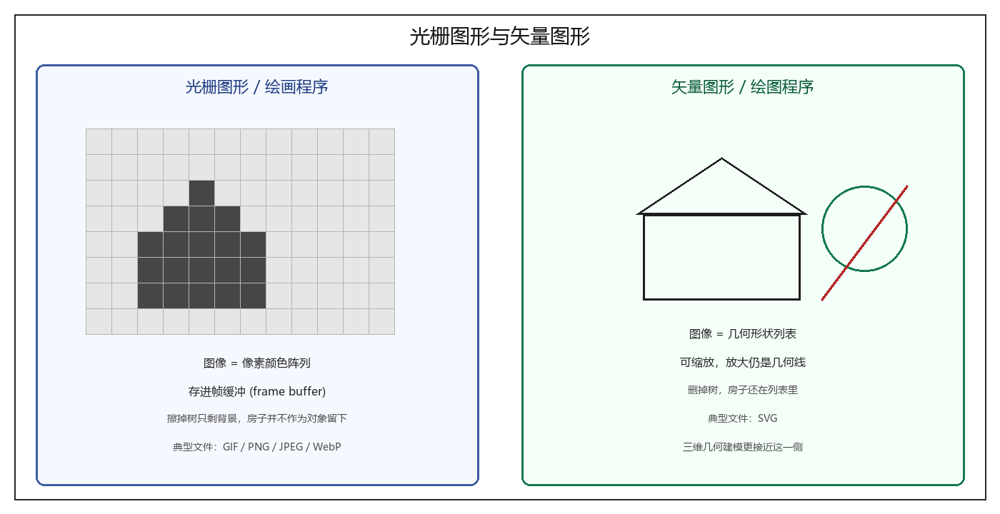
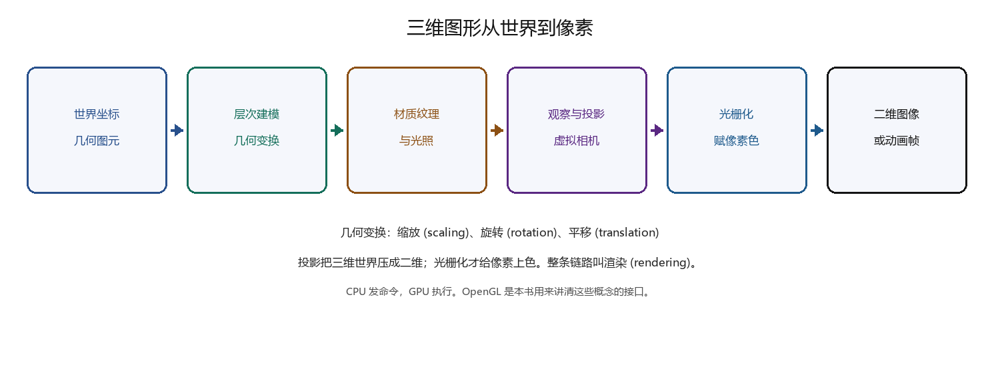

# 第1章 引言

### 来源说明

- 作者：David J. Eck
- 书名：*Introduction to Computer Graphics*（计算机图形学导论）v1.4
- 官方来源：https://math.hws.edu/eck/cs424/downloads/graphicsbook-linked.pdf
- 主页：https://math.hws.edu/graphicsbook
- 许可：CC BY-NC-SA（Creative Commons Non-Commercial Attribution Share-Alike，知识共享署名–非商业性使用–相同方式共享）
- 本笔记仅供个人学习使用。

阅读范围：前言 Preface PDF 10–12（页脚 viii–x），第1章 Introduction PDF 13–21（书页 1–9）。作者署名为 Hobart and William Smith Colleges 数学与计算机科学系荣休教授，前言日期是 2023 年 8 月。本地 PDF 共 533 页。

### 本章总览

这本书按一学期入门课来写，也适合自学。读者需要有一门语言的编程经验，并懂一点面向对象和数据结构。作者自己的课至少上过两学期编程，语言以 Java 为主；书中例子用 JavaScript、Java 和 C。可以只用 JavaScript，但若干节需要一点 C。三种语言的要点在附录 A。

版本线写在前言里。Version 1.0 用于 2015 年秋季课。Version 1.1 改正错误并补材料，用于 2017 年秋季。Version 1.3 用于 2021 年秋季，补了 WebGL 2.0 与 GLSL ES 3.00，JavaScript 改到 ES6，第5章跟 three.js Release 129。Version 1.4 是 2023 年夏天写的：新加 WebGPU 一章，three.js 升到 Release 154，附录 A 补 promises 与 async，第5章改用 JavaScript modules。除模块化以外，第5章材料没有改。全书还修了一批笔误。

课程骨架不是某一套最新 API。作者用 **OpenGL 1.1 的一个子集** 先讲三维图形的基本概念，再讲浏览器里的 WebGL，最后一章才介绍 WebGPU。真正强调的是几何建模与变换、层次建模与场景图、颜色、光照、纹理，以及动画。

第1章是全书地图，不展开公式。它先把二维图像拆成光栅与矢量两条路，再把三维图形拆成几何、外观、成像三块，最后交代 GPU 与 OpenGL 为什么会变成今天这个样子。

图注：左侧是 raster graphics（光栅图形）和 painting program（绘画程序）的模型：屏幕只记住每个像素的颜色。右侧是 vector graphics（矢量图形）和 drawing program（绘图程序）的模型：图像是带属性的形状列表。原书第1章没有单独插图，这张是按 1.1 节的定义重绘的。

### 核心知识点

#### 计算机图形学指什么

computer graphics（计算机图形学）指在计算机上创建或操作图像的一切工作，也包括动画。领域变化很快，初学者不容易找到入口。本书只覆盖能放进一学期课的那些基础想法，当作起点，而不是全书。

🔑 关键速记：图形学很宽，本书只收能进一学期课的基础想法。

#### 课程怎么读、例子在哪里跑

前言把各章的任务写清楚。第1章是短导论。第2章用 Java、JavaScript 和 SVG 讲二维，重点是后面三维还要用的变换和场景图。第3–4章讲 OpenGL 1.1 里仍然基本的那些能力，而且只覆盖 API 的一部分。第5章用更高层的 three.js 看同一套概念。第6–7章讲 WebGL：它很底层，许多 OpenGL 1.1 里现成的功能要自己写 shader program（着色器程序）。第8章极短地看 OpenGL 做不到的技术。第9章介绍 WebGPU。附录 A 是 Java、C、JavaScript；附录 B 用 Blender 练三维直觉；附录 C 极短介绍 Gimp 与 Inkscape。

多数示例和演示是网页。第2章用 HTML canvas，第9章用 WebGPU，其余三维章用 WebGL。Canvas 和 WebGL 在当时的现代浏览器里一般能跑。WebGPU 在 2023 年 7 月默认只出现在 Windows 和 MacOS 的 Chrome 与 Edge，其它浏览器要开实验开关，而且不一定所有硬件都能用。作者仍认为它很可能是网页三维的下一步。

示例在网站下载包的 `source` 与 `demo` 文件夹。浏览器常拒绝从本地文件系统读三维模型和模块化脚本，所以一部分例子必须走在线版，或在本机开一个 web server。不要为了看例子去改浏览器的本地文件策略后再去上网。

源码仓库是 https://github.com/davidjeck/graphicsbook 。前言写明：这些源文件当初不是为发表准备的，不保证、支持也很少。

🔑 关键速记：先用 OpenGL 1.1 把概念讲透，再下到 WebGL，最后才碰 WebGPU。

#### 最终结果几乎总是一张二维图

本书主线是 three-dimensional graphics（三维图形），大部分工作花在搭一个三维场景模型。几乎所有项目的最终结果仍是一张二维图像。直接做二维图像本身也重要，而且许多想法会从二维带到三维。所以课程从二维开始。

屏幕上的图像由 pixel（像素）组成。屏幕是一行行、一列列的矩形网格。像素足够小，很高分辨率的显示器上几乎看不见单个像素。同一时刻一个像素只显示一种颜色。

当时多数屏幕用 24-bit color（24 位色）：三个 8 位整数分别给 red、green、blue。能显示的颜色都是这三种“原色”的组合。也可以用 grayscale（灰度），一个数表示从黑到白的灰阶，通常 256 级。更早的屏幕用 indexed color（索引色），只能显示一个编号表里的 16 或 256 种颜色，像素里存的是表中的整数下标。

全部像素的颜色值放在一块大内存里，叫 frame buffer（帧缓冲）。改屏幕上的图，就是改帧缓冲里的颜色。屏幕每秒重画很多次，帧缓冲一改，显示几乎立刻跟上。

🔑 关键速记：三维做的是模型，端上屏幕的仍是像素；像素颜色住在帧缓冲里。

#### 光栅图形

上面这种用法就是 raster graphics（光栅图形）的基本模型。raster 这个词本来指旧式真空管显示器：电子束沿像素行扫描，让荧光点发光。磁场偏转电子束，束越强点越亮，帧缓冲里的值用来调制束强。彩色屏上每个像素有红、绿、蓝三个点，分别被照亮。

现代平板显示器没有移动的电子束，控色机构也因屏幕类型而不同。屏幕仍由像素组成，颜色仍存在帧缓冲。一张图是像素网格、每个像素有一个数值颜色：这就是光栅图形的定义。

🔑 关键速记：光栅图形 = 像素网格 + 每个像素一个数值颜色，跟电子束是否还在无关。

#### 矢量图形

指定每个像素的颜色并不总是最好的造图办法。另一条路是列出图里的几何对象：线段、圆、三角形、矩形。这就是 vector graphics（矢量图形）：图像是几何形状的列表。形状可以带属性，例如线宽、矩形填充色。不是所有图都能这样拼，美丽的日落照片就不行；建筑图纸和科学插图却很合适。

计算早期，矢量还曾直接用在屏幕上。当时光栅又慢又贵。真空管可以让电子束沿一条线扫过去，直接画出线段。矢量显示器保存一份 display list（显示列表），里面是该出现的线，并一遍遍重画。改图只要改列表。列表太长，一条线还没轮到下一次重画就已经暗下去，图会闪。

要点是：若图像由不太多的几何形状组成，矢量表示比光栅省得多。一千条线段只需存两千个端点，只要几千字节；同一张图放进帧缓冲则要多得多的内存。矢量显示器画这些线，也曾比光栅从帧缓冲拷到屏幕更快。光栅一旦又快又便宜，就靠“什么图都能凑合显示”把矢量显示器挤掉了。

🔑 关键速记：形状不多时，矢量只存端点和属性；光栅要为每个像素付钱。

#### 绘画程序与绘图程序

光栅和矢量的分界还出现在造图软件里。painting program（绘画程序）把图存成像素网格，用户给像素上色。笔刷或画几何形状的工具都可以用，但保存下来的只有像素颜色。先画房子再在前面画树，擦掉树只能露出空白背景，不会露出房子。图里从来没有一个叫“房子”的对象，只有观众看起来像房子的那些像素。

drawing program（绘图程序）让用户添加几何形状，图是形状列表。房子还在列表里，树只是叠在上面。删掉树，房子还在。还可以选中一个形状去移动或改大小。绘画程序做不到这些编辑；反过来，绘画程序能做的事，绘图程序也不是都能做。

实际软件常两边都沾一点，但通常有一侧占主导。绘图程序可以把一张光栅图当作一个形状。绘画程序可以做 layer（图层），各层像绘图程序里的形状那样叠和编。

书中点名：Adobe Photoshop 偏绘画，Adobe Illustrator 偏绘图。自由软件里，Gimp 可替代 Photoshop，Inkscape 是还能用的绘图程序。Gimp 与 Inkscape 的短介绍在附录 C。

🔑 关键速记：绘画改像素，绘图改形状列表；擦掉树以后能不能看到房子，就看走的是哪一条。

#### 图形文件格式

同一条分界也出现在文件格式上。要从文件里的比特恢复原图，表示法必须遵守已知的精确约定，这种约定叫 graphics file format（图形文件格式）。书中列出的常见格式有 GIF、PNG、JPEG、WebP 和 SVG。网上多数图是 GIF、PNG 或 JPEG；多数浏览器也支持 SVG 和较新的 WebP。

GIF、PNG、JPEG、WebP 基本上是光栅格式，按像素存颜色。GIF 较老，大体被 PNG 取代，但仍能在网上见到。GIF 支持动画，常用来做网页上的小动画。GIF 用最多 256 色的索引色。PNG 可以用索引色或完整 24 位色。JPEG 面向全彩色图。

光栅数据可以很大，但常有冗余，于是要 compress（压缩）。GIF 和 PNG 用 lossless data compression（无损压缩），能完璧恢复原图。JPEG 用 lossy data compression（有损压缩），恢复出来的图与原图不完全一样。差别常常不明显，压缩率通常更大。JPEG 对照片一般好用，对颜色之间有锐利边界的图较差，对线条图和带文字的图尤其差；这类图优先用 PNG。WebP 两种压缩都能用。

SVG 从根本上是矢量格式，尽管图里可以嵌入光栅图。它是基于 XML 的二维矢量描述语言。名字是 Scalable Vector Graphics（可缩放矢量图形）。scalable 指出矢量的一个好处：放大不掉品质。两点之间的线在任何尺度下仍是同一条几何直线。光栅图大幅放大时，没有足够的颜色值去填新像素，原来的一个像素会扩成一块同色矩形。因此 SVG 适合浏览器和桌面图标；书称有的桌面环境已经在用 SVG 做图标。

数字图像无论哪种格式都要用 coordinate system（坐标系）。坐标系在数字和几何点之间建立对应。二维里每个点有一对数，常叫 \(x\)-coordinate 和 \(y\)-coordinate，名字本身是任意的。

光栅图是行列像素网格，天然坐标系是一对整数：列号和行号。即便如此，行是从上往下编号还是从下往上编号，各系统并不一致。矢量图则自然使用实数坐标。同一张图可以用不同坐标系来写。坐标系是本书后面很大一块的主题，三维里比二维更要紧。

🔑 关键速记：GIF/PNG/JPEG/WebP 存像素，SVG 存形状；照片可走有损 JPEG，线条和文字优先无损 PNG。

#### 三维：几何建模

三维里最常见的做法更接近矢量而不是光栅：图像内容是几何对象的列表。这种技术叫 geometric modeling（几何建模）。先在三维空间里用简单几何形状搭一个“人造三维世界”。对象带属性，属性再加上世界的全局性质，决定外观。基本形状的种类往往很少，也许只有点、线段和三角形。多边形或球面如果本身不算基本，就由更基本的形状搭出来或逼近。要得到场景的二维图像，再把三维投影到二维。投影相当于给场景拍照。

空间只存在于概念里，但要能在脑子里看见它。空间需要坐标系，每个点配三个数，通常叫 \(x\)、\(y\)、\(z\)。这套坐标叫 world coordinates（世界坐标）。

场景由几何对象组成。线段用两个端点，三角形用三个顶点。最小的积木叫 geometric primitives（几何图元）。不同系统提供的图元不同，很多系统只把线和三角形当图元。复杂场景可以有大量图元，不可能靠给每个图元手写坐标来搭。

解决办法是把图元打成可复用的组件。场景里有几辆汽车，可以先做一个轮子的几何模型；一辆汽车是四个轮子加其它部件；场景里再放几份汽车模型。模型一旦设计好，就可以嵌进更复杂的模型。这叫 hierarchical modeling（层次建模）。

轮子装到汽车上时，它所有图元的坐标都要改。得到的好处是：这些坐标按同一种方式改。把轮子放进汽车，只需指定作用在整个轮子上的一次调整。这种调整叫 geometric transform 或 geometric transformation（几何变换）。它调整几何对象的大小、方向和位置。造汽车时做一只轮子，再对它施加四次不同的变换，得到四个轮子。把几辆汽车放进场景，也是对同一汽车模型施加不同变换。

三种最基本的几何变换是 scaling（缩放）、rotation（旋转）和 translation（平移）。缩放按给定因子放大或缩小。旋转绕某条轴转一个角，用来定方向。平移把对象从原位置挪开一段，用来定位置。本书先在二维里见面，三维里它们才真正不可少。

👉 二维里这三种变换的公式、复合顺序和齐次矩阵，第2章 2.3 节会展开。层次建模怎样一层层套变换，也从二维讲起。完整深度讲解见第2章。📝待补全

🔑 关键速记：三维场景是图元加层次建模；同一组件靠缩放、旋转、平移复制到不同位置。

#### 三维：外观

几何形状本身并不好看，还要能设定 appearance（外观）。做法是给几何对象赋 attributes（属性）。颜色是最明显的一种，但真实外观远不只给每个图元指定一种颜色。三维里通常不谈 color，而谈 material（材质）。这里的材质指决定表面固有视觉外观的那些性质，本质上是表面如何与打到它上面的光相互作用。材质可以包括基本颜色，以及 shininess（光泽）、roughness（粗糙）、transparency（透明）等。

一类很有用的材质性质是 texture（纹理）。最一般地说，纹理让材质性质在表面上逐点变化。最常见的用法是让不同点有不同颜色，往往拿一张二维图像当纹理，让它看起来像“画”在表面上。纹理也可以改透明或 bumpiness（凹凸）。纹理能在不增加大量图元的前提下给场景加细节。

材质是对象的固有性质，实际外观还取决于观看时的环境。真实世界里没有光就什么也看不见。三维图形同样要给场景加模拟光照。场景里可以有多个光源，各有颜色、强度、方向或位置。这些光再与对象的材质相互作用。图形系统对光照的支持可以从相当简单到非常复杂、计算很重。

🔑 关键速记：三维看的是材质加光照，不是给三角形涂一块平板色；纹理用一张图换掉大量几何细节。

#### 三维：观察、投影、光栅化

三维图形的最终目标通常是得到这个三维世界的二维图像。从三维到二维要做 viewing（观察）和 projection（投影）。从不同视点看，世界不一样。要定一个视点，需要给出观察者的位置、看的方向，以及一个“向上”的方向——这个方向在最终图像里朝上。这相当于把一台 virtual camera（虚拟相机）放进场景。视点定好之后，从这个视点看到的世界再投影到二维。投影好比按快门。

最后一步是给二维图像里的单个像素赋颜色。这个过程叫 rasterization（光栅化）。整条出图过程叫 rendering（渲染）这个场景。

许多时候目标不是单张图，而是 animation（动画）：一串显示世界在不同时刻的图像，相邻两张只有很小的变化。动画里几乎任何东西都可以变：图元坐标、变换、材质、视点。逐渐加大缩放因子，对象就会长大；移动视点，就像在场景里走或飞。计算这些变化可以很难。帮助计算的技术很多，其中很重要的一种是 physics engine（物理引擎），按物理定律算物体的运动和相互作用。本书不讲物理引擎。

图注：几何在世界坐标里用图元搭好，层次建模和几何变换负责摆放，材质、纹理和光照决定外观，虚拟相机做观察和投影，光栅化才写出像素。整条链路是 rendering。原书 1.2 节没有单独流程图，这张按该节的三块——几何、外观、成像——重绘。

🔑 关键速记：相机定视点，投影压成二维，光栅化写像素；这一整段叫渲染。

#### GPU 与图形 API

三维编程的主要底座是 OpenGL。最初版本 1992 年由 Silicon Graphics 发布，该公司以图形工作站出名。今天一部智能手机上的图形计算能力已经超过那些机器。多数现代设备的图形硬件支持 OpenGL，包括桌面、笔记本和许多移动设备。以 WebGL 的形式，它也是当时网页上大多数三维图形在用的接口。

第一批桌面计算机里，屏幕内容由 CPU 直接管。画一条线段，CPU 要循环给线上每个像素上色。图形既占 CPU 时间，也慢。后来变快，不只是因为计算机整体更快，更因为图形计算交给了专门的 GPU（Graphics Processing Unit，图形处理单元）。GPU 里有做图形计算的处理器，而且可以有很多个并行工作。它还有自己的专用内存，用来存图像和坐标列表。GPU 处理器访问 GPU 内存，比访问主机内存快得多。

CPU 只要把命令和必要数据发给 GPU，由 GPU 执行。CPU 把大部分图形工作卸掉。GPU 能懂的那套命令就是它的 API。OpenGL 是图形 API 的一个例子。多数 GPU“支持 OpenGL”，意思是它们能懂 OpenGL 命令，或至少能把这些命令有效地译成自己能懂的命令。

OpenGL 不是唯一的图形 API，而且正在被更现代的替代品替换，其中包括同一组织推出的开放 API Vulkan。苹果和微软还有专有 API：Metal 和 Direct3D。网页上，WebGPU 已经开发一段时间，并已在部分浏览器里实现。这些新 API 复杂、底层，为速度和效率设计，不是为好学设计。本书不讲 Metal、Direct3D、Vulkan；WebGPU 放到第9章。书的大部分用 OpenGL，因为它更容易作为三维入门，再用 WebGL，因为它仍是浏览器里的主要三维 API。

🔑 关键速记：画图的是 GPU；OpenGL 是 CPU 发给 GPU 的那套命令。

#### OpenGL 的客户端 / 服务器模型

OpenGL 其实是一串被反复扩充和改写的 API。2023 年时，当时的（也是书里认为也许是最后的）版本是 4.6，2017 年首次发布，和 1992 年的 1.0 很不一样。另外还有面向手机和平板这类 embedded systems（嵌入式系统）的 OpenGL ES，以及基本是 OpenGL ES 移植的 WebGL。

OpenGL 被设计成 client/server（客户端 / 服务器）系统。服务器负责控制显示器并做图形计算，执行客户端发来的命令。典型情况下，服务器就是 GPU，包括它的图形处理器和内存。客户端是同一台机器上的 CPU 和正在跑的应用程序。OpenGL 命令来自 CPU 上的程序。也可以在网络上远程跑：应用程序在远程计算机（OpenGL 客户端）上执行，图形计算和显示在你正在用的计算机（OpenGL 服务器）上做。

关键想法是客户端和服务器是分开的组件，中间有一条通信通道。OpenGL 命令和它们需要的数据沿这条通道从 CPU 送到 GPU。通道容量会限制图形性能。若 GPU 画一张图只要微秒，把数据从 CPU 送到 GPU 却要毫秒，GPU 再快也没用，时间花在通信上。

因此 OpenGL 演进的一个动力，就是限制 CPU 与 GPU 之间需要的通信量。一条路是把信息存在 GPU 内存里：要反复用的数据只传一次。另一条路是减少画出给定图像所需的 OpenGL 命令条数。

🔑 关键速记：CPU 是客户端，GPU 是服务器；传数据往往比算图形更慢。

#### 从逐顶点命令到缓存对象

OpenGL 画三角形这类图元。指定一个图元，就是指定每个顶点的坐标和属性。最初的 OpenGL 1.0 里，每个顶点的坐标用一条命令，属性一变又是一条命令。一个三角形至少三条命令。由成千上万个三角形组成的复杂对象，要成千上万条命令。到了 OpenGL 1.1，已经可以用一条命令画出这样的对象：数据先装进数组，再一步送到 GPU。可惜对象若要画不止一次，数据每次都得重传。这件事在 OpenGL 1.5 用 Vertex Buffer Objects（顶点缓冲对象，VBO）修好。VBO 是 GPU 里的一块内存，能存一组顶点的坐标或属性值，从而不必每次从 CPU 再传一遍。

类似地，OpenGL 1.1 引入 texture objects（纹理对象），让几张图像可以存在 GPU 上当纹理用。要反复用的纹理图只需加载一次，GPU 就能在图像之间切换而不必重载。

🔑 关键速记：VBO 和纹理对象把反复用的数据留在 GPU 上，避免每次重传。

#### 着色器：把 GPU 变成可编程的

新能力加进 OpenGL，API 就变大。新的、更复杂的做图技术发明得更快。有些技术被加进 OpenGL，但无论加多少功能，总会有人要更新的功能，也会有人抱怨东西太多太复杂。真正的解决办法是让这台机器可编程。从 OpenGL 2.0 起，可以把程序送到 GPU，作为图形计算的一部分来执行。程序在 GPU 上按 GPU 的速度跑。想用新技术的人自己写实现，交给 GPU。API 不必改，它只要能把程序送到 GPU。

这些程序叫 shaders（着色器），尽管这个词并不能描述它们多数实际在做的事。最先引入的是 vertex shaders（顶点着色器）和 fragment shaders（片元着色器）。画一个图元时，每个顶点上要做一些工作，例如对顶点坐标做几何变换，或用属性和全局光照算这个顶点的颜色。顶点着色器可以接过这类 per-vertex（逐顶点）计算。图元内部的每个像素上也有工作要做。片元着色器可以接过这类 per-pixel（逐像素）计算。片元着色器也叫 pixel shaders（像素着色器）。

可编程图形硬件非常成功。成功到 OpenGL 3.0 里，原来那些固定的逐顶点和逐片元处理被 deprecated（不鼓励使用）。OpenGL 3.1 把它们从标准里删掉，尽管仍作为可选扩展存在。实践中，OpenGL 的原始功能在桌面版里仍然得到支持，书称大概以后也会继续可用。嵌入式一侧则不同：从 OpenGL ES 2.0 起，着色器是强制的，OpenGL 1.1 API 的很大一部分被完全去掉。WebGL 基于 OpenGL ES，要做成任何事也必须写着色器。尽管如此，本书仍从 1.1 开始。那个版本里的多数概念和许多细节仍然相关，对三维图形的新手也更好进。

OpenGL 的着色器用 GLSL（OpenGL Shading Language）写。GLSL 也经过几个版本。课上后面会花时间看 GLSL ES，也就是 WebGL 和 OpenGL ES 用的版本。GLSL 的语法接近 C。

不同顶点上的计算大体独立，可以并行。不同片元上的计算也是。GPU 可以有几百或几千个能并行工作的处理器。单个处理器远不如 CPU 强，但典型的逐顶点和逐片元计算并不很复杂。处理器数量大，图形计算里能并行的部分也大，所以即便不贵的 GPU 也能有很强的图形性能。

🔑 关键速记：新功能不再靠加 API，而是靠把着色器送到 GPU；WebGL 已经强制走这条路，本书仍先用 OpenGL 1.1 入门。

### 章末要点

1. 最终产品几乎总是二维像素图；三维图形的工作在模型和光照，二维图形的工作在坐标系和形状。
2. 光栅存颜色网格，矢量存形状列表；绘画程序和绘图程序、JPEG 和 SVG，是同一条分界的两边。
3. 三维场景 = 世界坐标里的图元 + 层次建模 + 缩放 / 旋转 / 平移 + 材质与光 + 虚拟相机 + 光栅化。
4. CPU 下命令，GPU 计算；通信比计算更容易成为瓶颈，所以才有 VBO、纹理对象和着色器。
5. 本书用旧而清楚的 OpenGL 1.1 讲概念，再用 WebGL 看实现，最后用 WebGPU 看方向。

### 易混淆点与差异对比

光栅和矢量不是“好图”和“坏图”的差别，而是存储单位不同。照片走光栅；图标、图纸、可无限放大的线走矢量。一张图可以两边都有，例如 SVG 里嵌一张 PNG。

绘画程序里的“画房子”并没有留下房子对象。绘图程序里的房子是列表中的一项。图层让绘画程序借到一点绘图程序的编辑能力，但各层本身仍是光栅。

无损和有损不是“好压缩”和“坏压缩”。PNG 完璧恢复，适合硬边和文字。JPEG 故意丢掉人眼不太在意的信息，照片文件才能更小。同一张线图存成 JPEG，边缘会脏。

材质不是颜色的别名。颜色可以是材质的一部分；真正决定你看见什么的，是材质怎样响应场景里的光。没有光，材质再完整也看不见。

改对象和改窗口可以给出同一张图。把汽车向右平移，和把观察窗口向左平移，成像可以一样，只是作用对象相反。第1章只把这件事说清楚，公式在第2章。

OpenGL 1.1 在桌面上往往还能用，并不等于它仍是标准的必选路径。OpenGL ES 2.0 和 WebGL 已经强制着色器。本书从 1.1 起步，是教学选择，不是在推荐新项目只写 1.1。

下面对照三种容易混在一起的“画图单位”。

| 单位 | 存的是什么 | 改其中一块之后 |
| --- | --- | --- |
| 像素 / 帧缓冲 | 每个格子一种颜色 | 只改颜色，不留下几何对象 |
| 形状列表 | 线、圆、三角形及属性 | 删掉叠在上面的形状，下面的还在 |
| 三维模型 | 图元 + 变换 + 材质 + 光 + 相机 | 渲染后才变成像素 |

表后要点：屏幕上最后都是像素。差别在于，像素是唯一真相，还是从形状或三维模型算出来的近似。

### 本章要点总结

前言把这本书定为 2023 年的 v1.4 免费教材，许可是 CC BY-NC-SA。它按一学期课写，假定读者已经会编程。作者用 OpenGL 1.1 把顶点、法向、坐标变换、光照和材质讲透明，再进入 WebGL 和 WebGPU。例子主要在浏览器里跑。

第1章先钉死一件事：三维是主线，二维图像是出口。光栅图形用帧缓冲里的像素颜色；矢量图形用形状列表。绘画程序和 Photoshop / Gimp 走前一条，绘图程序和 Illustrator / Inkscape 走后一条。GIF、PNG、JPEG、WebP 存像素，SVG 存可缩放的形状。坐标系给点和数配对，具体约定留到后面各章。

三维侧按三块走。几何：世界坐标、图元、层次建模、缩放 / 旋转 / 平移。外观：材质、纹理、光源。成像：虚拟相机、投影、光栅化、渲染；动画是一串这样的图像。硬件侧，GPU 是服务器，CPU 是客户端。通信贵，所以数据要留在 GPU 上。功能涨得太快，API 就改成可编程：顶点着色器和片元着色器在 GPU 上并行跑。本书仍从 OpenGL 1.1 进门，因为那一层概念清楚。
