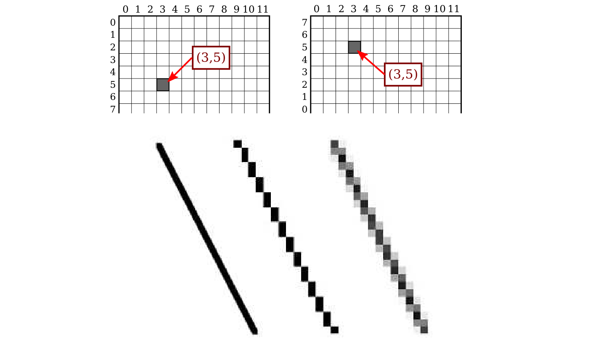
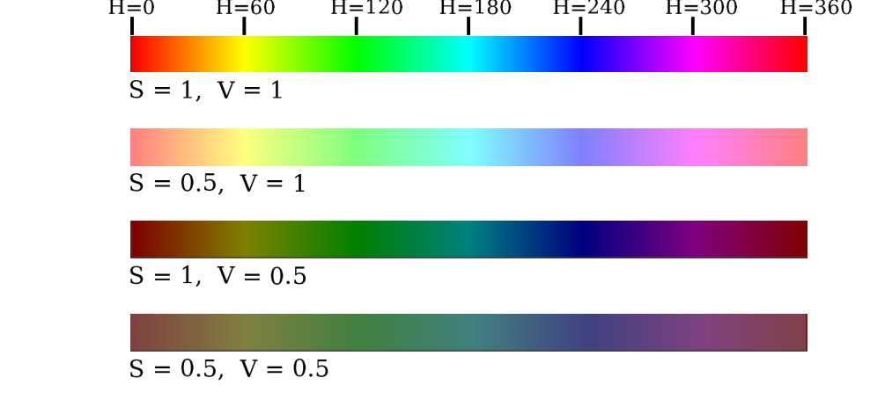
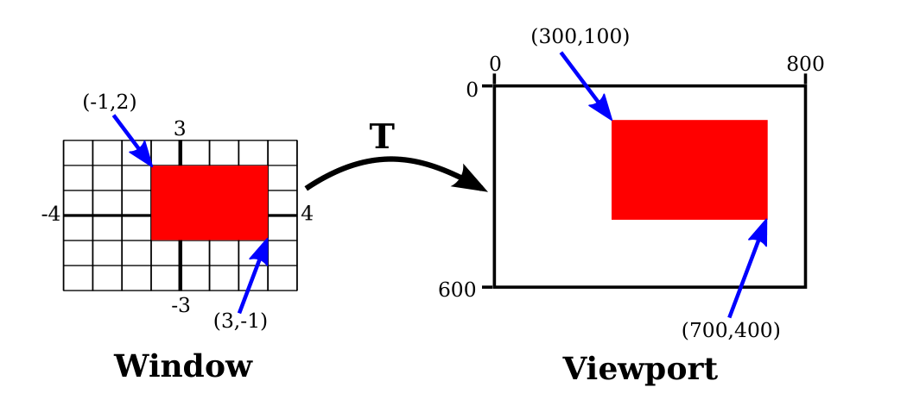
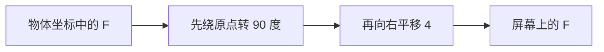

# 第2章 二维图形

### 来源说明

本章继续 David J. Eck，*Introduction to Computer Graphics*（计算机图形学导论）v1.4。官方来源、许可与第1章相同：https://math.hws.edu/eck/cs424/downloads/graphicsbook-linked.pdf ，CC BY-NC-SA，仅供个人学习使用。

阅读范围：Chapter 2 Two-Dimensional Graphics，PDF 22–87（书页 11 起；第3章从 PDF 88 开始）。本笔记只抽数学主线：2.1 的像素、坐标、颜色，以及 2.3 Transforms（变换）。2.2 形状、2.4 层次建模不展开。2.5 Java Graphics2D、2.6 HTML Canvas、2.7 SVG 只各用几句说明它们是课程载体，不写成编程笔记。

### 本章总览

二维比三维容易看见，但本章多数想法后面三维还要用。前四节先不绑某一门语言，例子用伪代码。后三节再看三种真实系统怎样落实这些想法。

一张二维图要给每个点一种颜色。点用一对数来指名，颜色也用数来指名。数和点、数和颜色的对应都有约定，所以必须先讲 coordinate system（坐标系）和 color model（颜色模型）。

几何对象并不直接写在像素上。场景用实数世界坐标描述，再经过变换落到视口的像素网格。2.3 节把这件事写成仿射变换：平移、旋转、缩放、剪切，以及窗口到视口。变换可以复合；计算机用矩阵把一串变换收成一次乘法。平移不是线性变换，所以二维点要写成 $(x,y,1)$，用 $3\times 3$ 矩阵。

图注：上排是原书 PDF 23 的 12×8 网格。左图行号从上往下，右图从下往上，标出来的都是 (3,5)，像素位置不同。下排是原书 PDF 24：左边是几何直线，中间是只涂黑白像素的阶梯，右边用抗走样把部分覆盖的像素涂成灰。原书图。

### 核心知识点

#### 像素坐标

数字图像由一行行、一列列像素组成。一个像素可以用“第几列、第几行”指出，也就是一对整数。例如 (3,5) 在第 3 列、第 5 行。

列通常从左到右编号，从零起。本章要学的系统多数把行从上到下编号，也从零起。有的系统包括 OpenGL 从下往上编号。同一对 $(x,y)$ 指哪一个像素，取决于当前坐标系。先要知道用的是哪一套，才能知道自己在说哪个点。

行列号标出的是像素，不是点。一个像素里有许多点，数学上是无穷多。计算机图形学的目标并不是给像素上色，而是创建和操作图像。理想情况下，图像应对每个点指定颜色，而不仅仅对每个像素。像素是近似。若想象有一幅真正的理想图像，任何靠给像素上色得到的显示都是它的近似。

🔑 关键速记：整数坐标标的是格子，不是几何点；同一对 (3,5) 在 y 向上和 y 向下的网格里不是同一个像素。

#### 走样与抗走样

数学上的线没有厚度，看不见。实际要画的是有宽度的线段。即便只要一像素宽，斜线也不可能刚好盖住一串完整像素，它只会盖住某些像素的一部分。一个像素不能一半黑一半白。只用黑白像素去画斜线，会得到锯齿状的楼梯。这种效果是 aliasing（走样）的例子。屏幕上的字轮廓、两种颜色之间的斜边界或弯边界上也能看见。

aliasing 这个词多半来自：理想图像用实数坐标描述，换成像素以后，许多不同的实数坐标会落到同一对整数像素坐标上，它们成了同一像素的不同名字或“别名”。

antialiasing（抗走样）用来减轻走样。想法是：像素只被形状盖住一部分时，它的颜色应是形状色和背景色的混合。白底画黑线，被盖住一部分的像素就是灰，灰的深浅取决于覆盖比例。精确算每个像素的面积太难，实际用某种近似。抗走样给不出完美图像，但在正常尺度下可以减轻 jaggies（锯齿）。

整数坐标该对准像素的哪一点，也没有唯一答案：中心，还是某个角？书中的一般说法是：这些数指像素的左上角；也可以说整数坐标指像素之间的线，而不是像素本身。即便如此，画出一个几何形状时到底影响哪些像素，仍不确定。

HTML canvas 的例子把这件事说具体。整数坐标对准像素之间的线。一像素宽的线向几何直线两侧各伸出半像素。从 (100,100) 画到 (120,100)，这条线一半在上一行像素、一半在下一行，抗走样系统把两行都涂成灰。从 (100.5,100.5) 画到 (120.5,100.5)，线正好压在一行像素上，这一行是黑的；端点处的灰像素是因为线只伸进端点像素的一半。别的图形系统可能把同一对端点画成另一个样子。

在线演示 `c2/pixel-magnifier.html` 用来试像素和抗走样。演示在本书网页版，下载网站后也在 `demos` 文件夹。本笔记不截这个界面。

🔑 关键速记：斜线盖不住整颗像素，黑白硬切就是走样；抗走样按覆盖比例把像素涂成混合色。

#### 像素当单位，以及 PPI

像素已经不像从前那么大。显示设备的分辨率用每英寸多少像素来量，叫 PPI（pixels per inch），有时也叫 DPI（dots per inch）。早期屏幕大约 72 PPI，那个距离上单个像素清楚可见。有一段时间多数显示器大约 100 PPI。高分辨率可以到 200、300 甚至 400 PPI，最高时已经分不出单个像素。

若坐标系按像素来建，这就成了问题。按 100 PPI 做好的图，在 400 PPI 上会显得很小。一像素宽的线在 100 PPI 上看着合适，在 400 PPI 上往往太细。

许多图形系统里，“pixel”并不真指物理像素的大小，而只是系统设定的一个长度单位。桌面系统上一个像素通常大约是一英寸的百分之一。手机看得更近，这个值可能接近 $1/160$ 英寸。用户放大网页时，这个单位的含义还可以再变。

像素带来的问题没有完全解决。对矢量图形，麻烦要小一些，本书后面主要用矢量。像素要到 rasterization（光栅化）那一步才进来：矢量图被转成用于显示的像素。矢量图本身可用任何方便的坐标系，它代表一幅理想的、与分辨率无关的图。光栅化结果是近似，怎样近似可以交给显示硬件。

🔑 关键速记：今天的“像素”常常是长度单位，不是物理格子；矢量图先按实数做完，最后一步才变成像素。

#### 实数坐标系

做二维图形时，你得到一块要在上面画图元的矩形。图元用这块矩形上的某套坐标系来写。坐标系应当能按应用来选。若矩形表示 15 英尺 × 12 英尺的房间平面，单位就可以是英尺，水平从 0 到 15，竖直从 0 到 12。这时一英尺可以对应图像里的许多像素。像素坐标一般是实数而不是整数。更好的做法是忘掉像素，只想图像里的点。一个点有一对实数坐标。

要在矩形上指定坐标系，只需给出左、右两边的水平坐标，以及上、下两边的竖直坐标。记成 left、right、top、bottom。它们也常被想成 $x_{\min}$、$x_{\max}$、$y_{\min}$、$y_{\max}$，但不要假定 top 一定小于 bottom。若希望竖直坐标从下往上增加，top 对应的是最大 $y$，不是最小 $y$。

理想情况下应有一个

$$
\texttt{setCoordinateSystem}(\textit{left},\textit{right},\textit{bottom},\textit{top})
$$

由图形系统自动把指定坐标系变成像素坐标。这个子程序不一定有，所以要会手算。

一般情形：已知一点在第一套坐标系下的 $(\textit{oldX},\textit{oldY})$，求它在第二套下的 $(\textit{newX},\textit{newY})$。两套的水平竖直界限分别是 oldLeft、oldRight、oldTop、oldBottom 和 newLeft、newRight、newTop、newBottom。公式是

$$
\textit{newX}=\textit{newLeft}+\frac{\textit{oldX}-\textit{oldLeft}}{\textit{oldRight}-\textit{oldLeft}}\,(\textit{newRight}-\textit{newLeft})
$$

$$
\textit{newY}=\textit{newTop}+\frac{\textit{oldY}-\textit{oldTop}}{\textit{oldBottom}-\textit{oldTop}}\,(\textit{newBottom}-\textit{newTop})
$$

逻辑是：oldX 位于 oldLeft 到 oldRight 的某个比例处，newX 应位于 newLeft 到 newRight 的同一比例处。oldX 等于端点、oldY 等于端点时，公式也对。

例如要把界限为 left、right、top、bottom 的实数坐标系变到像素坐标：左 0、右 800、上 0、下 600。此时 newLeft 和 newTop 是 0，公式化成

$$
\textit{newX}=\frac{\textit{oldX}-\textit{left}}{\textit{right}-\textit{left}}\times 800
$$

$$
\textit{newY}=\frac{\textit{oldY}-\textit{top}}{\textit{bottom}-\textit{top}}\times 600
$$

得到的仍是实数。若需要整数像素坐标，再舍入或截断。反方向——从像素坐标回到自己选的实数坐标——同样有用。例如鼠标点在屏幕上给出整数像素坐标，往往要变回自己的坐标系。实践中通常不必自己算，多数图形 API 会提供更高层的方式来指定变换。细节在 2.3 节。

🔑 关键速记：换坐标系就是按左右上下的比例重标；$y$ 向上还是向下，由 top 和 bottom 谁大谁小决定。

#### 宽高比

rectangle 的 aspect ratio（宽高比）是宽比高。2:1 表示宽是高的两倍，4:3 表示宽是高的 $4/3$。虽然常写成 width:height，书里也用分数 width/height。正方形的宽高比是 1。宽高比 $5/4$、高 600 的矩形，宽是 $600\times(5/4)=750$。

坐标系也有宽高比。界限是 left、right、bottom、top 时，宽高比是绝对值

$$
\left|\frac{\textit{right}-\textit{left}}{\textit{top}-\textit{bottom}}\right|
$$

若这套坐标系用在同一宽高比的矩形上，水平方向的一个单位和竖直方向的一个单位看起来一样长。对不上就会变形。方程 $x^2+y^2=9$ 定义的形状应当是圆，只有 $(x,y)$ 坐标系的宽高比和绘图区一致时才是圆。

书中的例子：$x$ 和 $y$ 都从 $-5$ 到 $5$，画半径 3、圆心在 $(0,0)$ 的“圆”。绘图区是正方形时，它看起来是圆；否则被拉成椭圆。问题出在坐标系宽高比和绘图区宽高比不匹配。

水平和竖直用不同长度单位并不总是坏事。若既想用给定的 left、right、bottom、top，又想保住宽高比，就要按显示矩形的形状，去改 left 与 right，或改 bottom 与 top，让两边的宽高比对齐。具体改法在 2.3.7 的窗口到视口里。

🔑 关键速记：圆会不会被拉成椭圆，看的是坐标系宽高比和绘图区宽高比是否同一分数。

#### RGB 与色域

屏幕上的颜色由红、绿、蓝光组合而成。三种光的强度不同，得到的颜色不同。一种颜色可以用三个数给出红、绿、蓝的强度。强度从 0（最小）到 1（最大）。这种指定法叫 RGB color model（RGB 颜色模型），RGB 是 Red/Green/Blue。例如 $(1, 0.5, 0.5)$ 是红到满强度、绿和蓝到一半。这三个数叫该颜色在 RGB 模型下的 color components（颜色分量）。

光由许多波长组成。纯色的全部光只有同一波长；一般颜色可以含许多波长，数学上是无穷多。因此不能仅靠红、绿、蓝就表示所有颜色。

“三种原色足以表示所有颜色，因为人眼有三种分别探测红、绿、蓝的传感器”——这只是近似。人眼确有三种色传感器，叫 cone cells（视锥细胞）。它们并不只对红、绿或蓝有反应，每种都对很宽的波长范围有程度不同的反应。一组波长会按一定程度刺激三种细胞，刺激强度决定看见的颜色。另一组波长若对三种细胞的刺激相同，就会被看成同一颜色。所以感知色可以用三个数来写，分别是三种视锥的刺激强度。但无论怎样选三种基本色，都不可能靠它们的组合产生全部刺激模式。这只是眼睛实际工作方式的事实，本来也可以不同。三种基本色能覆盖可感知颜色里相当大的一块，仍有你在真实世界里能看见、在屏幕上永远看不见的颜色。讨论只适用于确实有三种视锥的人。缺少一种或几种视锥的 color blindness（色盲）相当常见。

设备能产生的颜色范围叫该设备的 color gamut（色域）。不同屏幕色域不同，同一组 RGB 值在不同屏幕上可以略有差别。彩色打印机的色域明显不同，而且往往更小，所以打印出来的图大概不会和屏幕上完全一样。打印机用油墨或染料组合颜色，和屏幕用光叠加不同。因此给打印机的颜色常用另一套基本色。常见的印刷模型是 CMYK：cyan、magenta、yellow、black。

计算机图形里最常见的仍是 RGB。RGB 颜色最常用每个分量 8 位，一共 24 位，有时叫 24-bit color。8 位数能表示 $2^8=256$ 个值，可取成 0 到 255 的整数。颜色于是写成整数三元组 $(r,g,b)$。

这种表示能用，是因为大约 256 级红、绿、蓝已经接近眼睛能分辨的数量。用颜色分量做计算时，常给每个分量更多位，以免舍入误差变成看得见的伪影。这类应用可能用 16 位整数，甚至 32 位浮点。位也可以更少。一种常见方案给红和蓝各 5 位、绿 6 位，一共 16 位。绿多一位，因为眼睛对绿光更敏感。这种 16-bit color 比 24 位省内存，内存在更贵的年代更常见。

🔑 关键速记：屏幕色是 RGB 三个强度；三个数写的是一种感知，不是光谱里的全部颜色。

#### HSV 与 HSL

RGB 以外还有许多颜色模型。RGB 有时被批评不够直观：多数人看不出黄是红加绿。相近的 HSV 和 HSL 描述同一套颜色，但试图更直观。HSV 有时叫 HSB，B 是 brightness；HSV 和 HSB 是同一模型。

这些模型里的 H 是 hue（色相），一种基本光谱色。H 增大时，颜色从红到黄、绿、青、蓝、品红，再回到红。H 常取 0 到 360，因为颜色可以排成一圈，红同时在 0 度和 360 度。

S 是 saturation（饱和度），取 0 到 1。饱和度 0 是灰色（灰的深浅由 V 或 L 决定）。饱和度 1 是“纯色”，降低饱和度就像往颜色里加灰。

V 是 value，L 是 lightness，决定颜色亮还是暗。主要差别：HSV 里纯光谱色出现在 $V=1$，HSL 里出现在 $L=0.5$。

书中的条带取遍 H，S 和 V 分别取 1 和 0.5。$S=V=1$ 是亮而纯的颜色；$S=0.5$ 更淡、更不饱和；$V=0.5$ 更暗。在线演示 `c2/rgb-hsv.html` 用来试 RGB 和 HSV。本笔记不截这个界面。

图注：原书 PDF 30。从上到下：$S=V=1$ 是纯光谱色；只把 $S$ 降到 0.5 会变淡；只把 $V$ 降到 0.5 会变暗；两个都 0.5 又淡又暗。H 从 0 到 360 走完一圈红。原书图。

🔑 关键速记：HSV 和 RGB 是同一套颜色的两种写法；纯色在 HSV 里是 $V=1$，在 HSL 里是 $L=0.5$。

#### Alpha 与混合

颜色模型上常再加第四个分量，叫 alpha。带它的模型叫 RGBA、HSLA 等。alpha 本身不是一种颜色，通常用来表示透明度。alpha 最大时完全不透明；alpha 为 0 时完全透明，因而看不见。中间值是半透明。透明度决定用一种前景色画在另一种背景色上时会发生什么。前景完全不透明，就直接替换背景。前景部分透明，就和背景混合。alpha 从 0 到 1 时，得到的颜色是

$$
\text{new color}=(\textit{alpha})\times(\text{foreground color})+(1-\textit{alpha})\times(\text{background color})
$$

红、蓝、绿三个分量分别算。这叫 alpha blending（alpha 混合）。效果像隔着有色玻璃看背景，玻璃的颜色给背景加一层色。这不是 alpha 的唯一用法，但是最常见的用法。

每分量 8 位的 RGBA 一共 32 位。这个数很方便，因为整数常用 32 位。一个 32 位整数可以读成一个 32 位 RGBA 颜色。分量在 32 位里怎么排，有一定任意性。最常见的是 alpha 放在高 8 位，后面是红、绿、蓝。这其实该叫 ARGB。其它排法也在用。

🔑 关键速记：alpha 管透明；常见混合是前景乘 alpha，背景乘 $1-\textit{alpha}$，三个颜色分量各自做一次。

#### 观察与建模

2.1 节已经说明，坐标可以从一套坐标系变到另一套。2.3 节把这件事看仔细，并说明怎样用几何变换把图形对象放进坐标系。

典型应用里有一块由像素组成的矩形，带着它天然的像素坐标，图像就显示在这里。这块矩形叫 viewport（视口）。另有一组几何对象，定义在可能不同的坐标系里，一般用实数而不是整数。这些对象构成要看的 scene 或 world，用来定义场景的坐标叫 world coordinates（世界坐标）。

二维里，世界在一张平面上。不可能显示整张无穷平面，必须挑一块矩形区域来显示。这块区域叫 window 或 view window（窗口、观察窗口）。再用一次坐标变换，把窗口映到视口。

图注：原书 PDF 38。左边 Window 的世界坐标大约 $x\in[-4,4]$、$y\in[-3,3]$；右边 Viewport 是 800×600 像素，原点在左上。变换是 $T(x,y)=\bigl(800(x+4)/8,\;600(3-y)/6\bigr)$。角点 $(-1,2)$、$(3,-1)$ 分别映到 $(300,100)$、$(700,400)$。窗口和视口不在同一空间，比大小没有意义。原书图。

$T$ 是函数：吃窗口里的世界坐标 $(x,y)$，吐视口里的像素坐标 $T(x,y)$。这样变换，是为了能用对场景自然的世界坐标来描述，而不必直接写视口坐标。

若同一个复杂对象在场景里出现好几次，或动画的不同帧里位置不同，会希望选定一套方便的坐标系，把对象定义一次就结束。用来定义对象的坐标叫 object coordinates（物体坐标）。把它放进场景时，要把物体坐标变到场景的世界坐标。这次变换叫 modeling transformation（建模变换）。物体在自己的物体坐标系里定义好，再由不同的建模变换映进世界。要看见场景，还需要另一次变换，把世界坐标里观察窗口中的对象映到视口。

观察窗口告诉图像里出现场景的哪一块。移动、缩放甚至旋转窗口，都会给出不同的视图。同一辆车的几张图，中间发生的事有两种读法。车向右移，和观察窗口向左移，可以是同一张图。车逆时针转，和窗口顺时针转，也可以是同一张图。车变小，和窗口变大，也可以是同一张图。窗口变大就是看到更大的 field of view（视场）；用相机就是变焦，或人往后退。

这里有一条一般原则。改观察窗口，就是改加在视口上的坐标系。这和保持那套坐标系不动、改去移动场景里的对象，是同一件事。若要最终图像相同，必须对对象施加相反的变换：窗口左移，等价于对象右移。因此，变换窗口和变换对象没有本质区别。

数学上，图元用某套自然坐标系给出坐标，计算机再对坐标施加一串变换，最后得到真正画到图像上的坐标。你会把其中一些叫建模变换，另一些叫坐标变换；对计算机来说都一样。在线演示 `c2/transform-equivalence-2d.html` 用来体会建模变换和视口变换的等价。本笔记不截这个界面。

几何变换是计算机图形学的中心概念。本章用到的二维变换可以写成

$$
x_1=a\,x+b\,y+e
$$

$$
y_1=c\,x+d\,y+f
$$

其中 $(x,y)$ 是变换前的点，$(x_1,y_1)$ 是变换后的点。六个常数 $a,b,c,d,e,f$ 决定这次变换。也可以写成函数

$$
T(x,y)=(a\,x+b\,y+e,\;c\,x+d\,y+f)
$$

这种形式叫 affine transform（仿射变换）。仿射变换有一条性质：两条平行线变完还平行。一个仿射变换后面再跟一个仿射变换，结果仍是仿射变换。

二维里的平移加旋转，就是把对象当成刚体来搬：长度和角度都保住。写成线性部分加平移之后，它就是 $f(x)=h(x)+c$。把点抬成 $(x,1)$，再用底行为 $(0,0,1)$ 的矩阵一次乘完，平移不再单独待在矩阵外面。线性代数把这件事写成仿射映射和齐次坐标，并不只针对屏幕上的“F”。

👉 完整深度讲解见 01 线性代数第5章（直和、秩–零度与仿射映射）。📝待补全

若不许缩放，只许平移和旋转，得到的是平面刚体运动。机器人把平面位姿写成 $SE(2)$，三维刚体写成 $SE(3)$，并用指数坐标和李群来算复合与速度。Eck 这一节只给出平面仿射公式和 $3\times 3$ 齐次矩阵，不写李代数，也不写旋量。

👉 完整深度讲解见 06 刚体变换与李群。📝待补全

🔑 关键速记：窗口变了还是物体动了，可以是同一张图；二维里用的变换是六个数决定的仿射变换。

#### 平移

translation transform（平移变换）把每个点水平移动一定量、竖直移动一定量。原点和像点满足

$$
x_1=x+e
$$

$$
y_1=y+f
$$

$e$ 是水平移动的单位数，$f$ 是竖直移动的量。对照仿射通式，这相当于 $a=d=1$，$b=c=0$。二维图形系统通常提供 $\texttt{translate}(e,f)$。平移作用于这条命令之后画的所有东西：随后每次绘图，$x$ 都加 $e$，$y$ 都加 $f$。

例子：一个“F”在自己的坐标里以 $(0,0)$ 为中心。先说 $\texttt{translate}(4,2)$ 再画，每个点先水平移 4、竖直移 2，画出来的“F”中心在 $(4,2)$。所有点受到同一位移。书中的图把 $y$ 轴朝上。

$\texttt{translate}(e,f)$ 之后画的全部内容都受影响，不是只影响下一个形状。若平移之后再施加另一次变换，第二次不会替换平移，而是与它复合。$\texttt{translate}(4,2)$ 再跟 $\texttt{translate}(-1,5)$，等于一次 $\texttt{translate}(3,7)$。

自己不必算坐标变换。只需给出对象的原始坐标（物体坐标），并指定要施加的变换。计算机负责把变换作用到坐标上。甚至不必记住方程，只要理解几何上做了什么。

🔑 关键速记：平移给每个点加上同一个 $(e,f)$；后写的变换会叠在已经平移过的对象上。

#### 旋转

这里的 rotation transform（旋转变换）让每个点绕原点 $(0,0)$ 转。所有点转过同一个角，叫 angle of rotation（旋转角）。角可以用度或弧度。本章后面要看的 Java 和 JavaScript 二维 API 用弧度，OpenGL 和 SVG 用度。正角把对象从正 $x$ 轴转向正 $y$ 轴。$y$ 轴朝上时这是逆时针；在通常的像素坐标里 $y$ 轴朝下，同一正角看起来是顺时针。

绕原点转 $r$ 弧度，作用在 $(x,y)$ 上得到

$$
x_1=\cos(r)\,x-\sin(r)\,y
$$

$$
y_1=\sin(r)\,x+\cos(r)\,y
$$

对照仿射通式：$e=f=0$，$a=d=\cos(r)$，$b=-\sin(r)$，$c=\sin(r)$。二维 API 通常提供 $\texttt{rotate}(r)$，在画对象之前调用。

🔑 关键速记：绕原点的旋转是 $x_1=\cos r\,x-\sin r\,y$，$y_1=\sin r\,x+\cos r\,y$；正角从正 $x$ 转向正 $y$。

#### 变换的复合与顺序

在画对象之前依次写

$$
\texttt{translate}(4,0),\qquad \texttt{rotate}(90)
$$

并假定角用度。平移作用于随后全部绘图。但因为有了旋转命令，平移作用的已经是旋转过的对象。也就是：代码里先写的变换，作用在已经被后写变换处理过的对象上。

图注：代码顺序是 translate 再 rotate，施加到点上的顺序相反：先旋转，后平移。原书 PDF 43 左图对应这条链路。

变换按代码里的相反顺序施加到对象上。顺序重要。若改成先 $\texttt{rotate}(90)$ 再 $\texttt{translate}(4,0)$，对象先右移 4，再绕原点转 90 度，得到另一张图。

若要绕点 $(p,q)$ 而不是 $(0,0)$ 转角 $r$：先 $\texttt{translate}(-p,-q)$ 把 $(p,q)$ 移到原点，再 $\texttt{rotate}(r)$，最后 $\texttt{translate}(p,q)$ 把原点移回去。代码必须按相反顺序写：

$$
\texttt{translate}(p,q),\quad \texttt{rotate}(r),\quad \texttt{translate}(-p,-q)
$$

有的 API 提供一条 $\texttt{rotate}(r,p,q)$，直接绕 $(p,q)$ 转 $r$。

🔑 关键速记：代码里先写的变换后作用；绕 $(p,q)$ 转，等于移到原点、转、再移回去。

#### 缩放

scaling transform（缩放变换）用来让对象变大或变小。数学上，它把每个 $x$ 乘一个数、每个 $y$ 乘一个数。$(x,y)$ 在 $x$ 方向乘 $a$、在 $y$ 方向乘 $d$，得到

$$
x_1=a\,x
$$

$$
y_1=d\,y
$$

对象若以原点为中心，就会被水平拉 $a$ 倍、竖直拉 $d$ 倍。水平和竖直因子相同的常见情形叫 uniform scaling（均匀缩放）。均匀缩放拉长或缩小形状，但不把它扭曲。

对象若不在 $(0,0)$ 为中心，缩放除了拉长或缩小，还会把它推离 0 或拉向 0。更准确的说法：缩放把每个点推离 $(0,0)$ 或拉向 $(0,0)$。若要绕原点以外的点缩放，也用和旋转类似的三步变换。

API 可以提供 $\texttt{scale}(a,d)$。负的缩放因子是允许的，结果是反射，并可能同时拉长或缩小。例如 $\texttt{scale}(1,-1)$ 把对象竖直反射，也就是关于 $x$ 轴反射。

书给出一条结论，不在这里证明：每个仿射变换都能由平移、绕原点的旋转和绕原点的缩放复合而成。演示 `c2/transforms-2d.html` 用来试这三种以及它们的复合。

只由平移和旋转组成、没有缩放的变换，保住对象的长度和角度，也保住矩形的宽高比。有这种性质的变换叫 Euclidean（欧氏）。若再允许均匀缩放，得到的变换保住角度和宽高比，但不保住长度。

🔑 关键速记：缩放是按坐标乘因子，锚在原点；均匀缩放保角度，欧氏变换连长度也保。

#### 剪切

再看一种基本变换：shearing transform（剪切变换）。剪切其实也能由旋转和缩放搭出来，但怎么搭并不显然。剪切会让对象“倾斜”。horizontal shear（水平剪切）向左（负剪切）或向右（正剪切）倾斜。vertical shear（竖直剪切）向上或向下倾斜。

水平剪切不移动 $x$ 轴。其它水平线按该线上 $y$ 值的比例向左或向右移动。作用在 $(x,y)$ 上是

$$
x_1=x+b\,y
$$

$$
y_1=y
$$

$b$ 是剪切因子。竖直剪切因子为 $c$ 时是

$$
x_1=x
$$

$$
y_1=c\,x+y
$$

剪切偶尔叫 skew（错切），但 skew 通常用角而不是剪切因子来指定。

🔑 关键速记：水平剪切是 $x_1=x+by$，$x$ 轴不动；竖直剪切是 $y_1=cx+y$。

#### 窗口到视口

对象显示到图像之前，最后一次变换是 window-to-viewport transformation（窗口到视口变换）：把 $xy$ 平面上包含场景的矩形观察窗口，映到显示图像的矩形像素网格。这里假定窗口没有旋转，边与坐标轴平行。这时这次变换可以写成平移加缩放。

典型情形：视口像素坐标从左边 0 到右边 width，从顶上 0 到底下 height；观察窗口的界限是 left、right、bottom、top。对应的编程顺序是

1. $\texttt{scale}\bigl(\textit{width}/(\textit{right}-\textit{left}),\;\textit{height}/(\textit{bottom}-\textit{top})\bigr)$
2. $\texttt{translate}(-\textit{left},-\textit{top})$

它们应是作用到点上的最后两次变换。因为施加顺序与程序中的书写顺序相反，所以它们应是程序里最先写出的变换。

点 $(x,y)$ 可能已经过若干建模变换，现在要进视口。它先被平移 $(-\textit{left},-\textit{top})$，变成 $(x-\textit{left},\,y-\textit{top})$，再乘上面的缩放因子：

$$
x_1=\frac{\textit{width}}{\textit{right}-\textit{left}}\,(x-\textit{left})
$$

$$
y_1=\frac{\textit{height}}{\textit{bottom}-\textit{top}}\,(y-\textit{top})
$$

于是 $(\textit{left},\textit{top})$ 映到 $(0,0)$，$(\textit{right},\textit{bottom})$ 映到 $(\textit{width},\textit{height})$。

宽高比仍是问题。若要强迫窗口的宽高比匹配视口，可能要改窗口界限。书中的伪代码假定视口左上角是 $(0,0)$，并在需要保住宽高比时这样改：

- $\textit{displayAspect}=|\textit{height}/\textit{width}|$
- $\textit{windowAspect}=|(\textit{top}-\textit{bottom})/(\textit{right}-\textit{left})|$
- 若 \textit{displayAspect} 更大：竖直方向扩大窗口，excess 是 $(\textit{top}-\textit{bottom})(\textit{displayAspect}/\textit{windowAspect}-1)$，top 加上 excess 的一半，bottom 减去一半
- 若 \textit{displayAspect} 更小：水平方向扩大窗口，excess 是 $(\textit{right}-\textit{left})(\textit{windowAspect}/\textit{displayAspect}-1)$，right 加上一半，left 减去一半
- 最后仍做上面的 scale 与 translate

注意：2.1.3 把坐标系宽高比写成 $|(\textit{right}-\textit{left})/(\textit{top}-\textit{bottom})|$，也就是宽/高；2.3.7 里用来比较的两个 aspect 都是高/宽。比较的是同一个比值的两边，不要和 2.1.3 的分数直接换用。

🔑 关键速记：窗口到视口先把 (left,top) 移到原点，再按宽高比缩放；要保圆不扁，先改窗口界限再变。

#### 矩阵、向量与齐次坐标

计算机图形学里的变换可以写成矩阵，它们作用的点写成向量。对计算机科学家来说，矩阵是二维数字数组，向量是一维数组。矩阵和向量属于 linear algebra（线性代数）。线性代数是计算机图形学的根基。矩阵和向量运算已经做进 GPU。这本书不需要很多线性代数，但几条基本想法不可少。

这里用到的向量是两个、三个或四个数的列表，常写成 $(x,y)$、$(x,y,z)$、$(x,y,z,w)$。$N$ 行 $M$ 列的矩阵叫 $N$-by-$M$ matrix。本书大部分需要的是 $N\times N$ 方阵，$N$ 是 2、3 或 4。

两个 $N\times N$ 矩阵 $A$、$B$ 可以相乘得到 $C=AB$。$A$ 是 $N\times N$，$v$ 是长度 $N$ 的向量，则 $w=Av$ 仍是长度 $N$ 的向量。把 $v$ 送到 $Av$ 的函数是一次变换，叫 linear transformation（线性变换）。

中心事实：$A(Bv)$ 和 $(AB)v$ 效果相同。可以先用 $B$ 乘 $v$ 再用 $A$ 乘结果，也可以先把 $A$ 和 $B$ 乘成 $AB$ 再乘 $v$。

旋转和缩放是线性变换。绕原点转角 $d$ 可以用一个 $2\times 2$ 矩阵 $R_d$ 去乘 $(x,y)$。水平因子 $a$、竖直因子 $b$ 的缩放是矩阵 $S_{a,b}$。若要对 $v=(x,y)$ 先缩放再旋转，可以算 $R_d(S_{a,b}v)$，也可以算 $(R_d S_{a,b})v$。

图形里常常要对成千上万个点做同一串操作。可以把乘积矩阵 $R_d S_{a,b}$ 算一次，然后对每个点只做一次乘法。程序里即便写了 $\texttt{rotate}(d)$ 再 $\texttt{scale}(a,b)$ 再画一个复杂对象，计算机也不必记住两次操作。它合成一个矩阵，只记住这个。即使施加 50 次变换，也可以合成一个矩阵。用矩阵代数，多次变换可以和一次变换一样便宜。

缺口也在这里：translation is not a linear transformation（平移不是线性变换）。为了把平移收进这套框架，做法起初看起来有点怪：二维点不再写成 $(x,y)$，而写成 $(x,y,1)$，也就是加上第三坐标 1。于是旋转、缩放和平移——因而任何仿射变换——都可以写成乘一个 $3\times 3$ 矩阵。需要的矩阵底行是 $(0,0,1)$。用这样的矩阵去乘 $(x,y,1)$，得到 $(x_1,y_1,1)$。丢掉多出来的坐标，就看成 $(x,y)$ 到 $(x_1,y_1)$ 的变换。

书中给出平移 $T_{a,b}$、缩放 $S_{a,b}$、旋转 $R_d$ 的 $3\times 3$ 矩阵，并说明可用矩阵乘法去对照前面的公式。本笔记不重排版面上被拆散的数字阵列，只保留已经在 2.3.2–2.3.5 写清的公式，以及这条结构：底行是 $(0,0,1)$，第三坐标恒为 1。

做图形编程时不必自己做这些乘法。应带走的想法是：一串变换可以合成一次变换。计算机只需记住一个矩阵，叫 current matrix 或 current transformation（当前矩阵、当前变换）。实现 $\texttt{translate}(a,b)$ 或 $\texttt{rotate}(d)$，就是用表示该变换的矩阵去乘当前矩阵。

🔑 关键速记：旋转和缩放是线性的，平移不是；点写成 $(x,y,1)$ 之后，仿射变换变成一次 $3\times 3$ 乘法。

#### 课程载体，不是本章的编程内容

Java Graphics2D 是标准桌面 Java 里 Swing 的二维接口，用来演示本章已经讲过的形状、描边填充和变换。旧版 Java 图形只认整数像素坐标；Graphics2D 把同一套能力收进对象。它不是本笔记的编程对象，只是课程用来看见 2.1 与 2.3 的一块屏幕。

HTML canvas 是网页上的一块空白矩形，用 JavaScript 拿到 `"2d"` 绘图上下文。上下文里记着当前颜色、变换和字体，角色相当于 Java 里的 Graphics2D。它让浏览器把像素坐标、抗走样和仿射变换当场画出来，本身不是要背的 API 清单。

SVG 是 scene description language（场景描述语言），不是编程语言。它用 XML 声明形状、样式和几何变换，而不是用过程去生成场景。名字里的 Scalable 就是 2.1 节那个“放大仍是几何线”。它把矢量图写成可以读的文档，用来对照前面的坐标系和变换，而不是用来默写标签。

🔑 关键速记：Graphics2D、Canvas、SVG 是三块能看见同一套数学的屏幕，不是本章要记的调用步骤。

### 章末要点

1. 像素是近似；斜线的锯齿是走样，灰阶混合是抗走样。
2. 实数坐标系按左右上下的比例换成像素；宽高比对不上，圆就变成椭圆。
3. RGB 三个强度写屏幕色；HSV / HSL 是同一套颜色；alpha 做前景与背景的线性混合。
4. 二维变换是 $x_1=ax+by+e$，$y_1=cx+dy+f$；平移、旋转、缩放、剪切都是它的特例。
5. 代码顺序与作用顺序相反；平移不是线性变换，所以点要写成 $(x,y,1)$。

### 易混淆点与差异对比

像素和点不是同一个东西。行列号选出一整个格子。整数坐标常对准格子之间的线，一像素宽的线会向两侧各伸出半格。同一对整数，在 y 向下的画布和 y 向上的数学坐标里，对的不是同一个格子。

“像素”有时是物理发光点，有时只是系统里的长度单位。PPI 一变，按像素写死的线宽和字号就会错。矢量图把这个问题推迟到光栅化。

2.1.3 的 aspect ratio 是宽/高。2.3.7 伪代码里的 displayAspect 和 windowAspect 是高/宽。两边比的是同一个匹配关系，分数不要跨节直接代入。

建模变换和观察变换可以对同一张图给出两种故事。对象右移等于窗口左移。对计算机，它们都只是乘在当前矩阵上的仿射变换。

代码里先写 translate 再写 rotate，点上先发生的是 rotate。这不是作者用词随便，而是“当前变换作用在随后要画的对象上”。

线性变换、仿射变换、欧氏变换不要混。线性变换把原点留在原点，平移不在其中。仿射变换是线性部分加平移，保平行。欧氏变换是平移加旋转，保长度和角度；再加上均匀缩放，保角度但不保长度。

RGB 和 CMYK 不是同一套原色换了个名字。屏幕加光，印刷加墨。同一组 RGB 换屏幕都会略变，打印更会偏。

HSV 的 $V=1$ 才是纯光谱色；HSL 要把 $L$ 放到 0.5。把两套的“最亮/最纯”当成同一个参数，颜色会对不上。

下面把几种二维变换对照写成一张表。表前先记住：它们都是六个数 $a,b,c,d,e,f$ 的特例。

| 名称 | $x_1$ | $y_1$ | 几何效果 |
| --- | --- | --- | --- |
| 平移 | $x+e$ | $y+f$ | 每个点加同一位移 |
| 绕原点旋转 | $\cos r\,x-\sin r\,y$ | $\sin r\,x+\cos r\,y$ | 全体绕 (0,0) 转同一角 |
| 缩放 | $a\,x$ | $d\,y$ | 推离或拉向原点 |
| 水平剪切 | $x+by$ | $y$ | $x$ 轴不动，其它水平线按 $y$ 平移 |
| 竖直剪切 | $x$ | $cx+y$ | 竖直方向按 $x$ 倾斜 |
| 窗口到视口 | $\frac{\textit{width}}{\textit{right}-\textit{left}}(x-\textit{left})$ | $\frac{\textit{height}}{\textit{bottom}-\textit{top}}(y-\textit{top})$ | (left,top)→(0,0) |

表后要点：负的缩放是反射。绕 $(p,q)$ 转或缩放，要先把该点移到原点。窗口到视口必须是作用顺序里的最后一次，因此是代码里最先写的那次。

### 本章要点总结

第2章从像素和颜色把二维图说清楚，再用仿射变换把对象从物体坐标送到视口。像素是理想图像的近似。斜线会走样；抗走样按覆盖比例混合颜色。整数坐标一般对准像素角或像素之间的线，不是自动对准像素中心。今天的“像素”还常常只是一个会随设备改变的长度单位。

实数坐标系用 left、right、top、bottom 标定，换算按线段上的比例做。坐标系宽高比和绘图区不一致时，$x^2+y^2=9$ 不再是圆。屏幕色用 RGB；HSV / HSL 换一种更顺口的写法；alpha 做最常见的透明混合。色域提醒：屏幕上看见的不等于世界上能看见的全部颜色，也不等于打印机能印出的颜色。

变换是本章的数学核心。视口是像素矩形，窗口是世界平面上要显示的那一块，物体坐标是为单个对象选的方便坐标系。建模变换把物体放进世界，窗口到视口把世界放进像素。改窗口和改物体可以互相抵消。通式是 $x_1=ax+by+e$，$y_1=cx+dy+f$。平移、旋转、缩放、剪切都落在这六个数里。代码顺序与作用顺序相反。旋转和缩放能写成矩阵乘法，平移不能；加上第三坐标 1 之后，当前变换就是一个 $3\times 3$ 矩阵。

Graphics2D、HTML Canvas 和 SVG 只是把同一套坐标和变换画到屏幕上的三种载体。调用细节不属于本笔记。二维仿射与齐次坐标的一般理论对照 01 第5章；刚体意义下的平移加旋转对照 06。
