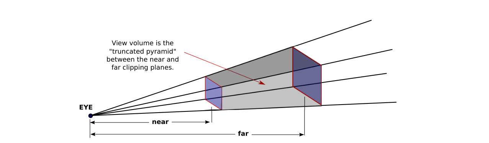
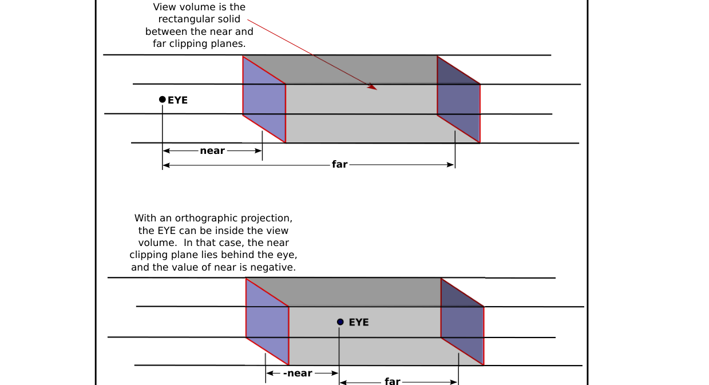

# 第3章 三维几何与投影

### 本章总览

本章对应 David J. Eck，*Introduction to Computer Graphics*（计算机图形学导论）第 3 章 *OpenGL 1.1: Geometry*，PDF 第 88–144 页。第 4 章从 PDF 145 起；第 5 章从 PDF 183 起，本笔记未读第 5 章正文。

原书这一章大部分是 OpenGL 1.1 的画图与窗口接口。本笔记**只抽数学**：3.2 三维坐标与变换（PDF 98–104）、3.3 投影与观察（PDF 104–115）、3.5 若干线性代数（PDF 126–131）。

3.1 图元与颜色、3.4 多边形网格与数组绘制、3.6 GLUT / JOGL 只在总览点名，不写成编程笔记。3.1.4 深度测试(depth test)的几何后果会在投影一节用到：深度缓冲只能表示有限深度区间，所以视体必须用近、远平面截断。

三维里坐标仍是任意贴在点上的数字；变换用坐标写，但对应的是真实的刚体或仿射动作。眼睛坐标(eye coordinates)约定观察者在原点、看向 $-z$、$y$ 朝上、$x$ 朝右，这是右手系(right-handed)。默认裁剪坐标(clip coordinates)是左手系，$+z$ 指向屏幕里。

图注：原书 3.3.1 的坐标链。建模把物体放进场景，观察转到以观察者为中心的眼坐标，投影把视体(view volume)映到边长为 2 的裁剪立方，视口再把 $x,y$ 缩到像素矩形。OpenGL 内部不单独保存世界坐标，建模与观察合成模型视图(modelview)。

### 核心知识点

#### 三维坐标与右手系

点需要三个数。第三轴常叫 $z$，与 $x,y$ 都垂直。点是位置；同一组数字也可以当向量，表示沿箭头的坐标改变量。

OpenGL 程序员常把 $x,y$ 放在屏幕平面、$z$ 垂直于屏幕。约定的眼坐标里，$+z$ 指向观察者，$-z$ 指向场景深处。完全不做变换时的默认坐标与此类似，但 $+z$ 指向屏幕里。两者并不矛盾：实际用哪一套由变换决定。

右手系：右手拇指沿 $+z$，四指从 $+x$ 卷向 $+y$（对着拇指尖看是逆时针）。默认未变换坐标是左手系。左右手不是世界的属性，只是坐标怎么铺。

场景在世界坐标(world coordinates)里组装。物体先写在自己的物体坐标(object coordinates)里，再经建模变换(modeling transform)放进世界，或放进更大物体。眼坐标是观察者自己的坐标系。

🔑 关键速记：眼坐标是右手、观察者在原点看向 $-z$；默认裁剪坐标是左手、$+z$ 进屏幕。

#### 基本三维变换

三维基本变换是二维平移、缩放、旋转的直接推广。

平移(translation) $(dx,dy,dz)$ 把点 $(x,y,z)$ 送到 $(x+dx,\,y+dy,\,z+dz)$。

缩放(scaling) $(sx,sy,sz)$ 把点送到 $(x\cdot sx,\,y\cdot sy,\,z\cdot sz)$，中心在原点 $(0,0,0)$。三因子相同是均匀缩放。某一因子为 $-1$ 是反射：例如只反转 $z$ 就是关于 $xy$ 平面的反射。反射把右手系变成左手系，或反过来。

旋转(rotation)在三维里是绕一条轴(axis of rotation)，不是绕一个点。轴上的点不动，其余点绕轴走圆。一般取过原点的轴。过原点的轴由另一点 $(ax,ay,az)$（不全为零）决定：轴就是 $(0,0,0)$ 到该点的直线。

正角方向用右手定则(right-hand rule)：拇指从原点指向 $(ax,ay,az)$，四指卷曲方向就是正角。左手系里要改用左手定则。转角在书中的接口里以度为单位。

绕坐标轴转 $90^\circ$ 的轴像（书中例子，右手系）：

| 轴 | 正 $90^\circ$ 的轴像 |
| --- | --- |
| $x$ 轴 | $+y\to +z$，$+z\to -y$ |
| $y$ 轴 | $+z\to +x$，$+x\to -z$ |
| $z$ 轴 | $+x\to +y$，$+y\to -x$ |

绕 $x$ 转 $-90^\circ$ 与绕 $-x$ 转 $+90^\circ$ 效果相同。二维可以看成在 $xy$ 平面上操作：平移用 $(dx,dy,0)$，缩放用 $(sx,sy,1)$，绕原点旋转就是绕 $z$ 轴；此时 $+z$ 出屏幕，正角在 $xy$ 上逆时针，把 $+x$ 转向 $+y$。

变换作用在**之后**画出的对象上；对物体的施加顺序与书写顺序相反。

平移加绕轴旋转保持长度和（若不反射）手性，这就是刚体变换(rigid transformation)：物体可以搬、可以转，但不能拉长或翻转。缩放和反射不在刚体里。把旋转和平移收成一个位姿、用李群写复合与速度，是机器人与视觉里的下一层语言。

👉 完整深度讲解见 06 刚体变换与李群第 3 章。📝待补全

🔑 关键速记：平移加三个数，缩放关于原点，旋转绕过原点的轴并用右手定则定正角。

#### 层次建模与矩阵栈

层次建模(hierarchical modeling)让复杂物体由简单物体搭起来。物体先在自己的自然坐标里定义，参考点常取 $(0,0,0)$，再缩放、旋转、平移放进世界或放进更大物体。

要限制一次建模变换只作用在一个部件上，需要变换栈：画之前把当前变换压栈，画完（含子物体的临时变换）再弹栈恢复。当前矩阵(current matrix)是已施加变换的复合；画顶点时，物体坐标被当前矩阵变换。单位变换(identity)表示坐标完全不变，常作为一串变换的起点。

压栈只保存副本、不改当前矩阵；弹栈用栈顶替换当前矩阵。压、弹必须成对，中间可以再套成对的压弹。

单位立方体的六个面可以由「前脸」绕坐标轴转到其余位置：右脸绕 $y$ 转 $90^\circ$，顶脸绕 $x$ 转 $-90^\circ$，后脸绕 $y$ 转 $180^\circ$，左脸绕 $y$ 转 $-90^\circ$，底脸绕 $x$ 转 $90^\circ$。先均匀缩放再转这些面，得到边长为给定尺寸的立方体。

现代接口不再内置这套栈，但矩阵复合的数学一样。

🔑 关键速记：层次建模靠「压栈—局部变换—弹栈」把变换限制在子物体上。

#### 多坐标系与模型视图

物体坐标按画物体方便来选。建模变换把物体坐标映到世界坐标。观察变换(viewing transformation)再把世界映到眼坐标。

观察者不能看见整个无限世界，只能看见视口(viewport)里的那一块，并且眼坐标里只有有限的 $z$ 区间。这个可画的空间叫视体。投影变换(projection transformation)把视体映到以原点为中心、三轴都从 $-1$ 到 $1$ 的立方；这套坐标叫裁剪坐标。到这一步还没有真正投到平面上，丢掉 $z$ 就得到二维图；$z$ 仍留给深度测试。

裁剪坐标在模型视图和投影都是单位变换时就是实际使用的坐标，左手、$+z$ 进屏幕。

设备坐标(device coordinates)是显示器上的二维像素坐标。视口变换把裁剪坐标的 $x,y$ 缩到视口矩形。

图元的处理顺序：物体坐标 $\to$ 模型视图（建模+观察）$\to$ 投影到裁剪立方（在立方外则丢弃，跨边界则裁掉外面）$\to$ 视口到设备坐标 $\to$ 给像素着色。

建模和观察在原则上分不开：同一个矩阵既可以看成转物体，也可以看成反方向转观察者。对物体转 $90^\circ$（绕 $y$）和对观察者转 $-90^\circ$，得到同一幅房子侧视图。对物体右移 5 与对观察者左移 5 也等价。观察者缩小看起来像世界放大。差别只在概念：同一观察变换通常作用整场，每个物体可以有自己的建模变换。OpenGL 因此只保存一个模型视图，不在内部使用世界坐标。

典型画场顺序：加载单位矩阵；施加观察；再对每个物体施加自己的建模（常用压弹栈限制范围）。加载单位矩阵之后，观察者在原点、看向 $-z$、$+y$ 朝上。把观察者沿 $+z$ 移到 $(0,0,20)$，等价于把世界沿 $-z$ 移 20。

作为建模，「先平移 10（沿 $+x$）再绕 $y$ 转 $90^\circ$」把原点处的物体送到 $(0,0,-10)$，正好在观察者正前方 10 个单位（建模对物体的顺序与书写相反）。作为观察，效果是逆变换：先绕 $y$ 转 $-90^\circ$（观察者仍在原点但改为沿 $+x$ 看），再沿 $x$ 移 $-10$，观察者到 $(-10,0,0)$。观察变换的施加顺序与书写顺序相同。

用三个世界点描述典型观察：眼睛 $(eyeX,eyeY,eyeZ)$，参考点 $(refX,refY,refZ)$，上方向 $(upX,upY,upZ)$。例如眼睛在 $(-10,0,0)$、看向原点、$y$ 朝上。

投影决定「镜头」的视场和视体形状；观察决定相机放在哪、朝哪看。真实相机没有沿 $z$ 的近远裁剪，类比在这里断开。

🔑 关键速记：模型视图把物体直接送到眼坐标；投影只规定视体形状，观察只规定相机位姿，二者原则上互为逆。

#### 视口变换

视口变换最简单：指定设备上那块矩形。绘制表面是像素网格，坐标原点在左下，$x$ 向右、$y$ 向上。最初视口等于整块表面。矩形由左下角 $(x,y)$ 和宽高给出；裁剪坐标 $[-1,1]$ 映到这块矩形，绘制被限制在视口内。视口可以伸出表面，但不常见。

表面尺寸改变时，OpenGL 本身不会自动改视口。同一表面可以并排两套视口，例如 600×400 的表面左半 $300\times 400$、右半从 $(300,0)$ 起再放 $300\times 400$。

🔑 关键速记：视口只做裁剪 $x,y$ 到像素矩形的仿射缩放，原点在左下。

#### 透视投影与正交投影

视体由观察和投影共同决定。观察给出观察者位置和朝向，不给出能看见多大一块；投影给出这块区域的形状和范围。可以想象相机前面粘着一个看不见的盒子，盒子内部就是视体：相机移动时盒子跟着走，形状尺寸不变。

投影把眼坐标里的视体映到裁剪立方。指定投影就是相对观察者指定视体的大小和形状。

两类投影：透视(perspective)与正交(orthographic)。

透视更接近透过屏幕这扇窗看真实三维世界，也接近普通相机。物体越远看起来越小。只能看见观察者前方。忽略 $z$ 裁剪时，可见部分是无限金字塔，观察者在顶点，侧面穿过视口矩形四边。深度缓冲只能存有限深度，所以必须再用 near 和 far 截断。透视要求 near、far 都为正，且 far $>$ near。比 near 更近或比 far 更远的点丢掉。截断后的金字塔叫视锥(frustum)。六个面都是裁剪平面(clipping planes)。

眼坐标里观察者在原点、面向 $-z$。近平面 $z=-\mathrm{near}$，远平面 $z=-\mathrm{far}$（注意负号）。$(\mathrm{xmin},\mathrm{xmax},\mathrm{ymin},\mathrm{ymax})$ 是近平面上的左右下上范围；近平面小端左上角是 $(\mathrm{xmin},\,\mathrm{ymax},\,-\mathrm{near})$。远平面上的 $x,y$ 范围通常大得多。$\mathrm{xmin},\mathrm{ymin}$ 常常关于零对称，但不是必须；不对称时 $z$ 轴不穿过视体中心。

更顺手的透视参数：竖直张角 fieldOfViewAngle（度，常见 30 到 60）、宽高比 aspect（视体横截面宽除以高，一般取视口宽高比），以及同样的 near、far。

正交投影丢掉眼坐标的 $z$。表观尺寸与距离无关，观察者身后的物体也可以入画。建模时要看真实尺寸和角度、不被透视拧弯，正交更有用。观察者仍算在原点、面向 $-z$。理论上前后无限的矩形走廊都可见，实际只取 near、far 截出的长方体(parallelepiped)。far 仍须大于 near，但 near 可以为负，把「近」平面放到观察者身后。near 为负时，近平面在 $+z$ 上（身后）。视体的最小 $z$ 是 $-\mathrm{far}$，最大 $z$ 是 $-\mathrm{near}$。若 $\mathrm{near}=-\mathrm{far}$，最小、最大 $z$ 恰好就是 near 和 far。

把 $[-10,10]^3$ 的盒子映到裁剪立方，效果等于三轴缩放 $(0.1,0.1,-0.1)$；$z$ 的负号是因为投影把右手眼坐标翻成左手默认坐标。仍应把投影和普通缩放分开想。

透视里，越远的物体越小，平行线在远处看起来相交。这和针孔相机(pinhole camera)是同一件事：光线过一个投影中心，打在一块像平面上。Eck 用近、远平面截断，是为了深度缓冲；多视图几何里的透视相机更关心投影中心、像平面和内参，不一定先谈 near/far。

👉 完整深度讲解见 05 射影与多视图几何（透视相机）。📝待补全

🔑 关键速记：透视视体是截头锥，near、far 必须为正；正交视体是盒子，near 可以为负；两者都映到 $[-1,1]^3$。

#### 向量及其运算

向量有长度和方向，画成箭头时位置无关。图形里常用它表示方向，例如指向光源或表面朝向。

把三维向量 $V$ 画成从原点到点 $P=(a,b,c)$ 的箭头，就可以暂时把 $V$ 和 $P$ 看成同一组坐标；箭头也可以从别的点画出。点给出位置，向量给出坐标改变量。有时只有一串数字，按上下文当成点或向量。

三维向量 $(x,y,z)$ 的长度（范数, norm）是 $\sqrt{x^2+y^2+z^2}$，记 $|v|$。长度为 1 的叫单位向量(unit vector)。非零 $v=(x,y,z)$ 同方向的单位向量是各分量除以长度，这个手续叫归一化(normalize)。

加法按分量：$v_1+v_2=(x_1+x_2,\,y_1+y_2,\,z_1+z_2)$。几何上，把 $v_2$ 的起点接到 $v_1$ 的终点，从 $v_1$ 起点到 $v_2$ 终点就是和。

三种乘法：

- 数乘(scalar product)：$a(x,y,z)=(ax,ay,az)$。$a>0$ 时同向、长度乘 $a$；$a<0$ 时反向、长度乘 $|a|$。
- 点积(dot product)：$v_1\cdot v_2=x_1x_2+y_1y_2+z_1z_2$，结果是数。$|v|=\sqrt{v\cdot v}$。非零向量夹角满足 $\cos(\mathrm{angle})=(v_1\cdot v_2)/(|v_1|\,|v_2|)$。两个单位向量的点积就是夹角余弦。点积为零当且仅当非零向量垂直。光照里入射角就靠点积。
- 叉积(cross product)，只在三维：

$$
v_1\times v_2=(y_1z_2-z_1y_2,\; z_1x_2-x_1z_2,\; x_1y_2-y_1x_2).
$$

非零 $v_1,v_2$ 的叉积为零，当且仅当它们同向或正好反向。非零叉积同时垂直于两者；在右手系里，$v_1,v_2,v_1\times v_2$ 满足右手定则。两个垂直单位向量的叉积仍是单位向量。

两点差 $P_2-P_1=(x_2-x_1,\,y_2-y_1,\,z_2-z_1)$ 是从 $P_1$ 指向 $P_2$ 的向量。多边形顶点 $P_1,P_2,P_3$ 上，$(P_3-P_2)\times(P_1-P_2)$ 垂直于多边形，称为法向量(normal vector)。长度为 1 的叫单位法向(unit normal)，光照要用。

🔑 关键速记：点积给夹角余弦，叉积给右手法向；多边形法向由两条边的叉积得到。

#### 矩阵、仿射与齐次坐标

矩阵是数的矩形表。$A$ 的列数等于 $B$ 的行数时可以乘。$n$ 维向量看成 $n\times 1$。$3\times 3$ 矩阵乘 $(x,y,z)$ 的第 $i$ 个分量，是第 $i$ 行与向量的点积。这样定义的变换是线性变换(linear transformation)：$L(v+w)=L(v)+L(w)$，$L(sv)=sL(v)$。

旋转和缩放是线性的，平移不是。加上平移之后得到仿射变换(affine transformation)：先线性再平移。几何上仿射保持平行线。三维仿射写成

$$
\begin{aligned}
x_2&=a_1x_1+a_2y_1+a_3z_1+t_1,\\
y_2&=b_1x_1+b_2y_1+b_3z_1+t_2,\\
z_2&=c_1x_1+c_2y_1+c_3z_1+t_3.
\end{aligned}
$$

把戏是把 $(x,y,z)$ 换成 $(x,y,z,1)$，并用 $4\times 4$ 矩阵

$$
\begin{pmatrix}
a_1&a_2&a_3&t_1\\
b_1&b_2&b_3&t_2\\
c_1&c_2&c_3&t_3\\
0&0&0&1
\end{pmatrix}.
$$

乘完仍得到 $(x_2,y_2,z_2,1)$。于是三维仿射变成四维线性。底行是 $(0,0,0,1)$。

单位矩阵对角为 1、其余为 0，对应恒等。变换函数的效果是把当前矩阵 $M$ **右乘**表示该变换的矩阵 $T$，得到 $MT$。书中图示（$d$ 为转角）：

| 变换 | $4\times 4$ 矩阵（书中图） |
| --- | --- |
| 单位 | 对角 1 |
| 平移 $(t_x,t_y,t_z)$ | 右上角三元为 $t_x,t_y,t_z$，底行 $(0,0,0,1)$ |
| 缩放 $(s_x,s_y,s_z)$ | 对角 $s_x,s_y,s_z,1$ |
| 绕 $z$ 转 $d$ | 左上 $2\times 2$ 为 $\cos d,-\sin d;\sin d,\cos d$ |
| 绕 $y$ 转 $d$ | 涉及 $\cos d,\sin d$ 的 $x,z$ 块（书中图示） |
| 绕 $x$ 转 $d$ | 涉及 $\cos d,-\sin d;\sin d,\cos d$ 的 $y,z$ 块（书中图示） |

任意 $4\times 4$ 也可右乘进去，例如剪切(shear)，它不容易拆成缩放、旋转、平移的乘积。矩阵在内存里按列主序(column-major)排成 16 个数：先第一列，再第二列，以此类推。

透视投影不是仿射：平行线在远处相交，仿射做不到。仍可用 $4\times 4$ 矩阵，只要允许第四个坐标 $w$ 不一定是 1（四个数不全为零）。$w\neq 0$ 时，$(x,y,z,w)$ 表示三维向量 $(x/w,\,y/w,\,z/w)$；这与 $(x,y,z,1)$ 表示 $(x,y,z)$ 相容。$w=0$ 时没有对应的有限三维点，可把 $(x,y,z,0)$ 想成沿 $(x,y,z)$ 的无穷远点(point at infinity)。这样用的 $(x,y,z,w)$ 叫齐次坐标(homogeneous coordinates)。底行不必是 $(0,0,0,1)$ 的矩阵也能变换三维向量，其中就包括透视投影。内部顶点、向量都用齐次坐标，变换都用 $4\times 4$。$w\neq 0$ 的四元顶点生成三维点 $(x/w,y/w,z/w)$。日常几乎不必直接碰齐次坐标；下一章配置光源位置时会再用。

🔑 关键速记：仿射用底行为 $(0,0,0,1)$ 的 $4\times 4$；透视要齐次坐标，$(x,y,z,w)$ 表示 $(x/w,y/w,z/w)$。

#### 章末要点

1. 眼坐标右手、看向 $-z$；裁剪坐标左手、$+z$ 进屏幕。
2. 平移、缩放关于原点，旋转绕过原点的轴；对物体的施加顺序与书写相反。
3. 模型视图合并建模与观察，二者互为逆；投影只定视体。
4. 透视视锥的 near、far 必须为正；正交盒子的 near 可为负。
5. 仿射进 $4\times 4$ 且底行固定；透视靠齐次 $w$。

### 易混淆点与差异对比

| 对比 | 含义 | 容易混的地方 |
| --- | --- | --- |
| 眼坐标 vs 默认裁剪坐标 | 右手、$+z$ 朝观察者 vs 左手、$+z$ 进屏幕 | 「默认坐标」几乎不用；约定眼坐标才是建模时想的那套 |
| 建模 vs 观察 | 转物体 vs 反方向转观察者 | 同一矩阵两种读法；对物体顺序与书写相反，对观察与书写相同 |
| 透视 vs 正交 | 近大远小的截头锥 vs 丢掉 $z$ 的盒子 | 透视 near 必须为正；正交 near 可为负，观察者可以在视体内部 |
| 线性 vs 仿射 vs 透视 | 过原点的线性；线性加平移；近大远小 | 平移不是线性；透视不是仿射，但都能写成 $4\times 4$ |
| 点 vs 向量 | 位置 vs 长度+方向 | 同一组数字两种读法；差 $P_2-P_1$ 才是向量 |
| 刚体 vs 缩放/反射 | 只搬和转 vs 改长度或手性 | 书中的三维工具箱比刚体更大 |

### 本章要点总结

第 3 章要留下的是坐标链和变换的代数，不是画正方形的接口。物体坐标经模型视图到眼坐标，再经投影到裁剪立方，最后视口落到像素。透视用截头锥，正交用盒子；near/far 写的是到观察者的距离，平面在 $z=-\mathrm{near}$ 与 $z=-\mathrm{far}$。

向量用点积看夹角、用叉积看法向。仿射是线性加平移，收进底行为 $(0,0,0,1)$ 的 $4\times 4$；透视打破平行，必须用齐次坐标。当前矩阵右乘新变换，所以对物体要从后往前读一串变换。

投影与针孔相机对照 05，刚体对照 06 第 3 章，两处均已标 📝待补全。3.1 / 3.4 / 3.6 的接口本笔记不写。
