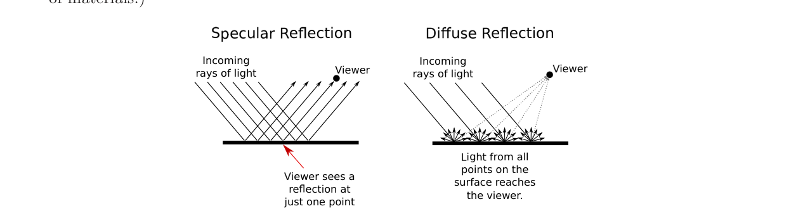
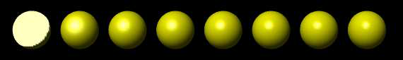

# 第4章 光与材质

### 本章总览

本章对应 Eck《Introduction to Computer Graphics》第 4 章 *OpenGL 1.1: Light and Material*，PDF 第 145–182 页。第 5 章从 PDF 183 起，本笔记未读。

原书目标之一是物理真实，另一目标是速度。OpenGL 1.1 为实时图形做了很大折中：光、材质、纹理的支持按今天的标准既粗且不全，但用到的概念仍是现代实时图形的底座，也在相当程度上支撑最真实的离线绘制。更现代的材质看法见第 8 章 8.2。

本笔记**只抽光照与材质的数学模型**。4.2 里的函数名、4.3 图像纹理、4.4 属性栈与相机动画不写成编程笔记。光源位置用到的齐次坐标，数学上接第 3 章 3.5.3。

默认不做光照计算时，顶点颜色就是当前颜色。打开光照后必须再打开光源，否则物体全黑。表面与光如何作用，由材质(material)决定。

### 核心知识点

#### 镜面反射与漫反射

光打到表面，一部分反射。真实反射很复杂，OpenGL 1.1 用两类反射做极粗的近似：镜面反射与漫反射。其他三维系统也常用这两类。

理想镜面（「像镜子」）里，入射光线完整地反射出去，反射线与表面的夹角等于入射线与表面的夹角。观察者必须正好站在反射线上才能看见。即使整块表面都被照亮，也只在几何对上的那些点看见光源的像。这样的亮斑叫镜面高光(specular highlights)。实务上把反射想成一个或窄或宽的光锥，而不是一根完美射线。

很亮的表面反射锥窄，高光小而锐；较钝的表面锥宽，高光大而糊。控制高光大小与锐度的材质量叫光泽度(shininess)，取值 0 到 128。数越大，高光越小。书中八个球只改 shininess：最左为 0，高光几乎盖住半球，很难看；从左到右每次加 16。

纯漫反射把入射光线向各方向均匀散射。观察者会看见整个表面上的反射光。若入射是均匀照亮表面的平行光，表面看起来均匀亮。（若不同射线以不同角度打到表面——近灯或曲面都会如此——则该点的照度取决于入射角，而不取决于该点到观察者的方向。）

入射光可以一部分被吸收，一部分漫反射，一部分镜面反射。不同波长的反射比例可以不同，这就是材质的颜色。于是材质可以有两种颜色：漫反射色(diffuse color)是物体的基本色，镜面色(specular color)是高光的颜色。两者可以相同（金属常如此），也可以不同（塑料高光常常是白的，与漫反射色无关）。

🔑 关键速记：漫反射色是物体本色；镜面色加 shininess 决定高光的颜色和锐度。

#### 环境色与自发光

OpenGL 还给材质另外两种「颜色」。

环境色(ambient color)描述表面如何反射环境光(ambient light)。环境光是不再来自某一确定方向的整体亮度，来自反复反射后的光。它解释了为什么影子不是绝对黑。这只是对多次反射的粗近似，但比完全忽略多次反射好。环境色一般设成与漫反射色相同。

自发光色(emission color)不是反射意义上的颜色：它与外来光无关，看起来像物体自己发出的。这并不表示物体会照亮别的物体，但即使没有任何光源（连环境光也没有）也能看见它。有外来光时，它会比单靠照明更亮，因而显得在发光。通常是黑，即完全不自发光。

四种材质颜色都用三个数表示 RGB。真实光有连续波长，RGB 三通道对人类色觉通常够用。材质颜色也可以带 alpha；OpenGL 里真正用到的只有漫反射色的 alpha。

对环境、漫反射、镜面的红绿蓝分量，「颜色」其实是反射率(reflectivity)：红色分量是打到表面的红光被反射的比例。三类反射色对应三类光，同一材质可以对三类光有不同反射率。

🔑 关键速记：环境色乘整体环境光；自发光直接加到颜色里，并不照亮别人。

#### 光源：点光、方向光与三种强度

除环境光外，光来自灯或太阳。这是两类光源：点光(point light)从空间一点向四面八方发射；方向光(directional light)的光线平行。太阳因为极远，到达地球时当作方向光。

光源也有颜色。更准确地说是强度或能量在波长上的分配。计算机里通常只留红、绿、蓝三个强度。OpenGL 给每个光源三种颜色：环境、漫反射、镜面。漫反射强度与材质漫反射色作用，镜面强度与材质镜面色作用；二者常常取成相同。

光源的环境强度加到场景的整体环境光上（还可以有不挂在任何光源上的全局环境光）。环境光与材质环境色的作用不依赖光源或观察者的位置：光源不必照到物体，只要开着，就会影响环境项。

这不是真实物理：真实光源没有分开的环境/漫反射/镜面三色。许多系统只用一种光源颜色。

🔑 关键速记：点光从一点向四周；方向光是平行束；每个光源仍拆成环境、漫反射、镜面三项。

#### 法向量与平坦/光滑着色

光照既依赖材质和光，也极大依赖光线打到表面的角度。镜面反射必须用到这个角，漫反射也受它影响。所以均匀颜色的曲面在不同点看起来不同。

表面朝向用垂直于表面的非零向量表示，即法向量。光照计算里法向必须长度为 1，即单位法向。任意非零法向除以自己的长度就得到单位法向。曲面上不同点朝向不同，法向属于特定点。计算时法向赋在图元的顶点上，再用这些顶点法向给整个图元算光。

多边形是平的，真正垂直于多边形的法向处处相同。若目标就是多面体的扁面，每个面的法向应相同。若多边形只是在逼近球面之类的曲面，顶点法向应垂直于**真实曲面**，而不是垂直于那块扁多边形。

书中两条矩形带几何完全相同：上面用垂直于曲面的法向，看起来光滑；下面用垂直于矩形的法向，能看见棱。同一顶点若属于两个矩形，光滑情形共享一个法向，平坦情形两个矩形各用法向，衔接处法向突变，渲染上就是一次突然变暗，被看成棱或角。这两种赋法向的方式叫平坦着色(flat shading)与光滑着色(smooth shading)。

法向由建模者指定，不必字面上垂直于多边形。一点上总有两个相反的单位法向。多边形有正反两面；默认规则是：看正面时顶点逆时针，看背面时顺时针。法向应从正面指出。右手定则：四指按顶点列举顺序卷，拇指就是法向。看正面时法向朝向你，看背面时法向离你而去。

缩放会改法向长度，旋转和平移不改长度。变换后若不再是单位长，应再归一化，否则光照公式会错。

🔑 关键速记：光照用法向在顶点上的值；逼近曲面时用法向贴曲面，不要贴扁面。

#### 光照方程

「做光照计算」的目标是给表面上一点一个颜色 \((r,g,b,a)\)。OpenGL 1.1 只在顶点上算，图元内部由顶点颜色插值。

alpha 等于该顶点漫反射材质的 alpha。下面忽略 alpha。设材质的环境、漫反射、镜面、自发光 RGB 为 \((m_{ar},m_{ag},m_{ab})\)、\((m_{dr},m_{dg},m_{db})\)、\((m_{sr},m_{sg},m_{sb})\)、\((m_{er},m_{eg},m_{eb})\)。与任何光源无关的全局环境强度为 \((g_{ar},g_{ag},g_{ab})\)。光源编号 0、1、2，……。红色分量为

\[
r = m_{er} + g_{ar}\,m_{ar} + I_{0,r} + I_{1,r} + I_{2,r} + \cdots
\]

绿、蓝形式相同。自发光直接相加。全局环境项是强度乘材质环境色，即环境色是被反射的环境光比例。关掉的光源贡献为零。

单个光源的几何：\(N\) 是该点单位法向；\(L\) 是沿「光来的方向」指回去的单位向量；\(V\) 指向观察者；\(R\) 是镜面反射方向。\(N\) 与 \(L\) 的夹角等于 \(N\) 与 \(R\) 的夹角。单位向量的点积等于夹角余弦。

设该光源的环境、漫反射、镜面强度为 \((l_{ar},l_{ag},l_{ab})\)、\((l_{dr},l_{dg},l_{db})\)、\((l_{sr},l_{sg},l_{sb})\)，材质光泽度为 \(m_h\)。该光源对红色的贡献为

\[
I_r = l_{ar}\,m_{ar} + f\bigl(l_{dr}\,m_{dr}\,(L\cdot N) + l_{sr}\,m_{sr}\,\max(0,V\cdot R)^{m_h}\bigr)
\]

绿、蓝相同。第一项是这个光源的环境贡献，无论表面是否朝向光都加上。

\(f\) 在表面背对光时为 0，朝向光时为 1。可用 \(L\cdot N<0\) 判断：点积是夹角余弦，小于 0 表示夹角大于 \(90^\circ\)，法向与光不在表面同侧。\(f=0\) 时没有漫反射项和镜面项。

漫反射项（再乘 \(f\)）是 \(l_{dr}m_{dr}(L\cdot N)\)：光的漫反射强度乘材质漫反射率，再乘 \(L\) 与 \(N\) 夹角的余弦。夹角变大时，同样能量摊在更大面积上；从 \(0^\circ\) 到 \(90^\circ\)，余弦从 1 降到 0，漫反射贡献变小。

镜面项来自反射锥：\(R\) 在锥轴上，观察者离轴越近，镜面越强，远近由 \(V\cdot R\) 刻画。公式是 \(l_{sr}m_{sr}\max(0,V\cdot R)^{m_h}\)。\(\max(0,\cdot)\) 保证夹角大于 \(90^\circ\) 时镜面贡献为 0。\(m_h=0\) 时 \((V\cdot R)^{m_h}=1\)，与角度无关，就是 shininess 为 0 时那种又大又难看的高光。\(m_h>0\) 时，\(V\) 与 \(R\) 夹角为 0 贡献最大，夹角增大则下降；\(m_h\) 越大下降越快，高光越小越锐。

各开启光源的贡献相加。分量很容易超过 1，最后夹到 \([0,1]\)，大于 1 的改成 1。大片夹成白就会像过曝，照明信息丢掉。

本节公式没有写点光随距离衰减，也没有写只发射一个光锥的聚光灯(spotlight)。书明确说这两项可以配置，但本书不讲。这个模型也没有影子：物体挡不住光，光会穿过它们。

书中一组金色材质数字（仅作四通道取值的例子）：环境 \((0.24725,\,0.1995,\,0.0745)\)，漫反射 \((0.75164,\,0.60648,\,0.22648)\)，镜面 \((0.628281,\,0.555802,\,0.366065)\)，光泽度 \(50\)。

🔑 关键速记：顶点色 = 自发光 + 全局环境 + 各灯的（环境 + \(f\)·漫反射·\(L\cdot N\) + \(f\)·镜面·\(\max(0,V\cdot R)^{m_h}\)），最后夹到 \([0,1]\)。

#### 光源的齐次位置

光源位置用四个数 \((x,y,z,w)\) 给出，至少一个非零。这就是齐次坐标。

\(w=0\) 时是方向光，\((x,y,z)\) 给出方向：光线沿从 \((x,y,z)\) 指向原点的直线。光源可看成沿 \((x,y,z)\) 的无穷远点。

\(w\neq 0\) 时是点光，位于 \((x/w,\,y/w,\,z/w)\)。通常 \(w=1\)，即点 \((x,y,z)\)。

所有光源的默认位置是 \((0,0,1,0)\)：从 \(+z\) 射向 \(-z\) 的方向光。默认只有 0 号灯的漫反射色不是零；其余灯的强度默认全零，只打开而不改强度不会发光。0 号灯默认还可看成从观察者方向射入的白光、没有镜面项。

位置在设置时所处的模型视图下变换，也就是在眼坐标里解释：与顶点一样先乘当前模型视图。方向光的方向只受模型视图里的旋转部分影响。三种典型用法：在任何模型视图之前设置，光钉在观察者上；在观察变换之后、建模之前设置，光钉在世界上；在某物体的建模之后设置，光跟着那个物体走。

全局环境光默认是黑（RGB 全零），即使所有灯都关着也会存在；一般应设得很低。书中例子用 \((0.15,0.15,0.15)\)。

🔑 关键速记：\(w=0\) 是无穷远方向光，\(w\neq 0\) 是有限点光；位置跟顶点一样乘模型视图。

#### 双面光照与局部观察者

多边形可以有正面材质和背面材质。默认只用正面材质，两面用法向也不翻。背面看起来会像被「位于正面一侧」的灯照着，这是错的。

双面光照打开后：背面用背面材质，并且计算背面时把法向反向。可能看见背面时（例如开口柱体内壁）才需要；封闭实心物体的背面藏在内部，通常不必。

第三项全局选项是局部观察者(local viewer)。默认 \(V\) 总是直直指出屏幕，这对正交投影为真，对透视不准确。打开后使用指向观察者的真实方向。实务上差别通常不明显。

圆柱侧面（半径 1、高 2、轴沿 \(z\)）上，顶底边缘点为 \((\cos a,\sin a,\pm 1)\)，侧面法向为 \((\cos a,\sin a,0)\)，与半径同向、\(z\) 分量为 0。顶面用法向 \((0,0,1)\)，底面用 \((0,0,-1)\)；底面顶点顺序与顶面相反，以保持正面朝外。

🔑 关键速记：双面要把背面法向翻过来；局部观察者才让 \(V\) 指向真正的眼睛。

#### 章末要点

1. 材质四色：环境、漫反射、镜面、自发光；shininess 在 0 到 128。
2. 光源三强度，再加可有可无的全局环境；点光与方向光靠齐次 \(w\) 区分。
3. 顶点色按书中方程累加各灯，最后夹到 \([0,1]\)。
4. 法向必须单位长，逼近曲面时贴曲面而不是贴扁面。
5. 本模型没有影子，也不含衰减与聚光灯公式。

### 易混淆点与差异对比

| 对比 | 含义 | 容易混的地方 |
| --- | --- | --- |
| 漫反射色 vs 镜面色 | 物体本色 vs 高光颜色 | 塑料常白高光；金属常两者相同 |
| 环境光 vs 漫反射光 | 无方向的整体亮度 vs 从光源直接来、与 \(L\cdot N\) 有关 | 环境项不看位置；灯开着就会加 |
| 自发光 vs 光源 | 加到自己的颜色 vs 能照别人 | 自发光不照亮场景里其他物体 |
| 平坦 vs 光滑法向 | 垂直于多边形 vs 垂直于被逼近的曲面 | 几何可以完全一样，观感完全不同 |
| 点光 vs 方向光 | \(w\neq 0\) 的有限点 vs \(w=0\) 的无穷远 | 默认 \((0,0,1,0)\) 是方向光，不是原点处的灯 |
| 镜面色 vs 第 8 章的镜面反射率 | 高光（反射光源） vs 反射其他物体 | 书把后者留到光线追踪；本模型不会在表面上映出别的物体 |

### 本章要点总结

第 4 章的数学模型是顶点上的局部光照：自发光加上全局环境，再加上每盏灯的环境、漫反射、镜面。漫反射带 \(L\cdot N\)，镜面带 \(\max(0,V\cdot R)^{m_h}\)，背对光时后两项关掉。颜色最后夹到 \([0,1]\)。

材质用反射率说话，光源用强度说话。法向决定角度；光滑着色用曲面上的法向。光源位置是齐次的，\(w\) 区分点光与方向光。影子、衰减、聚光灯和多次反射都不在这个方程里。纹理与动画接口本笔记不写。更完整的散射描述见第 8 章的 BSDF 与路径追踪。
