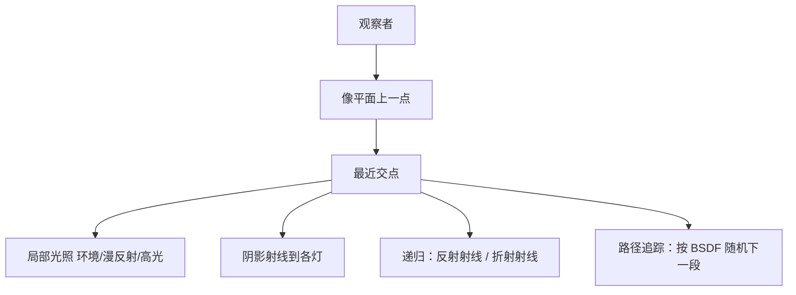
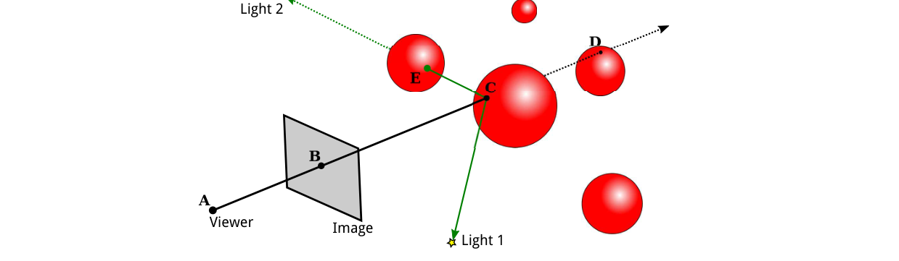
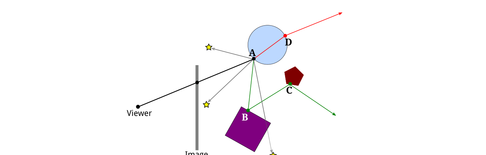

# 第8章 光线追踪

### 本章总览

本章对应 Eck《Introduction to Computer Graphics》第 8 章 *Beyond Basic 3D Graphics* 的 8.1–8.2，**只读 PDF 第 339–347 页**。第 9 章从 PDF 348 起，本笔记不写第 5–7 章与第 9 章。

前七章讲的是实时图形：一帧要在一秒的几分之一内画完。游戏常要每秒六十帧。电影级 CGI 可以花数小时算一帧，有时已经难与实拍区分。高端 GPU 开始为光线追踪和全局光照提供硬件，但实时仍追不上最高质量的离线绘制。

本章只给概念，不给例程，也不展开公式推导。前面学过的几何图元、变换、材质、纹理、光源仍然适用，只是材质和光照可以更复杂。设计师看的实时预览仍可用前几章的方法；电影里最终那一帧换成更费计算的算法。

8.1 是光线追踪(ray tracing)，8.2 是路径追踪(path tracing)。二者都从观察者向场景反方向跟光线。

图注：从观察者穿过像点进入场景，先取最近交点。光线追踪在交点上算局部光、阴影射线，并按需要递归反射或折射。路径追踪则按 BSDF 随机选方向，把路径一直跟到发光体。

### 核心知识点

#### 光线投射

光线追踪背后的想法不复杂：要知道朝某一方向看见什么，就沿着从该方向到达你的那条光线往回走，看它从哪来。通常的说法是：从所在位置朝该方向射出一条射线，看它打中什么。

确定射线打中什么，叫光线投射(ray casting)。它是光线追踪和其他高级方法的底座。射线(ray)是从起点沿某一方向伸到无穷的半直线。本章关心的是离起点最近的那个交点。

把图像想成观察场景的矩形窗。要给窗上一点着色，从观察者位置穿过该点射入场景，取与物体的最近交点。

算 C 的可见颜色，仍需要该点法向和材质，这些必须能从场景描述算出来。对一盏灯，令 \(L\) 从 C 指向光源。若 \(L\) 与法向夹角大于 \(90^\circ\)，灯在表面背后，不加光照。否则再从 C 沿 \(L\) 投射：若在到达光源之前先打到物体，该物体挡住这盏灯。从表面上一点指向光源的射线叫阴影射线(shadow ray)，用来判断该点是否落在另一物体的影子里。

有了这些，像点颜色可以用第 4 章 4.1.4 的同一套光照方程。光线投射本身就解决了隐藏面，不需要深度缓冲；额外得到 OpenGL 里很难做的影子。若穿过 B 的射线什么也打不中，B 用背景色，或随方向变化的「天空」色；也可以让整个场景包在天空盒(skybox)里，未打中其他物体的射线打到天空盒。

实现细节可以很麻烦。球面相对容易：直线与球有求交公式；球面上一点的法向与球心到该点的方向相同；材质均匀时数据就齐了。

表面常常是三角网格，属性只在顶点上给出。交点落在某个三角形内时，要把顶点上的量插值到交点。常用重心坐标(barycentric coordinates)：三角形顶点 \(A,B,C\)，内部点 \(P\) 可唯一写成

\[
P = aA + bB + cC,\qquad a,b,c\in[0,1],\quad a+b+c=1.
\]

\(a,b,c\) 就是 \(P\) 的重心坐标。顶点上某量 \(V(A),V(B),V(C)\)（漫反射色、纹理坐标或法向）在 \(P\) 处取

\[
V(P)=a\,V(A)+b\,V(B)+c\,V(C).
\]

直线与三角形是否相交、交点重心坐标的具体公式，书中不写，只指出存在公式。

🔑 关键速记：穿过像点取最近交点，再用阴影射线决定哪些灯照得到，然后套第 4 章的局部光照。

#### 递归光线追踪

基本投射加上阴影射线，就能做 OpenGL 式绘制并带影子。再多射几条射线，就得到光线追踪。为了与单纯投射区分，常叫递归光线追踪(recursive ray tracing)。

OpenGL 的镜面项只能让物体在反射光源时显出高光。真正的镜面还会反射其他物体。要给镜面点 \(A\) 着色，需要考虑其他物体经镜面反射对 \(A\) 的贡献。从 \(A\) 射出反射射线(reflected ray)，方向由该点法向和从 \(A\) 指向观察者的方向决定。

到达 \(A\) 的那条反射线的颜色，就是在 \(B\) 上再做一遍光线追踪：用 \(B\) 的材质，从 \(B\) 向各灯射阴影射线，若方块也是镜面再从 \(B\) 射反射线。于是圆盘上能看见方块，方块上能看见五边形，多层镜面反射可以处理。

半透明(translucency)用类似办法。给半透明点着色，要计入穿过物体到达该点的光，再沿进入物体的方向射一条射线。光从一种介质进入另一种介质时路径会弯，称为折射(refraction)；穿过半透明物体的那条叫折射射线(refracted ray)。弯曲程度取决于两种介质的折射率(index of refraction)之比。实务上常把物体外的折射率取成 1，于是弯曲只取决于物体的折射率。折射率常简写 IOR，是半透明物体的又一项材质。

一个像点的颜色由最近交点上各类贡献相加：

1. 各光源的漫反射、镜面、可能还有环境。依据物体的相应颜色、法向和灯的性质。环境色和漫反射色常常来自纹理。镜面项产生高光，本质上是光源的像。阴影射线决定哪些方向光和点光照得到该点；除此以外，这一部分与 OpenGL 相似。
2. 若表面有镜面般的反射，再射反射线并递归求颜色。贡献按镜面反射强度(mirror reflectivity)掺入。完美镜子贡献 100%，一般更少。这是一项新材质；它负责物体在彼此表面上的映像，而镜面色负责高光。
3. 若物体半透明，再射折射线。贡献取决于透明度；一部分光可被吸收而不透过。透明度可以随波长变，例如有色玻璃。

红、绿、蓝各做一遍。

递归必须有出口。射线不交任何物体是一类出口。也可以在继续射下去已不能给图像加多少颜色时停止：每次反射都按物体颜色吸收一部分，多次之后几乎没剩；也可以计入随距离的衰减。此外应设最大递归深度，给自调用次数一个硬上限。

🔑 关键速记：在交点上叠加局部光、递归反射和递归折射；镜面反射率映出其他物体，镜面色只负责高光。

#### 光线追踪做不到的事

点光和方向光很合适，面积光(area light)不行。面积光从一整块表面发光，真实光源都是这样：灯管是柱面，亮窗也是一块面积，灯泡也不是严格的一点。阴影射线只沿一个方向，只能打中面积光上的一个点。精确处理需要对面上每一点另射一条阴影射线。

近似办法是把面积光换成点光网格，朝每个格点射阴影射线；格点越多越好，代价是时间。

光线追踪也不计入**反射光**对其他物体的照明。镜子反射的光应照亮别的东西，但算法不知道阴影射线该朝哪射——反射光可以从任意方向来。不只是镜子：漫反射光也应照亮近旁物体。从绿色物体漫反射出去的光会给附近物体添一层绿，称为颜色溢出(color bleeding)。现实中光可以反射很多次，每次都给碰到的物体添一点颜色。

近似手段包括光子映射(photon mapping)：预处理阶段从光源射出大量「光子」，跟踪它们如何给物体添色，再在追踪阶段用这张光子图。OpenGL 用环境光近似多次反射，并假定对环境光处处相等，这是差的近似。更好的近似是环境遮蔽(ambient occlusion)：把环境光想成来自背景，从一点向随机方向射若干射线，被几何挡住的比例越大，该点环境遮蔽越强。它同样不是物理真实，但常让物体更立体。

试图计入光与场景中所有物体全部相互作用的算法，称为全局光照(global illumination)。上面这些近似可以挂在光线追踪上，代价是复杂度和时间。这就是为什么很真实的图像算得那么久。

🔑 关键速记：经典光线追踪没有面积光，也算不准反射光照和颜色溢出；全局光照要另加近似或换算法。

#### BSDF

路径追踪用一种更一般的材质：双向散射分布函数 BSDF (Bidirectional Scattering Distribution Function)。OpenGL 材质是环境、漫反射、镜面、自发光再加 shininess；除自发光外，它们描述表面如何与光作用，并且可以随点变化（纹理）。这只是粗近似。

光到达一点后：一部分被吸收，一部分不受影响地穿过，一部分被散射到其他方向。穿过可看成散射的特例。BSDF 描述表面上或体积里每一点如何把光散射出去。

单条入射光子的命运依赖来向。不被吸收时，它更可能朝某些方向离开（例如镜面反射）。该点的 BSDF 给出光子沿某一给定方向离开的概率。它是「双向」的，因为答案是两个方向的函数：入射方向，以及你询问的出射方向。它也随位置变，并且一般随波长变。「分布函数」来自连续概率的数学语言；这里只需知道：它描述从某方向来的光如何分配到可能的出射方向。

空的空间里 BSDF 很平凡：到达的光 100% 沿原方向继续。雾、尘土空气、脏水里，有一定概率被吸收，有一定概率被散射到随机方向。半透明固体内部类似。

传统图形更关心表面。表面可以吸收、反射，或（若半透明）透射。只描述反射的有时叫 BRDF (Bidirectional Reflectance Distribution Function)，只描述透射的叫 BTDF (Bidirectional Transmission Distribution Function)。表面的 BSDF 是二者的组合。

用 BSDF 语言回看 OpenGL：基本 OpenGL 里光只能被反射或吸收。漫反射时，光等概率射向与法向夹角小于 \(90^\circ\) 的一切方向，并且不依赖来向。镜面反射时来向有关：可能的出射方向构成一个锥，锥轴与法向的夹角等于法向与入射线的夹角；轴是最可能的出射方向，离开轴则概率下降，下降快慢由 shininess 给出。表面的 BRDF 把漫反射和镜面合在一起。环境材质不太进得了 BSDF：物理上没有一种与普通光不同的「环境光」。

光线追踪又加了两种：完美镜面反射（出射与法向的夹角精确等于入射与法向的夹角），以及按内外折射率决定出射角的透射。BSDF 还能消掉「反射物体」与「反射光源」的人为区分：完美镜子两种都应按镜面方式反射；又亮又糙的表面则把所有镜面反射送进一个方向锥，物体和灯的像都发糊。BSDF 也不应区分来自灯的光和从其他物体反射来的光。

次表面散射(subsurface scattering)对略微半透明的材料（牛奶、玉、皮肤）往往很重要：光进入物体，在内部散射几次，再从另一点出来。内部行为由内部介质的 BSDF 决定，与雾类似，只是散射概率更大。几乎任何物理上真实的材质，都可以用选对的 BSDF 来建模。

🔑 关键速记：BSDF 用两个方向上的概率代替 OpenGL 那几项颜色；BRDF 管反射，BTDF 管透射。

#### 路径追踪与渲染方程

路径追踪依据渲染方程(rendering equation)：从给定点沿给定方向离开的光能，等于该点沿该方向发出的光能，加上从其他地方到达该点、再被散射到该方向的光能。

「发出」指被创造出来的光，例如光源。渲染方程里任何物体都可以是发射体：带自发光色的物体真的会照亮别人。面积光就是从每一点发光的延展物体；典型路径追踪场景常用大块发光体。点光和方向光往往要先赋一点面积，或掺一些正向路径追踪，算法才能正确工作。正向路径追踪(forward path tracing)从光源沿时间向前跟光线，书中提到它有时也会被使用。

散射由该点 BSDF 决定。光一般可以从任意方向到达，可以来自场景中任意其他点。方程在每一点都成立，把所有点的到达光和离开光耦在一起，精确解通常得不到。绘制算法就是在找这个方程的好近似。

路径追踪是概率算法。它考察「到达观察者的光可能走过的路径」，每条路径有一个概率。按这些概率随机抽出一批路径，用来生成近似解。可以证明：样本越大，图像越接近真解。每个像素往往要跟数千条路径，结果可以非常真实。

只让表面发射和反射时：仍从观察者穿过像点射入，找最近交点。目标是跟一条从源头走到观察者的可能路径，选中某条路径的概率应等于光真正走这条路的概率。因此每次从表面散射时，下一段方向按该表面 BSDF 的概率分布随机选，再沿该方向投射。反向（沿时间往回）继续，经过可能的多次反射，直到碰到发光体；这个物体就是光的源头。该路径对图像的颜色由发射体的颜色和强度、沿途表面的颜色、以及打到各表面的角度决定。若在碰到发光体之前逃出场景，这条路径不贡献颜色。（也可以设一块大面积发光的背景，例如天空。）物体可以同时发射和反射，路径碰到光源后仍可继续。

一个像素的颜色是穿过该像素的所有路径颜色的平均。

若光可以在空间中任意点散射，而不只在表面上：问题变成光走多远才会被散射。介质的 BSDF 给出两次散射之间路程的概率分布。光进入介质后，按这个分布随机抽一段路程（除非先碰到表面或进入另一种介质）。在介质内散射后，再按 BSDF 随机抽下一段方向和长度。薄雾的平均自由程很长，牛奶那样的密介质很短。

路径追踪发明于 1980 年代，直到近年才比较能通用；高质量仍可能要许多小时。附录 B 的 Blender 里，Cycles 渲染器走路径追踪。

🔑 关键速记：离开的光 = 自发光 + 按 BSDF 散射进来的光；用按概率抽样的路径去平均，近似渲染方程。

#### 章末要点

1. 光线投射取最近交点，阴影射线给出影子，局部色仍用第 4 章方程。
2. 递归追踪加反射射线与折射射线；IOR 决定弯曲，镜面反射率映出其他物体。
3. 经典追踪处理不好面积光和反射光照；颜色溢出、环境遮蔽、光子映射都是补丁。
4. BSDF 用双方向上的散射概率统一材质；次表面散射由内部 BSDF 描述。
5. 路径追踪对渲染方程做概率抽样，像素色是大量路径的平均。

### 易混淆点与差异对比

| 对比 | 含义 | 容易混的地方 |
| --- | --- | --- |
| 光线投射 vs 光线追踪 | 一次求最近交点 vs 再递归反射/折射 | 投射已能做局部光和影子；「追踪」通常指递归 |
| 阴影射线 vs 反射射线 | 指向光源，用来挡光 vs 按反射定律去取其他物体的颜色 | 阴影射线不递归着色，只问中间有没有挡 |
| 镜面色 vs 镜面反射率 | 高光（灯的像） vs 物体在彼此表面上的映像 | 第 4 章只有前者；后者是追踪新增的材质 |
| 光线追踪 vs 路径追踪 | 沿镜面/折射的少数确定射线 vs 按 BSDF 随机的大量路径 | 追踪是递归树；路径是概率抽样 |
| 环境光 vs 环境遮蔽 | 处处相同的填光 vs 用随机射线估计被挡住的比例 | 后者仍不是物理真实，但通常更立体 |
| BSDF vs OpenGL 材质 | 双方向散射概率 vs 环境/漫反射/镜面/自发光 | 环境项进不了 BSDF；自发光在渲染方程里变成真的会照别人 |

### 本章要点总结

PDF 339–347 留下的结论是：从观察者反方向跟光。投射解决隐藏面并给出影子；递归追踪再加上镜子和玻璃；它仍然算不准面积光和间接光。

BSDF 把材质改写成「从哪个方向来、往哪个方向去」的概率。渲染方程说，离开的能量等于发出的加上散射进来的。路径追踪按这个概率抽大量路径并取平均，从而统一处理面积光、颜色溢出和体积散射。第 4 章的局部方程仍是追踪里「这一段直接来自灯」的那一项，不是全部。
