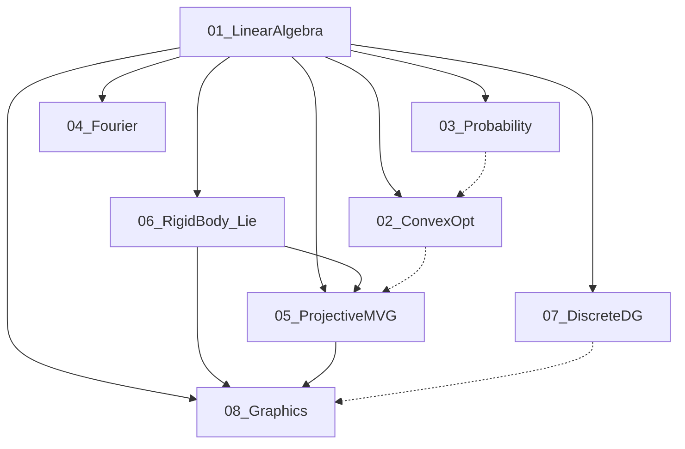

# 视觉相关数学知识库 整体规划大纲

> 状态：规划已确认，待按章生成笔记。本文件只做整体规划，不替代 MEMORY，也不含正文笔记。
> 源文档根目录：`./docs/视觉相关数学知识/`。索引见 `./docs/视觉相关数学知识/来源与版权说明.md`。
> 阅读边界：只读了各 PDF 的目录、前言、引言（或无前言时的开篇说明）。正文主体未读，大纲不写算子参数与定理细节。
> Osgood 无独立前言，开篇在 Chapter 1.1。Pajdla 无前言，第 1 章是 Notation（记号），依赖声明在第 2 章开头一句。
> 本阶段不生成章节笔记，不更新 README，不修改 MEMORY。批量笔记须另行确认后，再按各领域「建议首批」分章局部读 PDF。

---

## 整体说明

### 知识库定位

面向计算机视觉的数学基础知识库，覆盖 8 个核心领域。每领域对应 `./docs/视觉相关数学知识/` 中的一份作者或高校公开教材，用作该领域的主线。机器人学、机器学习或图形学 API 教程里超出该领域数学主线的章节，保留在大纲中并标为后置，不与数学主线章节同等展开。

### 来源

全部为作者 / 高校 / 出版社公开版教材与讲义。Hartley & Zisserman《Multiple View Geometry in Computer Vision》（多视图几何）无官方全文，未收录；多视图几何以 Pajdla 讲义为准。

### 库外前置

这 8 本书里没有微积分专书。Boyd 前言写明，没学过分析（analysis）与概率仍能抓住要点，数值计算与最优化也不必预先学过。Osgood、Crane，以及 Lynch 中角速度、动力学部分，默认读者能使用多元微积分。

### 学习路径建议

下列顺序是视觉数学主线，不是各书内部的授课顺序。

1. **01 线性代数**。Gallier 前言把线性代数和优化理论并列为读懂计算机视觉、机器人、机器学习的底子；本 PDF 是第一卷，收到 Jordan 形为止。
2. **03 概率统计**。先读 Murphy Part I 的概率、统计、决策、信息论。书中第 7 章 Linear Algebra（线性代数）、第 8 章 Optimization（优化）是回顾，正式内容分别归 01、02。
3. **04 傅里叶分析**。内积与正交用过 01 之后再读。复数在 Osgood 附录 A。成像被 Chapter 1.1 列为受众之一。视觉上优先卷积、采样、DFT、高维变换。
4. **02 凸优化**。向量与矩阵用过 01 之后再读。统计估计章可与 03 对照。几何问题章服务后面的标定与拟合。Pajdla 讲义本身从线性代数进入，不把 Boyd 当作开读条件。
5. **06 刚体变换与李群**。Lynch 前言写明 Chapter 2–6 是该书最低限度，且应按顺序讲。对本知识库，本域核心是 Chapter 2–3 与 Appendix B（单位四元数等）；Chapter 4–6 是机器人运动学延伸。
6. **05 射影与多视图几何**。第 2 章开头写明依赖线性代数。刚体运动可先用 Lynch Chapter 3，或先读 Pajdla 自己的 Motion（运动）章再补李群。
7. **08 计算机图形学**与 **07 离散微分几何**放在几何主线之后。图形学的数学骨架是坐标、变换、投影、光照、光线追踪；离散微分几何服务三维网格与曲面，可与图形学并行，不挡多视图几何。

建议首批笔记范围写在各领域下。后置章节仍保留在大纲里，供以后按需补笔记。

---

## 分领域章节规划

### 01 线性代数（Linear Algebra for CV, Robotics, ML）

- 原书：Jean Gallier, Jocelyn Quaintance, *Linear Algebra for Computer Vision, Robotics, and Machine Learning*（面向计算机视觉、机器人与机器学习的线性代数）。UPenn CIS 5150 持续更新稿，本地 PDF 800 页。路径：`./docs/视觉相关数学知识/01_线性代数/线性代数_Gallier_Quaintance_LA_for_CV_Robotics_ML.pdf`。前言与 Chapter 1 Introduction（引言）确认：本册是第一卷，覆盖经典线性代数直到准素分解与 Jordan 形。
- 核心章节（引言用 Chapter 8、Section 5.5、Section 11.7、Section 14.5、Chapter 15 对过号）：
  - Preface（前言）；Chapter 1 Introduction（引言）
  - Chapter 2 Vector Spaces, Bases, Linear Maps（向量空间、基与线性映射）
  - Chapter 3 Matrices and Linear Maps（矩阵与线性映射）
  - Chapter 4 Haar Bases, Haar Wavelets, Hadamard Matrices（Haar 基、Haar 小波与 Hadamard 矩阵）
  - Chapter 5 Direct Sums, Rank-Nullity Theorem, Affine Maps（直和、秩–零度定理与仿射映射）
  - Chapter 6 Determinants（行列式）
  - Chapter 7 Gaussian Elimination, LU, Cholesky, Echelon Form（高斯消元、LU、Cholesky 与阶梯形）
  - Chapter 8 Vector Norms and Matrix Norms（向量范数与矩阵范数）
  - Chapter 9 Iterative Methods for Solving Linear Systems（线性方程组迭代法）
  - Chapter 10 The Dual Space and Duality（对偶空间与对偶）
  - Chapter 11 Euclidean Spaces（欧氏空间）
  - Chapter 12 QR-Decomposition for Arbitrary Matrices（一般矩阵的 QR 分解）
  - Chapter 13 Hermitian Spaces（埃尔米特空间）
  - Chapter 14 Eigenvectors and Eigenvalues（特征向量与特征值）
  - Chapter 15 Unit Quaternions and Rotations in SO(3)（单位四元数与 SO(3) 旋转）
  - Chapter 16 Spectral Theorems（谱定理）
  - Chapter 17 Computing Eigenvalues and Eigenvectors（特征值与特征向量的计算）
  - Chapter 18 Graphs and Graph Laplacians; Basic Facts（图与图拉普拉斯）
  - Chapter 19 Spectral Graph Drawing（谱图绘制）
  - Chapter 20 Singular Value Decomposition and Polar Form（奇异值分解与极分解）
  - Chapter 21 Applications of SVD and Pseudo-Inverses（SVD 与伪逆的应用）
  - Chapter 22 Annihilating Polynomials; Primary Decomposition（零化多项式与准素分解）
- 前置依赖：无。群、环、域只在 Chapter 2 里有简短引子。
- 视觉相关度：高。前言点名计算机视觉、机器人、机器学习；引言单列 Haar 小波、仿射映射、矩阵范数、矩阵指数与 Rodrigues 公式、单位四元数。
- 建议首批：Chapter 2–8、10–11、14–15、20–21。Chapter 4、18–19 服务图像与图；Chapter 9、12–13、16–17、22 后置。习题与 Bibliography（参考文献）、Index（索引）不单独成笔记。

### 02 凸优化（Convex Optimization）

- 原书：Stephen Boyd, Lieven Vandenberghe, *Convex Optimization*（凸优化）。Cambridge 纸书，Stanford 作者页公开 PDF，本地 714 页。路径：`./docs/视觉相关数学知识/02_凸优化/凸优化_Boyd_Convex_Optimization.pdf`。前言目标是学会辨认、写成并求解凸问题；读者经验主要来自电气工程与计算机科学研究生。
- 核心章节（书签标题；Chapter 2、10、11 的章名在目录页正文核对过）：
  - Preface（前言）；Chapter 1 Introduction（引言）
  - Part I Theory（理论）：Chapter 2 Convex Sets（凸集）；Chapter 3 Convex Functions（凸函数）；Chapter 4 Convex Optimization Problems（凸优化问题）；Chapter 5 Duality（对偶）
  - Part II Applications（应用）：Chapter 6 Approximation and Fitting（逼近与拟合）；Chapter 7 Statistical Estimation（统计估计）；Chapter 8 Geometric Problems（几何问题）
  - Part III Algorithms（算法）：Chapter 9 Unconstrained Minimization（无约束极小化）；Chapter 10 Equality Constrained Minimization（等式约束极小化）；Chapter 11 Interior-Point Methods（内点法）
  - Appendix A Mathematical Background（数学背景）；Appendix B Problems Involving Two Quadratic Functions（含两个二次函数的问题）；Appendix C Numerical Linear Algebra Background（数值线性代数背景）
- 前置依赖：01。附录 A 自带范数、分析、导数与线性代数回顾。前言写明分析与概率未学过仍可抓住要点，故 03 是 Chapter 7 的加分项，不是开门条件。
- 视觉相关度：高。前言列举估计、信号处理、数据分析与建模；Chapter 6–8 直接对上拟合、统计估计和几何问题。书的应用面宽于视觉。
- 建议首批：Chapter 1–8。Chapter 9–11 与附录后置，需要数值求解时再展开。

### 03 概率统计（Probability and Statistics）

- 原书：Kevin P. Murphy, *Probabilistic Machine Learning: An Introduction*（概率机器学习导论）。MIT Press 开放稿 Book 1，本地 860 页。路径：`./docs/视觉相关数学知识/03_概率统计/概率统计_Murphy_Probabilistic_Machine_Learning.pdf`。前言说明此书用概率视角重写机器学习，并补了 2012 年旧书腾不出的优化与线性代数背景；引言把未知量都当作带分布的随机变量。
- 核心章节：
  - Preface（前言）；Chapter 1 Introduction（引言）
  - Part I Foundations（基础）：Chapter 2 Probability: Univariate Models（概率：一元模型）；Chapter 3 Probability: Multivariate Models（概率：多元模型）；Chapter 4 Statistics（统计）；Chapter 5 Decision Theory（决策论）；Chapter 6 Information Theory（信息论）；Chapter 7 Linear Algebra（线性代数）；Chapter 8 Optimization（优化）
  - Part II Linear Models（线性模型）：Chapter 9 Linear Discriminant Analysis（线性判别分析）；Chapter 10 Logistic Regression（逻辑回归）；Chapter 11 Linear Regression（线性回归）；Chapter 12 Generalized Linear Models（广义线性模型）
  - Part III Deep Neural Networks（深度神经网络）：Chapter 13 Neural Networks for Tabular Data（表格数据神经网络）；Chapter 14 Neural Networks for Images（图像神经网络）；Chapter 15 Neural Networks for Sequences（序列神经网络）
  - Part IV Nonparametric Models（非参数模型）：Chapter 16 Exemplar-based Methods（基于样本的方法）；Chapter 17 Kernel Methods（核方法）；Chapter 18 Trees, Forests, Bagging, and Boosting（树、森林、装袋与提升）
  - Part V Beyond Supervised Learning（监督学习之外）：Chapter 19 Learning with Fewer Labeled Examples（少标签学习）；Chapter 20 Dimensionality Reduction（降维）；Chapter 21 Clustering（聚类）；Chapter 22 Recommender Systems（推荐系统）；Chapter 23 Graph Embeddings（图嵌入）
- 前置依赖：01 的向量、矩阵、特征值。Chapter 3 起会用到多元线性代数。02 可后补，书内 Chapter 8 只作回顾。
- 视觉相关度：高。概率建模是视觉不确定性的语言；Chapter 14、20、21 直接触及图像与表示。全书同时是机器学习教材，推荐系统等章对视觉数学主线贡献低。
- 建议首批：Chapter 1–6。Chapter 7–8 不重写，改指向 01 与 02。Chapter 9–12、14、20、21 作为视觉常用模型选读。其余后置。

### 04 傅里叶分析（Fourier Analysis）

- 原书：Brad G. Osgood, *The Fourier Transform and its Applications*（傅里叶变换及其应用）。Stanford EE 261 讲义，本地 428 页。路径：`./docs/视觉相关数学知识/04_傅里叶分析/傅里叶分析_Osgood_Fourier_Transform_and_Applications.pdf`。无独立前言。Chapter 1.1 写明傅里叶方法用于信号处理、通信与成像（imaging）。
- 核心章节：
  - Chapter 1 Fourier Series（傅里叶级数）
  - Chapter 2 Fourier Transform（傅里叶变换）
  - Chapter 3 Convolution（卷积）
  - Chapter 4 Distributions and Their Fourier Transforms（分布及其傅里叶变换）
  - Chapter 5 III, Sampling, and Interpolation（梳状分布 III、采样与插值）
  - Chapter 6 Discrete Fourier Transform（离散傅里叶变换）
  - Chapter 7 Linear Time-Invariant Systems（线性时不变系统）
  - Chapter 8 n-dimensional Fourier Transform（n 维傅里叶变换）
  - Appendix A Mathematical Background（数学背景：复数、复指数与 Euler 公式）；Appendix B Some References（参考文献）
- 前置依赖：01 中的内积、正交与线性算子。复数由附录 A 自备。Chapter 3 的中心极限定理可与 03 对照，不作为读变换本体的前置。
- 视觉相关度：高。卷积、采样、DFT/FFT、高维变换与 Radon 变换都在目录内；成像是开篇点名的应用。
- 建议首批：Chapter 1–3、5–6、8。Chapter 4 分布理论与 Chapter 7 系统理论后置；Chapter 8 末的晶体与医学成像按目录保留为选读，本阶段不展开正文。

### 05 射影与多视图几何（Projective and Multiview Geometry）

- 原书：Tomas Pajdla, *Elements of Geometry for Computer Vision*（计算机视觉几何基础）。CTU 讲义，日期 Monday 9th May, 2016，本地 136 页。路径：`./docs/视觉相关数学知识/05_射影与多视图几何/射影与多视图几何_Pajdla_Elements_of_Geometry_for_CV.pdf`。无前言。
- 核心章节：
  - Chapter 1 Notation（记号）
  - Chapter 2 Linear Algebra（线性代数）
  - Chapter 3 Affine Space（仿射空间）
  - Chapter 4 Motion（运动）
  - Chapter 5 Image Coordinate System（图像坐标系）
  - Chapter 6 Perspective Camera（透视相机）
  - Chapter 7 Camera Calibration（相机标定）
  - Chapter 8 Homography（单应）
  - Chapter 9 Projective Plane（射影平面）
  - Chapter 10 Projective Space（射影空间）
  - Chapter 11 Camera Auto-calibration（相机自标定）
  - Chapter 12 Two-view Scene Reconstruction（双视图场景重建）
- 前置依赖：01。第 2 章开头写明依赖线性代数，并声明本章只复习后文要用的部分。运动与旋转可与 06 的 Chapter 3 对照；四元数以 Gallier Chapter 15 与 Lynch Appendix B 为准。
- 视觉相关度：高。全书就是相机、单应、射影平面/空间、自标定与双视图。
- 建议首批：Chapter 1–12 全部。此书短，且每章都在视觉几何主线上。Chapter 2 不重复 01 的长篇理论。

### 06 刚体变换与李群（Rigid-Body Transformations and Lie Groups）

- 原书：Kevin M. Lynch, Frank C. Park, *Modern Robotics: Mechanics, Planning, and Control*（现代机器人学：力学、规划与控制）。更新第一版预印本大字版，封面日期 December 30, 2019，本地 644 页。路径：`./docs/视觉相关数学知识/06_刚体变换与李群/刚体变换与李群_Lynch_Park_Modern_Robotics.pdf`。前言写明 Chapter 2–6 构成最低限度内容，并应按顺序学习。Brockett 与 Mason 的 Foreword（序）点明用矩阵指数和 Lie 代数写刚体运动。
- 核心章节：
  - Preface（前言）；Chapter 1 Preview（预览）；Chapter 2 Configuration Space（位形空间）；Chapter 3 Rigid-Body Motions（刚体运动）
  - Chapter 4 Forward Kinematics（正运动学）；Chapter 5 Velocity Kinematics and Statics（速度运动学与静力学）；Chapter 6 Inverse Kinematics（逆运动学）
  - Chapter 7 Kinematics of Closed Chains（闭链运动学）；Chapter 8 Dynamics of Open Chains（开链动力学）；Chapter 9 Trajectory Generation（轨迹生成）
  - Chapter 10 Motion Planning（运动规划）；Chapter 11 Robot Control（机器人控制）；Chapter 12 Grasping and Manipulation（抓取与操作）；Chapter 13 Wheeled Mobile Robots（轮式移动机器人）
  - Appendix A Summary of Useful Formulas（公式摘要）；Appendix B Other Representations of Rotations（旋转的其他表示：Euler 角、RPY、单位四元数、Cayley–Rodrigues 参数）；Appendix C Denavit–Hartenberg Parameters（D–H 参数）；Appendix D Optimization and Lagrange Multipliers（优化与 Lagrange 乘子）
- 前置依赖：01。Chapter 3 的角速度与指数坐标会用到微积分；与 Gallier 的 Rodrigues 公式、SO(3)、单位四元数交叉。
- 视觉相关度：高（限刚体与李群）。Chapter 3 与 Appendix B 是视觉里位姿、旋转、指数坐标的主来源。Chapter 4 起转入机器人机构、规划与控制，对纯视觉数学的相关度下降。
- 建议首批：Chapter 2–3、Appendix B。Chapter 4–6 标为机器人延伸选读。Chapter 7–13 与 Appendix C–D 后置。

### 07 离散微分几何（Discrete Differential Geometry）

- 原书：Keenan Crane, *Discrete Differential Geometry: An Applied Introduction*（离散微分几何：应用导论）。CMU 讲义，本地 174 页。路径：`./docs/视觉相关数学知识/07_离散微分几何/离散微分几何_Crane_Discrete_Differential_Geometry.pdf`。Chapter 1 说明笔记同时是三维几何处理课和古典微分几何入门，并会回头用到微积分与线性代数。
- 核心章节：
  - Chapter 1 Introduction（引言）
  - Chapter 2 Combinatorial Surfaces（组合曲面）
  - Chapter 3 A Quick and Dirty Introduction to Differential Geometry（微分几何速成）
  - Chapter 4 A Quick and Dirty Introduction to Exterior Calculus（外微分速成）
  - Chapter 5 Curvature of Discrete Surfaces（离散曲面曲率）
  - Chapter 6 The Laplacian（拉普拉斯）
  - Chapter 7 Surface Parameterization（曲面参数化）
  - Chapter 8 Vector Field Decomposition and Design（向量场分解与设计）
  - Chapter 9 Conclusion（结语）
  - Appendix A Derivatives of Geometric Quantities（几何量的导数）
- 前置依赖：01，外加多元微积分。Chapter 6 与 Gallier 的图拉普拉斯交叉，正式离散外微分以本书为准。参数化里的优化可事后对照 02。
- 视觉相关度：中。Chapter 1 的应用是曲率逼近、曲线与曲面平滑、参数化、向量场，服务三维几何处理；经典二维检测不依赖本书。
- 建议首批：Chapter 1–6。Chapter 7–8 选读。Chapter 9 与附录不单独成章，除非后文需要导数表。

### 08 计算机图形学（Computer Graphics）

- 原书：David J. Eck, *Introduction to Computer Graphics*（计算机图形学导论）。来源说明标注 v1.4，许可 CC BY-NC-SA；本地 533 页。路径：`./docs/视觉相关数学知识/08_计算机图形学/计算机图形学_Eck_Introduction_to_Computer_Graphics.pdf`。前言确认这是一学期入门课，读者需要编程经验；已读前言片段写到 Version 1.0 与 1.1。Chapter 1 说明主线是三维图形，最终结果几乎总是二维图像。
- 核心章节：
  - Preface（前言）；Chapter 1 Introduction（引言）
  - Chapter 2 Two-Dimensional Graphics（二维图形）
  - Chapter 3 OpenGL 1.1: Geometry（OpenGL 1.1：几何）
  - Chapter 4 OpenGL 1.1: Light and Material（OpenGL 1.1：光与材质）
  - Chapter 5 Three.js: A 3D Scene Graph API（Three.js：三维场景图 API）
  - Chapter 6 Introduction to WebGL（WebGL 导论）
  - Chapter 7 3D Graphics with WebGL（用 WebGL 做三维图形）
  - Chapter 8 Beyond Basic 3D Graphics（超出基础三维：Ray Tracing 光线追踪、Path Tracing 路径追踪）
  - Chapter 9 Introduction to WebGPU（WebGPU 导论）
  - Appendix A Programming Languages（编程语言）；Appendix B Blender；Appendix C Gimp and Inkscape；Appendix D Listing of Sample Programs（示例程序目录）；Appendix E Glossary（术语表）
- 前置依赖：01。投影与观察对照 05；刚体变换对照 06。目录中的数学落点是 Chapter 2.3 Transforms（变换）、Chapter 3.2–3.3 三维坐标与投影观察、Chapter 3.5 Some Linear Algebra（一些线性代数）、Chapter 4 光照、Chapter 8 光线追踪。
- 视觉相关度：中。变换、投影、相机观察、光照与视觉几何重合；OpenGL、WebGL、WebGPU、语言与 DCC 附录是课程载体。
- 建议首批：从 Chapter 1–4 与 Chapter 8 抽数学主线，API 调用不写成编程笔记。Chapter 5–7、9 与附录后置。

---

## 跨领域依赖关系

实线是建议先修。虚线是对照或加分，不挡住下一本开读。

重叠时的正本：线性代数以 Gallier 为准；凸优化以 Boyd 为准；刚体指数坐标与李群以 Lynch Chapter 3 为准；四元数 Gallier Chapter 15 与 Lynch Appendix B 对读；射影相机与双视图以 Pajdla 为准；图像频域以 Osgood 为准；离散曲面与外微分以 Crane 为准。

---

## 本阶段范围

- 本文件是整体规划大纲，不含章节笔记。
- 根目录 README.md 与 MEMORY.md 留待批量生成笔记时再更新。
- 另行确认开始批量生成后，才按各领域「建议首批」分章局部读 PDF。
